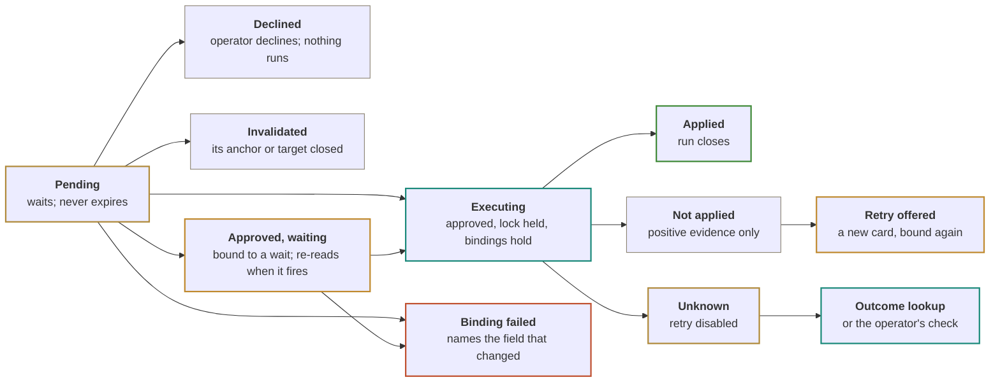
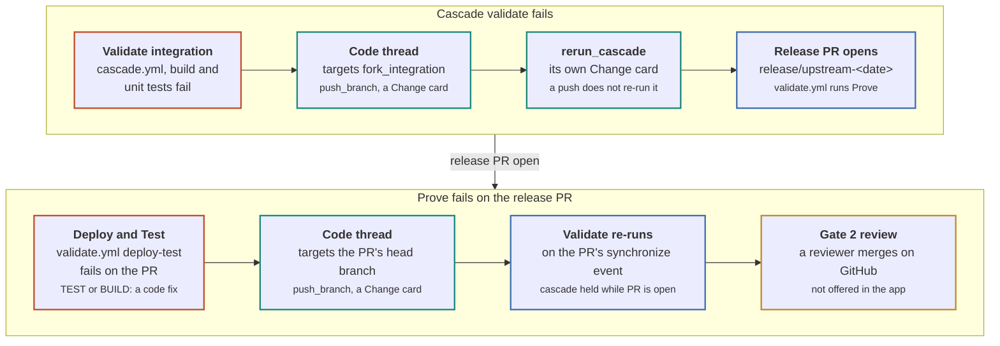

# SPI Code product requirements

*spi-code · product requirements · exploratory proposal*

What SPI Code must do at each milestone, how each requirement is checked, and which existing code each capability is built from.

Documents: [Product brief](spi-code-product-brief.md) · **Product requirements** (this page) · [Window design](spi-code-window-design.html) · [Visual design](spi-code-visual-design.html) ([PDF](spi-code-visual-design.pdf)) · [Original combined design (PDF)](spi-code-design.pdf)

> The [original design](spi-code-design.pdf) describes SPI Code in one document: the product, its rules, its window and its build plan. It does not give requirements an ID, a milestone or a check. It also has a few claims that the source does not support, among them the fix path for a cascade that fails at Prove. That makes it hard to plan a milestone or know when one is done.
>
> This document restates the design as requirements. Each one has an ID, the milestone that ships it, and the check that proves it. It corrects the claims the source contradicts (appendix F). Appendix C maps each capability to the repository, file and symbol it comes from, and says whether SPI Code extracts, copies, ports, emulates or only references that code.
>
> Everything here is proposed; no SPI Code exists yet. Requirements say what must hold, not how a module is laid out, except where the boundary is the requirement. The questions in Open questions are not settled, and no requirement assumes an answer to them unless it says so.

**Diagram colors.** amber outline = Operator: asks, approves, reviews; teal outline = SPI Code: reads, plans, executes, records; blue outline = Outside systems: GitHub workflows; green, amber, red and gray outlines are card or run states.

**Tiers.** Every tool has one tier, which sets how it is approved.

| Tier | How it runs |
|---|---|
| **Read** | runs at once |
| **Local** | runs at once in a worktree |
| **Command** | one card per command, sandboxed |
| **Change** | one card, one call |
| **Consequential** | card plus the typed target name |
| **Not offered** | no tool exists |

## How to read the requirements

IDs are an area prefix and a number, such as `AU-04`. The milestone column names the first milestone that must satisfy the requirement; later milestones keep it. "Verified by" names the test or observation that closes it. A requirement that depends on an open question names it.

| Prefix | Area |
|---|---|
| `PS` | Program shape and views |
| `TH` | Threads and anchors |
| `CP` | Copilot runtime |
| `AU` | Authority, tiers and approvals |
| `EV` | Evidence and redaction |
| `RN` | Runs, intents and durability |
| `PB` | Playbooks |
| `CT` | Code threads, the command sandbox and SPI Code's own git |
| `ST` | Setup and tools |
| `PM` | Process model and packaging |
| `CO` | Core extraction and the rib |
| `NF` | Non-functional requirements |

## Program shape and views

The window is T3 Code's workbench for the SPI program, laid out as the [window design](spi-code-window-design.html) draws it, with panes, the top row and Settings as the [window layout](spi-code-window-layout.html) draws them. Work happens in threads. The window has three layers. The strip is the window's top row and shows the line's state on every surface. The centre holds one thing: Today's brief, a place or a thread. The right panel is context for whatever the centre shows. The sidebar holds work: Today, the Line sheet, the places, the operator's pins and threads by status. Attention has four tiers decided by core, and only a decision that is the operator's interrupts. Every text the window draws comes from the same core functions the rib uses. The check is reachability, not word-for-word parity with the rib console: every field the rib renders is within one click of its place, with no conflicting duplicate. Window text follows the window design's Text rules. Five values the layout needs are contract additions and a hard predecessor of the surfaces that need them; no M2 surface ships on a placeholder, and a feature that has not shipped takes no space.

Where the [visual design](spi-code-visual-design.html)'s layout, page table or parity table disagrees with the window design, the window design wins. The visual design's palette and component kit stand. For layout, panes, the top row and Settings, the window layout wins over both.

PS-01 is retired: the tree of page links it described is replaced by PS-08. The lenses are retired: the Line sheet (PS-10) and the place readings carry their fields. PS-16 to PS-20 are new.

For PS-03, a GitLab source read that fails because glab is missing or signed out carries the existing `signin` code, so its row offers Open Settings to Readiness. Readiness can install glab or sign it in; a separate missing-tool stop code is not needed. Core tests cover both failures, recovery and unrelated transport failures; window tests cover Open Settings on the failed Upstream GitLab and Upstream radar rows (spicode-7zk). The action follows the code, never sign-in words in an unrelated error.

| ID | Requirement | Milestone | Verified by |
|---|---|---|---|
| **PS-02** | Every field the rib console renders from the `Briefing` object and the Releases pane input is reachable within one click of its place: on the place's reading, its Detail, or its Line sheet row. No two surfaces show conflicting values for the same field. Word-for-word parity and carrying the rib's lenses in full are not required. Parameterized places count per entity: the check opens every service and every release month in the fixture, and a field path is covered only when it is reachable for every entity that has it. The core regression checks on briefing output and the inspector and station oracle checks stay. | M2 | Reachability test on the `Briefing` object and the Releases pane input that `boards/console.ts` renders, from one recorded sweep with recorded release reads and notes: each field path is reachable within one click of its place, and every surface that shows it shows the same value; the core and oracle regression checks stay in the same suite |
| **PS-03** | Today is the operator's daily briefing on the whole program. It reads in the order a briefing is given: what needs you, what is coming from upstream, how the system stands place by place, the forming release, what is moving and what can wait. It is designed for the calm morning and grows from the top on a bad one: a calm Today is shorter, not emptier, and a bad one differs by one band, not by a different page. Time is not its spine: there are no due-by or Before the next sync groups and no clock rail, and a time appears only as a fact about an event ("failed 13 h ago", "4 commits at the 18:00 sync", "green since 11-09 22:27"). Top to bottom it shows: **the verdict headline**, core's `briefing.verdict`, one sentence from the tier counts, the environment's deployability and the stopped forks, naming both origins when both ask for the operator ("Storage's upstream sync needs you; 4 upstream changes need you before they land."), and on a calm morning a ○ mark and "Nothing urgent needs you. v0.35.5 is deployable; all 13 forks are flowing."; the date line carries the date only, and freshness stays on the strip. **The since pips**, core's `briefing.since`, on every morning: one labelled slot row of the 13 forks per workflow (Sync Upstream, Sync Template), each slot's state derived by core from the run and its PR association, with a count of what the row is about ("12/13 ran ok", "7/13 merged") and a "24 h" chip when there is no seen baseline. They report run outcomes, state adoption only from the rollout's own figure, and never claim a change core can't prove: an unproven effect is the "ran, effect unknown" slot. When the history read doesn't reach the baseline they name where they start; when the runs area wasn't read they read "As of 07:52, in the 24 hours before". **A caveat band**, full width, only when a source failed ("GitHub read failed at 08:15; items from it may be missing. Evidence ›"), with Open Settings only for a Readiness-fixable code. **The attention band**, full width and drawn only when it holds an Interrupt or in-system work: Needs you (every Interrupt whatever its origin, whole, in rung order, never folded; an upstream Interrupt's horizon card also carries ✕) and Decisions waiting (in-system Surface items, grouped once per core theme) side by side, then Failing (TEST items, and GATE items whose check is red). Its heading row carries a compact copy of the place marks and, when upstream changes need the operator, a "⇣ n upstream need you first" chip that scrolls to On the horizon. **On the horizon**, full width on every morning, is Upstream's summary on Today, headed "⇣ On the horizon · from upstream GitLab" with ⌀ when the radar was cut: a conveyor from upstream through the next sync and the open sync PRs to the forks, each stage with its count and fork chips from core's horizon stages, and forks whose sync is stopped or halted in an uncounted "won't land" sub-row; one card per upstream change core groups by theme, with a kind glyph, the change as a token, the forks it reaches with their stage and, when it holds a Surface item, its ! mark and verb as a button ("Absorb ›"), other cards quiet and counted "n to watch"; and ports owed as a per-fork segmented bar. On a calm morning the conveyor stays and the cards read "Nothing needs you before it lands." **Four place cards** in sidebar order (Line, Environment, Engineering system, Security), each with its mark, its figure in the reading's tone, one micro-visual drawn from a field core sends, a reason chip when the mark isn't ○, ⌀ with core's shortened qualifier when an area it reads (core's `briefing.places[].areas`) was cut or not read, and a "new" chip when the place has items new since the last look. A card's mark is the place's highest tier in the strip's vocabulary (✕ ! ◐ ○), named in words on hover; a card describes its place, not its items. **Releases**, about two-thirds of the width: all 13 released versions filled column-first, the released version from `services[].releases[]` and an open release PR's proposed version after an arrow whose accessible name reads "released 1.4.1, proposed 1.4.2"; one platform line for the stack, the template and core-lib-azure's spread across the 13 as a version distribution; one unreleased line, a stacked bar of what the open release PRs carry by kind (breaking, new, improved, fixed, security and other, summing to the total) and a Notable line naming the one or two most material changes and the services they reach. A body that wasn't read is "not read", never 0. Release history stays on Releases. **In motion** beside it: the In progress run of Ambient items (ROLLOUT, GATE, PORT, ENV) as item rows with only the rollout's next-merge chips, then **Can wait**: chips for the Background items no place card counts and the services with nothing waiting, opening the Can wait list in Detail with why each can wait. Each group holds one tier and every item has one home (PS-19), and Today states each fact once. Words stay only where they carry a decision, an action, a change title or a caveat; counts, states, progress, membership and time are marks, slots, bars and chips, each with core's sentence as its hover and accessible name, and Detail keeps the full text. The window draws from fields core sends and computes nothing beyond layout. Every row opens the place, or the item, that owns it. There are no tiles, no 75-word or five-item caps, no folded "more" line except at 740 px, and no New group (new is a chip). Today lifts the centre's 960 px content cap and uses the full centre width. In one column (740 px, or Detail open) the order is the headline and since pips, the band, On the horizon, the place cards in a two- or three-wide grid, Releases, then In motion. Opening Detail never folds anything; at 740 px only, Decisions waiting and each Ambient run show three lines and an "n more ›" that counts items and opens that group in Detail, folds are decided on width change and keep the selected row shown, and the conveyor compacts to one line. Needs you never folds. On a bad morning each place card whose areas went unread takes ⌀ and keeps its last good figure in muted ink with that area's last good time, the oldest when several, and Releases keeps its versions muted with the releases area's last good time. Each item keeps its P0, P1 or P2 rank as a chip and names its scope with a chip that opens its place. A pending card raised by a button is an Interrupt and is decided in Needs you (AU-10). A Surface item can be snoozed until the next sync. A composer anchored to the program closes the brief. Before the first sweep finishes, Today shows the sweep's sources live, in Evidence words, from `sweep.progress`: the eleven areas and releases in sweep order, each with what it reads and its state (waiting, reading, read, cut, put off or failed) with its time or plain reason, under one bar with a segment per source and no percentage or countdown. A cut source names the read kind from `cutKind` and counts from `incomplete` {count, total}: "6 run lists cut short; rest read" or "1 job log cut short; rest read", never only "n of m incomplete". A source where some reads failed while the rest read is partial, not failed: it takes the cut mark, counts the failed reads from `incomplete.failed` alongside any cut reads ("14 diffs cut short; 3 reads failed" or "2 reads failed"), and puts the host's safe `failure` sentence on the next line, naming the services from fleet ids ("Reads failed for 3 services: unit, crs-catalog, crs-conversion."), never core's failure text or command output. It says "rest read" only when other reads completed and none failed. Its hover and accessible description give the complete-read count and the safe cut reason with the read/total from completeness, for example "68 of 69 reads complete. Job log character limit: 64,000 of 92,438 characters read." Today and the retained list in Evidence use the same wording. A source that read nothing stays failed with its real reason code. A put-off or throttled source gives its resume time from `resumeAt`. A source that failed on sign-in offers Open Settings. Only `view.snapshot` hands over to the brief, in place; a sweep that finishes with some sources failed still hands over, and the caveat band names what failed. The completed list is kept after the hand-over, with each source's final state, time and reason, and is one click from the freshness field as Evidence (EV-03). When the first sweep fails outright, Today keeps the list under "The first sweep stopped." with the source it stopped on, the reason and the next attempt at `nextAttemptAt`, the real retry time (never `sweep.status.resetAt`, the budget reset), and offers Try again (`sweep.request`, through the non-forced sweep path and the readiness gate). The stopped panel and each stopped source offer Open Settings only when their reason code points at a Readiness fix: the current contract's set is `signin`. Readiness checks Copilot, git, gh and glab, not fleet configuration; no separate missing-tool or fleet stop code exists. Network, unavailable-forge, timeout, save and host errors offer Try again only, with their reason in plain words. The tray shows failed. The window never infers a time, count or Settings action from prose, and no raw field name is shown. | M2; the composer M3; pending cards in Needs you M4 | Core fixture tests on the calm, busy and bad Watch fixtures (spicode-f0s.5) for the verdict, the since pips, the place rows, the horizon, the Ambient split, Can wait and the forming releases (spicode-f0s.6 to spicode-f0s.16), including that every briefing item lands in exactly one home by tier; component tests that Today draws each block from core's fields, draws no band, Decisions waiting or empty group without items, and has no due-by or deadline group, tile, word or item cap, or New group (spicode-f0s.17 to spicode-f0s.22); component tests of the one-column order, Detail open folding nothing and the 740 px folds keeping the selected row (spicode-f0s.23); packaged screenshots of the calm, busy and bad mornings (spicode-f0s.24) and the maintainer's checkpoint on them (spicode-f0s.25); component test on the scope chip and snooze; component tests on the first-sweep list (spicode-t1k.261): every row state and copy line, the cut count, resume time and retry time taken from `incomplete`, `resumeAt` and `nextAttemptAt`, the bar, the failed sign-in's Open Settings, the stopped state's Try again sending `sweep.request`, a committed `sweep.progress` alone not handing over while `view.snapshot` does, the completed list kept with every source's final state after the hand-over, reduced motion, and no raw field name; component tests (spicode-t1k.287) of every reason code on the stopped panel and source rows, offering Open Settings only for the named Readiness-fixable set; component and host tests (spicode-t1k.270) for one and several cut reads, their kinds, complete-read counts and safe limit detail, including no "rest read" when all reads were cut; host, component and contract tests (spicode-t1k.271) that replaying a recorded radar outcome with 3 failed service reads yields a partial source naming those services, that a source with no successful read stays failed with its real code, and that `sweep.progress` carries `incomplete.failed` and `failure` on a cut source; unit tests (spicode-t1k.259) that the sweeper's progress hook reports each source's start and outcome in sweep order, and that a sweep without the hook is unchanged; contract tests (spicode-t1k.260) that `sweep.progress` rejects unknown states and extra keys, carries `nextAttemptAt` on a failed outcome, `resumeAt` on a throttled or deferred source and `incomplete` {count, total} on a cut source, and that `sweep.request` takes an empty payload; host tests (spicode-t1k.264) that progress coalesces to at most four updates a second, replays to a late subscriber, ends failed with a safe reason and a `nextAttemptAt` from the retry schedule, not the budget reset, when the sweep throws, the lease is lost or the commit fails, is never written to the store or budget log, and that `sweep.request` never starts a second sweep and is refused while readiness blocks Watch; a tray test (spicode-t1k.262) that a stopped first sweep shows failed; a component test (spicode-t1k.262) that after the hand-over one click on the freshness field opens the kept list in Evidence |
| **PS-04** | Selecting an item, a Line sheet cell or a station fills the right panel's Detail tab with what the Watch contract carries for that kind, as the visual design tabulates under What the Detail tab can show at M2. An item, flow row, repository row or release month shows the inspect result (class, cause, effect, next, why, evidence, related) with the row's text as its title; the month's `related` (key changes, highlights, changelog, issues, per-fork rows, links) is also the month place's document source; a theme or environment event shows the inspect result through its row's `inspect` id or, when the row has none, `theme:<id>`, `hold:<id>` or `run:<id>` by lane, as the window derives them today; runs are drawn as Environment lane events and inspected through `run:<id>`. A station's Detail leads with that station's own reading: its label, state word and text, plus the fork's upstream inspect for the four line stations, and never another station's cause. Related renders as a label and value table, never as one paragraph. Each item offers one action, which opens or starts the owning thread (TH-05) or raises its card; a disabled action states why, in place, and an action whose milestone has not shipped takes no space. "Ask about this" starts a thread anchored to the item with its evidence attached, and Add to chat adds it to a composer. Nothing is drawn as a placeholder. The action assembly the rib does in `boards/inspect.ts` (`verbsOf`) and `boards/template.ts` moves to core with CO-05. | M2; station Detail for Release and Stack lane, repository lines and runs after the contract additions bead; Ask about this and Add to chat M3 | Component test per kind and per failure class, including a clean Sync PR station that does not show the cascade's cause and Related as a table; the contract additions bead is a named hard predecessor of the line, run and station-Detail parts |
| **PS-05** | A place is any anchor the operator can open in the centre: a service, Upstream, the environment, the engineering system, a release month, Security or a campaign. Places are Today's drill-down: every row on Today opens the place, or the item, that owns it (PS-03), and each place opens on what Today can't show. Line keeps the 13 × 6 sheet; Upstream the radar, per-fork commits, filters and ports; the environment its lanes, runs, holds and the stack repo; the engineering system the rollout ladder and the template PRs; Releases the months, notes, every release PR and each forming release's full change list; Security its rules, packages, owners and campaigns. A place keeps its own headline, because Today quotes it, and its figure counts the same items as its card on Today. Every place has the same three parts in fixed order: its reading (a headline, three tiles and at most five items, the rib's shape), its threads with their status, and a composer anchored to it (TH-03). A part with nothing to show takes no space; there are no always-present empty sections. A service's reading is about 120 words. It reads "release review", not "gate 3", and carries no future lines. Its Upstream, Sync PR, Cascade, Main and Release PR stations are the cells of its Line sheet row (PS-10), each selectable. The rib's lane station is not a cell; lane context belongs to the Environment place and lane events (EV-08). Release and run facts appear in a service's reading only once the contract additions land, never as placeholders. A service place is reached from the strip, the Line sheet, ⌘K or a pin. Before the first snapshot, places stay clickable in the sidebar's muted ink and each opens one line saying when it can be read ("Upstream opens after the first sweep. It is read 9th of 12."); the Line sheet says "Service rows appear after the first sweep." Settings, Find and the panel toggles stay live. | M2 reading; threads and the composer M3; release and run facts after the contract additions bead | Component test on a service reading from a recorded sweep, with a word count; a test that no place renders an empty part; a component test (spicode-t1k.262) that each place and the Line sheet before the first snapshot open their one line; a component test that each Today place card and the horizon heading open their place (spicode-f0s.20, spicode-f0s.19); the contract additions bead is a named hard predecessor of the release and run facts |
| **PS-06** | The upstream hold for a SNAPSHOT toolchain shows the rib's "Take it anyway" variant of Prepare and Start, with the hold reason on the card. | M4 | Tool test with a SNAPSHOT fixture |
| **PS-07** | The Environment place labels live cluster reads (from `spi status --json`, Flux, pods) apart from state inferred from workflow runs. Before M6 its reading draws inferred state only, labeled inferred, and live reads take no space. | M6 | Screenshot test with both sources |
| **PS-08** | The sidebar is T3 Code's sidebar holding work: Find or ask (⌘K), Today with its count (AU-09), Line (⌘L), Places (Upstream, Environment, Engineering system, Releases, Security), Pinned (PS-17), threads by status (Waiting on you, then Working), the Settled shelf with its count once threads ship, and a footer with Settings and a readiness dot that opens the Settings dialog. It has no per-service or per-theme rows: a service appears only when pinned, with its strip glyph. A code thread shows its branch under its title. Groups collapse and remember it. | M2 shell, M3 threads and the Settled shelf | Screenshot test on a recorded sweep; component test that a service row exists only when pinned and on the thread rows, that the Settled shelf is absent until threads ship, and that the footer row opens Settings |
| **PS-09** | Upstream (PS-16), Environment, Engineering system, Releases and Security are places with the PS-05 shape. The environment's reading carries the stack repository's lines and the engineering system's carries the template repository's lines; the engineering system reads forks verified on the target template revision, not PRs merged. A release month is a place reached from Releases. Security's reading is SPI-owned findings across the fleet: tiles for high, total and upstream-origin counts, items grouped by rule, and each rule that spans forks shown as a detected campaign (TH-11). | M2 | Component test per place from a recorded sweep |
| **PS-10** | The Line sheet is the fleet table: one row per service in fleet order with its Upstream, Sync PR, Cascade, Main and Release PR stations, each a glyph from the typed station sub-state (✕ stopped, ! needs a person, ◐ in progress, ◷ scheduled, · nothing to do) and a short label. ⌘L or a click on the strip opens it as a sheet over the centre; it closes back to where the operator was, or pins beside a thread for a monitoring session. Rows that need nothing fold into one line that names them. Selecting a cell fills Detail. A campaign chip filters the sheet to that campaign's forks and adds its wave column; a fleet fact appears once, on its campaign chip, never in each cell. A place's Line view is the sheet filtered to that place. There are no lenses, and there is no Runs lens; workflow runs are lane events (EV-08). | M2; wave column M4 | Component test on folding, the campaign filter, close-to-origin and pin beside a thread; reachability under PS-02 for the fields the rib's Flow, Repositories and Horizon views carried |
| **PS-11** | The centre holds one thing: Today, a place or a thread. Threads occupy the centre. The right panel is context for what the centre shows and is closed when it has nothing to show. Outside a thread it has Detail, Evidence and Log tabs for the selection; in a thread the Thread tab (T3 Code's thread details) leads and the anchor's reading, Detail and Evidence stay as tabs, at every width; a thread can also pin the Line sheet, the lane or a diff's Detail there. No surface carries a second copy of the selection's detail. The top row carries T3 Code's three toggles: sidebar, terminal drawer, right panel. The sidebar (232 px by default, 200 to 320 px), the right panel (360 px by default, at least 280 px) and a pinned sheet (360 px by default, at least 320 px) are resizable from a drag edge on their shared divider, which is a focusable separator moved by arrow keys and reset by double-click. The width a drag ends on is the pane's preferred width, saved per machine with whether the pane was open; PS-13 decides the displayed width. | M2 panel and toggles, M3 Log, Thread tab and threads in the centre, M5 the code-thread items | Component test; a DOM assertion that no surface renders two detail surfaces, that the panel is closed when empty, and that Detail is reachable from a code thread; separator component tests for pointer drag, arrow keys, double-click reset, the announced values, and a displayed width narrower than the saved one without the saved one changing |
| **PS-12** | ⌘K (Ctrl+K on Windows) opens one palette, ported from T3 Code's `CommandPalette.tsx`, that finds every place, service, campaign and Today item, and from M3 searches threads by title and turns a sentence into a question to Copilot about the selection (TH-03). ⌘↩ (Ctrl+Enter) on a result opens and pins it (PS-17). It has no actions group. | M2 find and pin, M3 threads and ask | Component test on the groups, ⌘↩ and the keyboard model |
| **PS-13** | Panes fold by the width left for the centre, which keeps at least 520 px; there is no single window breakpoint. When the panes at their preferred widths (PS-11) do not fit beside it, the window takes four steps in order and stops at the first that fits: narrow (the right panel toward its minimum, then a pinned sheet toward its own), the right panel becomes a sheet over the right edge of the window, a pinned context such as the Line sheet or the lane stacks under the centre, and the sidebar goes off-canvas behind a named toggle (⌘B). The window is never narrower than 740 px. Sheets open below the top row, open on selection or from the right-panel toggle, and close with Escape or their named close button; opening either moves focus into it and closing returns focus to the control that opened it. Every control keeps its name and keyboard path at every width; there is no icon rail. | M2 | Unit test on the width budget as a pure function at the eight cases the [window layout](spi-code-window-layout.html) draws and at the thresholds either side of each step; screenshot test at 1440, 900 and 740 px in light and dark on macOS and Windows; an accessibility test that every control at 740 px has a name and is reachable by keyboard with focus restored |
| **PS-14** | A context chip packs one selection for a thread: its stable id, kind and title, the compact inspect result, its read records or evidence references, the provenance areas with their states, the sweep time and completeness; never a raw page, log, diff or issue body. Chips are added by @ in a composer, which adds a place (@legal, @environment) as a context attachment and never as a second anchor, by Add to chat on the Detail tab or a toolbar (⌘⇧A), and from a multi-row selection; in the composer a chip is a draft that shows a preview, can be removed and can be refreshed from the latest sweep; sending snapshots each chip's payload, sweep time and evidence references onto that message, and a sent chip never changes; drafts attach to a new thread or an existing one. By kind a chip carries what PS-04 gives that kind: the inspect result for every kind with an id (themes and environment events through the derived `theme:`, `hold:` and `run:` ids), a station's label, state, text and upstream inspect, and a place's reading; a repository line cannot be a chip until it has an id. A chip is at most 2,000 tokens and a message carries at most 8; an over-budget chip is trimmed to identity, class, cause, next and evidence references and says so. The seeded message is the structured payload. | M3 | Fake-session test asserting the seeded message is the structured payload, under budget, that a trimmed chip keeps its identity and evidence references, that an @ place leaves the anchor unchanged, and that a sent message keeps its payload after the draft chips change |
| **PS-15** | What a thread does returns to the view. A place's threads part and the sidebar show each thread's status (Working, Waiting on you, settled); an item a thread owns carries the thread's marker on Today, its place and the Line sheet. The host's thread store records every PR, run or issue a thread's tool call created, keyed by the URL or run id the tool result returned; a proposed write stays on its card and is never drawn as a row, and a branch, which has no such key, appears on the Thread tab only. The window joins snapshot rows to the store by key. Until a sweep has read the object its row or cell is drawn from the store, dashed and marked "pending · not yet in a sweep"; once a sweep row matches the key it is solid and sweep-confirmed. Today's Needs you lists every pending card raised by a button and opens the one place it is decided (AU-10); a pending card raised in a thread puts that thread under Waiting on you. | M3 join and status, M4 cards | Component test on the threads part, the item marker and the dashed-to-solid transition from a fixture; store test that a record needs a returned URL or run id |
| **PS-16** | Upstream is the place for the line's input: what GitLab hands each fork at the next sync. Its headline names the next sync and how many commits reach how many forks, and says how many need the operator first. Its tiles are commits incoming, toolchain moves and the largest incoming, each naming what it counts. Its items are the holds and halts due before the next sync and the detected toolchain moves. A subline qualifies the reading when the radar read was cut, from the per-read provenance. Its items are the same records Today shows, one record in two places, so resolving one clears both. Its Line view is the Line sheet filtered to the Upstream column. It sits first among the places. | M2 | Fixture test from a recorded sweep with a cut radar read; component test that an item resolved on Today clears on Upstream |
| **PS-17** | Any place can be pinned: with the Pin button in its header, from the context menu of a strip pip or a Line sheet row, or with ⌘↩ on a ⌘K result, which opens and pins it. Pins sit in the sidebar's Pinned group, the only way a service appears in the sidebar, and survive a restart. | M2 | Component test per pin path; sidebar test after a restart |
| **PS-18** | The strip is the window's top row on every surface, beside the window controls and the panel toggles. Its fields are fixed and keep their order: a pip per service in fleet order showing its worst typed station sub-state as a shaped mark (a diamond for stopped, a filled dot for needs a person, a half-filled dot for in progress, a hollow dot for nothing due), named on hover; the stopped services by name, with the count of cards waiting; the environment's version and deployability, and the lane's holder when one is borrowing; the engineering system as forks verified on the target template revision; the next sync time; and the freshness field (EV-03). The strip has no due count: time is a fact, not a field to count against (PS-03). When the fields do not fit, stopped names fold to a count and the pips shrink, then a run of the last fields moves to a second row, in order, as far back as the stopped field; the pips, window controls and panel toggles stay on the first row. A click opens the Line sheet. A P0 stays red on the strip until the line is green, whatever its thread does. The typed station sub-state and typed due are contract data that land with M2. | M2; the lane holder M3 | Component test that the fields keep their order on every surface, at 13 and 20 services and at 1440, 1100, 980 and 740 px on macOS and Windows, including the wrapped order, the 48 px drag area, a long environment state at 740 px, and a refresh that shrinks the content without unwrapping the row; fixture test that each pip follows the worst typed sub-state and that the template count counts verified forks, not merged PRs; component test that the strip draws no due count and keeps the next sync (spicode-f0s.4) |
| **PS-19** | Core assigns every state to one attention tier; the window draws the tier it is given. **Interrupt:** a card waiting on the operator's decision; a new or worsened P0; an owned item whose thread Failed, stalled or lost coverage; a failed recovery; an unowned item due within its lead time. Each reaches the Today count and the strip. **Surface:** a new P1, a newly detected theme, a thread Done, an item due before the next sync but outside its lead time. Each shows in its home on Today, with no notification. **Ambient:** work moving normally, successful retries, routine sweeps and items with no rush, shown on the strip, the Line sheet and Today's Failing or In progress run. **Background:** work that asks nothing of the operator today, counted by a place card or listed under Can wait, with no notification. On Today every item has exactly one home, by its tier, and Today never re-tiers an item to fit one: an Interrupt in Needs you, whatever its origin (an upstream Interrupt's horizon card also carries ✕); a Surface item of upstream origin on its horizon card, and one of system origin in Decisions waiting; an Ambient item in Failing (TEST items, and GATE items whose check is red) or In progress (ROLLOUT, GATE, PORT, ENV), in core's order and folded by shared evidence; a Background item in a place card's count or Can wait. Core gives each item one of two origins. **In your system:** the SPI forks, their PRs, the environment, the template and the releases. **From upstream:** commits queued for the next sync or held in open sync PRs, and merged upstream provider changes not yet ported. Only upstream origin carries the upstream role and the ⇣ glyph, on the horizon block and on upstream chips; an in-system sync PR whose content is upstream carries the ⇣ chip in In motion, and upstream-owned findings already in the forks carry neither. The lead time is a setting, 2 hours by default; its control is not part of the Sweep section in this pass. After the first sweep, a committed snapshot with an Interrupt in `seen.since` at a rung not yet notified this app run sends at most one coalesced OS notification per sweep, skipped while the window is focused. One item reads "Needs you · {scope}" / "{rank} {title}"; several read "{n} things need you" / the first two titles joined by "; ". Clicking opens Today with the item selected, or its owning thread once threads exist (TH-07). Dedupe by item id and rung lives in memory per app run, not a persisted notification store; the same item notifies again only when it worsens to another rung. After a relaunch, the first committed snapshot sends one summary of unacknowledged Interrupts, only when the window is not focused. A seen-state baseline records what the operator last acknowledged; acknowledging closes its banner and clears the open-on-Today trigger, never a stopped station on the strip, and never the count, which falls only when an item is resolved. Ownership suppresses duplicates, not escalation: an item a thread owns keeps its home on Today with its thread's marker (PS-15) and its repeat notifications stop, and it interrupts again if its thread fails, stalls or loses coverage, or the item worsens. One "SPI Code can't read the program" notification per outage, also skipped while focused, covers a source that read in the previous sweep now failing with code `signin`, or no committed sweep for 15 minutes while the machine is awake. Its body reads "gh is signed out. Today is from 08:02." for gh sign-out, or "No sweep has finished since 08:02. Last: {reason}."; clicking opens Readiness for sign-in or Evidence for no committed sweep. A committed sweep clears the outage. Never notify for a routine sweep starting or finishing, Sweep now finishing, Surface or Ambient items, cut, put-off or throttled sources, a single failed sweep, budget changes, the forks' upstream sync, glab when it was never signed in, or the same item twice at the same rung. System notification settings control delivery, sound and quiet hours; there is no in-app notifications switch. On first launch the first sweep's hand-over still sets the tray tooltip to "Today is ready" and, if the window is hidden, sends one "Today is ready" notification with the interruption count when there is one. | M2 tiers, seen-state (local), due, sweep notifications and the first sweep's "Today is ready"; the Background tier and item origin with the Today briefing; M3 ownership | Core test per tier rule from fixtures; core test that every briefing item has exactly one home on Today by tier and origin, and that Background items are counted by a place card or listed under Can wait (spicode-f0s.12); clock-driven test that an unowned due item becomes Interrupt inside its lead time; component test that acknowledging clears the banner but not the count or the strip; notification tests for coalescing, copy, click targets, focus suppression, same-rung dedupe, worsening, relaunch summary, both outage triggers and reset on commit, and every never-notify case; test that a failed owning thread interrupts again; test (spicode-t1k.262) that the first sweep's hand-over sets the tray tooltip and fires one "Today is ready" notification, only when the window is hidden |
| **PS-20** | Every capability added at M3 to M6 declares four things in its bead's acceptance: its anchor kind and reading, so it becomes a place; its attention rule, mapping each of its states to Interrupt, Surface or Ambient; whether it borrows the lane, so the lane queue (RN-09) and Lane watch cover it; and whether it is fleet-scoped, in which case it runs as a campaign (TH-11). That declaration replaces a new page or sidebar group. A new kind of work gains no authority until a typed tool exists for it. | M3 | Breakdown review: each M3 to M6 bead's acceptance names the four |

## Threads and anchors

| ID | Requirement | Milestone | Verified by |
|---|---|---|---|
| **TH-01** | Every thread has exactly one anchor, set when it starts: the program, the engineering system, the environment, the environment lane, Upstream, Security, a release month, a service line, a campaign, a queue item or a PR, and from M5 a fork branch. It carries any number of context attachments (PS-14) over its life; an attachment never becomes a second anchor. | M3 | Store schema test |
| **TH-02** | A new session's first context is the anchor's reading and the sweep time it came from. A queue item uses `readItem`. `readItem` takes only a `QueueItem`, so core adds a reading of the same shape for the other anchor kinds in TH-01. The upstream anchor's reading is the Upstream place's reading (PS-16): the next sync, commits incoming, toolchain moves, holds and the radar's completeness. A campaign's reading is its plan record (TH-11). | M3 | Fake-session test per anchor kind inspects the seeded message |
| **TH-03** | Every place carries a composer anchored to it, and typing there starts a thread anchored to that place. Today's composer and ⌘N start a thread anchored to the program. A sentence typed into ⌘K starts a thread anchored to the current selection, or to the current place when nothing is selected. "Ask about this" on a Today item or a Detail field starts a thread anchored to that item with its evidence attached, and Fix in code thread starts a code thread. The composer always shows the anchor. Threads the app starts itself (Lane watch findings, campaign children, Diagnose) say who started them in the thread header. | M3 | Component test per start path, including ⌘N anchoring to the program |
| **TH-04** | A thread's kind (operate or code) is fixed when it starts and shown in its header. The kind sets the session's `availableTools`. | M3 operate, M5 code | Fake-session test: an operate session cannot call a worktree tool |
| **TH-05** | When a thread owns a piece of work, every surface that shows that work (a Today item, a place's items, a Line sheet cell, the Detail tab) shows the thread and its status, and its one action opens that thread instead of offering a new one. | M3 | Component test on a Today item, a Line sheet cell and the Detail tab |
| **TH-06** | Tools that fit the anchor are offered first. Every tool stays reachable from any thread of the right kind. | M3 | Tool projection test |
| **TH-07** | Threads carry T3 Code's statuses (Working, Waiting on you, Done, Failed, Stopped). Working and Waiting on you threads are listed by status in the sidebar; the rest are Settled and sit in the Settled shelf with its count. The window opens on Today when an Interrupt item (PS-19) arrived since the operator last acknowledged. Otherwise it restores the last thread or place in the centre, and Today when there is neither. A notification opens the thread that owns its item, in the centre, and never replaces a thread the operator is typing in. | M2 landing, M3 statuses and threads | Store test on the status mapping; component test on the shelf and the landing rule with and without an unacknowledged Interrupt |
| **TH-08** | The composer is T3 Code's: file and image attachments, @ for places as context attachments (never a second anchor) and, in a code thread, files, $ for playbooks as skills, / for thread commands (sweep now, add context, open on GitHub, usage), and the Copilot model picker as the window design draws it (CP-09). T3 Code's runtime modes, plan mode, Standard or Fast switch and access mode are not carried; the tier model and per-call cards decide what runs. The model and effort belong to the thread. A switch mid-thread leaves one line in the timeline. New threads start on Auto or the Settings default; Lane watch, Diagnose and campaign threads each take their own default from Settings, Auto unless set. | M3; @ files at M5 | Component test on each trigger; fake-session test that the picked model reaches the session and that an agent thread starts on its Settings default |
| **TH-09** | Playbooks and hand-offs that run as child threads show their lineage in the Thread tab: the thread they started from and the agents they delegated to. | M4 | Component test from a fixture with one parent and two children |
| **TH-10** | A watcher is a standing operate thread, started explicitly and never ambient: "Watch the lane" in the Environment composer, or Start on a watcher's place. It has a scope, its last observation, a coverage state, and Pause and Stop. The host owns its durable waits (RN-05), deduplication and notifications; the model is called when an event needs diagnosis, not to narrate each sweep. Lane watch is anchored to the environment lane. It reads lane events (EV-08), reports an overlap as "possible contention" unless the failure log corroborates a cause, drafts one rerun card bound to the end of the restore and to lane admission, and reports the outcome once. It never reruns anything without an approved card and never calls the lane free from deployability alone. | M3 detection, M4 cards | Fake-session test that a sweep with no new event makes no model call; fixture test that an overlap without a corroborating log reads "possible contention"; component test on coverage, Pause and Stop |
| **TH-11** | A campaign is fleet-scoped work, such as a toolchain move or a template rollout (a campaign of kind engineering). Detected: core finds a fleet fact on several forks, such as a toolchain version on eight, and shows it once as a Today item and an Upstream item with Track, and as a Line sheet filter chip. Adopted: Track, a request in Today's composer or ⌘K, or Campaign from these on selected Line sheet rows starts a campaign thread anchored to a plan record (target, forks, pilot, waves, lane cap) that the operator edits; the right panel pins the Line sheet filtered to the campaign with its wave column and the lane queue. Waves: the thread brings the next eligible wave as one card at the tool's tier (`start_upstream` or `roll_out`, Consequential) with a ledger entry per fork (RN-04), admitted through the lane queue (RN-09). A single template PR outside a wave is one `merge_pr` Change card. Approving a plan approves no write. Children: a child code thread opens only for a fork that fails on its own code. The thread shows one meter, forks verified on the target. | M2 detected, M3 adopted, M4 waves, M5 children | Core detection test from a recorded sweep; store test on the plan record; tool test that approving a plan resolves no write card; component test on the meter |

## Copilot runtime

The host drives Copilot through `@github/copilot-sdk`, pinned. Keelson's Copilot provider already handles most session hazards and is the reference (appendix B).

| ID | Requirement | Milestone | Verified by |
|---|---|---|---|
| **CP-01** | The SDK's platform runtime is listed in `asarUnpack` and started over stdio by explicit path. In-process mode is never used. | M0 | Packaged smoke test on both platforms |
| **CP-02** | The client runs in empty mode with a `baseDirectory` under app data. MCP servers, agents, skills and instructions in the operator's `~/.copilot` are not visible to a session. | M0 | Smoke test with a user-level MCP server configured |
| **CP-03** | Each session gets its GitHub token from a `gitHubTokenProvider` that reads `gh auth token` and returns a short fixed `expiresIn`, so an account switch is picked up. The client sets `useLoggedInUser: false`. Model listing passes the same token explicitly through `client.rpc.models.list({ gitHubToken })`, because `client.listModels()` is a client-level call that never invokes the session provider and caches its result. If M0 shows the provider is unfit, the host passes the token at client level and drops the warm client and its model list when the credential changes. The runtime starts with an explicit `env` that has `GH_TOKEN`, `GITHUB_TOKEN` and `COPILOT_GITHUB_TOKEN` removed, because with `useLoggedInUser: false` it still accepts a token from its environment. No Copilot credential is written under app data. | M0 | M0 probe: start, list models, stream, account switch; the model list follows the switch; a launch with a stray `GH_TOKEN` set still signs in as the gh account |
| **CP-04** | `availableTools` lists every allowed tool as `custom:<name>` and no built-in tool. Every SPI tool is registered with `defer: "never"`. | M0 | M0: every appendix A tool name reaches the model as a stub |
| **CP-05** | `onPermissionRequest` denies every kind. SPI tools set `skipPermission` and enforce policy in their handlers. | M0 | Fake-session test: a built-in tool request is refused |
| **CP-06** | The system message is ported from the rib's Watch Officer prompt, then the anchor context and its sweep time. The port takes the fleet list as an argument, and its tool and authority lines match the thread kind and the tools shipped so far. The rib's prompt says it never writes and names only some read tools, so those lines are rewritten, not copied. | M3 | Fake-session test |
| **CP-07** | After every resume, the host calls `session.setModel` with both the model and the reasoning effort. | M3 | Fake-session test asserts both arguments |
| **CP-08** | A resumed session waits for the previous one to release first. Warm clients are reference counted. A connection error restarts the runtime, resumes the session and marks the in-flight tool call cancelled. | M3 | Fake-session tests per hazard |
| **CP-09** | The model picker is T3 Code's without the provider rail. It lists the models the operator's plan returns through `client.rpc.models.list` with the gh token (CP-03), with Auto first and the default. Starred models sit on top with ⌘1 to ⌘4. Each row shows its premium-request multiplier from `billing.multiplier` beside its shortcut. The reasoning column appears only when the chosen model supports it, with its levels and default from `supportedReasoningEfforts` and `defaultReasoningEffort`. A model whose `policy.state` is disabled or unconfigured is greyed, not hidden, with a pointer to GitHub settings. The footer shows the Copilot account, premium-request usage when Copilot reports a quota for the account ("usage unavailable" otherwise) and a refresh. | M3 | Smoke test; component test from a recorded model list with a disabled model, a model without reasoning levels and an account without a quota |

## Authority, tiers and approvals

Every action is a typed tool that builds its own command from validated arguments and declares one tier. A button, a playbook step and a Copilot call reach the same handler. Appendix A lists every tool with its binding and outcome lookup.

| ID | Requirement | Milestone | Verified by |
|---|---|---|---|
| **AU-01** | Each tool validates its arguments with zod, then runs the tier check in its handler before any outside call. Any error or unreadable answer in the check refuses the call. | M3 | Fake-session test per tier, with a throwing check |
| **AU-02** | A **Read** runs at once and is logged. A **Local** runs at once inside a code thread's worktree only. | M3, M5 | Tier table test |
| **AU-03** | A **Change** runs only after the operator approves its card. One card is one call. | M4 | Tier table test |
| **AU-04** | A **Consequential** tool runs only after the operator types the target's name into the card. A card with several targets is confirmed by typing its campaign and wave name ("Boot 4 wave 1"), never a bare "wave 1". The field starts empty. A Consequential card is never batched with another card. | M4 | Component and tool test |
| **AU-05** | Neither Copilot nor a playbook can approve a card. A button creates a card; it never writes. | M4 | Fake-session test: no tool or playbook step resolves a card |
| **AU-06** | On approval, the host takes the target's named lock, re-reads every binding field, and runs only if all of them hold. Otherwise the card moves to binding failed and names the field that changed. A card bound to a wait reads approved, waiting until the wait fires; the lock and the re-read happen then, not at approval. | M4 | Stale-binding test, live and recorded, including a binding that changes while an approved card waits |
| **AU-07** | Merges are sent with `--match-head-commit`. `merge_pr` covers Dependabot and template PRs only. | M4 | Tool test moves the head between check and send |
| **AU-08** | Clearing maintenance checks what the lifecycle workflows check: no lifecycle run in flight, deployed ref equals the declared stack version, and `spi status` reports ready with maintenance as the only blocker. It does not require deployable. | M6 | Tool test with each condition false |
| **AU-09** | Each card has one id and one state in the approval store: pending, approved and waiting, binding failed, executing, applied, not applied, unknown, declined or invalidated. Pending cards raised by a button are Interrupts and wait in Today's Needs you, which replaces the Inbox. The Today count is the number of distinct Interrupt items (PS-19): a pending card counts once, and the thread waiting on that card and the P0 it owns are not counted again. The count falls when an item is resolved, not when it is acknowledged. From M2 it appears on Today's sidebar row and the macOS dock badge, which reads "9+" past nine; on Windows the count is in the tray tooltip. The tray icon never shows a number. The right panel has no Approvals tab. | M2 count and badge; M4 cards | Screenshot and desktop tests for zero, one and more than nine Interrupts, the macOS badge and Windows tooltip with no numbered tray icon; store test and count test with a card, its waiting thread and its P0 |
| **AU-10** | A card requested in a thread is drawn and decided only in that thread's composer strip. A card requested by a button is decided only in Today's Needs you. Every other place a card appears (Detail, its run, a place, the Line sheet) shows its state and links to its decision place, with no Approve or Decline of its own. | M4 | Component test that no surface but the two decision places renders a live Approve or Decline |
| **AU-11** | No tool exists for anything in the **Not offered** row of appendix A, including merging cascade PRs, submitting review approvals, force pushes, reading Kubernetes Secrets and any guard bypass. | M3 | Tool registry test against the list |
| **AU-12** | No child process inherits `SPI_SKIP_GUARD` or another guard-bypass variable. | M4 | Environment test on every spawn path |

The lookup after Unknown resolves the card to Applied or Not applied. Time passing never counts as evidence that a write did not happen.

## Evidence and redaction

| ID | Requirement | Milestone | Verified by |
|---|---|---|---|
| **EV-01** | Every read result carries an envelope: source, observed time, completeness, and one state of fresh, stale, incomplete, failed or unread. | M2 | Collector tests |
| **EV-02** | A source is stale when its last good read is older than twice its sweep interval; incomplete when a page or size limit cut the read; failed when its latest read errored (in the sweep's source list, PS-03, a source whose other reads succeeded is partial instead); unread when no read has succeeded since start. | M2 | Clock-driven unit tests |
| **EV-03** | Freshness appears once, as the last field of the top row (PS-18): a dot toned by the worst area, the sweep time, and the count of areas failed, cut, incomplete or stale, with the counts by state in its hover and accessible name. The hover also gives "next sweep 08:07" when scheduled, never an expired time as a promise. Clicking it opens the sweep's Evidence. While a sweep runs the field carries its progress: "◐ sweeping · 9 of 12" during the first sweep ("◐ 9 of 12" at 740 px), where a click scrolls Today's list into view; during a later sweep "08:02 · sweeping 4 of 12", where a click opens Evidence with the live list. While the first sweep is stopped, before any snapshot, the field reads "first sweep stopped" ("stopped" at 740 px) in the failed tone, never "waiting for the first sweep". Cancelled first sweeps are stopped too. Sweep Evidence with no snapshot shows the same stopped panel as Today: the reason, source list, Try again and Open Settings only for Readiness-fixable stops (PS-03). Failed progress supplies the retry time from `nextAttemptAt`; cancelled progress says "The sweep was cancelled." and uses `sweep.status.nextSweepAt`. Neither promises an expired or unscheduled time. A new running first sweep replaces the stop with its live list. Its hover and accessible name keep the full wording; clicking scrolls Today to the stopped panel with its reason and actions. Try again returns the field to its sweeping form when the host starts the retry. After the first sweep hands over, its completed list is kept and the field opens it in one click as Evidence, each source with its final state, time and reason. The brief stays and never reflows mid-sweep; only the field changes. The sweep's Evidence header reads "Swept 08:02 · next sweep 08:07" with Sweep now (ST-07), or "Sweeping since 08:07 · 4 of 12" while running. A place headline whose sources failed or were cut says so in its subline (PS-16); on Today a failed source takes the caveat band, and a cut or unread area takes ⌀ on the cards that read it (PS-03). The Evidence tab names each area of the selection in plain words with its state, age and completeness, and a context chip carries its sweep time. No section header or cell carries its own freshness mark until provenance maps a failed source to the values it feeds. The inferred label is coarse at M2: a surface, selection or chip is labeled "inferred" when every area it depends on is inferred, with per-value labels waiting on per-value provenance. A value from an unread area reads "not read yet", never zero. | M2 | Screenshot test, including the packaged first-sweep surfaces (spicode-t1k.265: running with a failed source, stopped, and the top row during a later sweep) at 1440, 900 and 740 px in light and dark; component tests (spicode-t1k.287) for the stopped field's full and 740 px wording, failed tone, stopped-panel click target and return to sweeping on retry; component and Shell tests (spicode-0i1) for failed and cancelled first sweeps without a snapshot in Evidence and the top row, future-only retry times, Settings actions and opening the right panel with nothing selected; component test on the freshness field (its tone, an accessible name that matches its counts, the next sweep hover without expired promises, and, in spicode-t1k.262, each sweeping state with its 740 px form, where a click lands, and one click after the hand-over opening the first sweep's kept list in Evidence; the list's retention after the hand-over in spicode-t1k.261), the Evidence header's idle and running states and Sweep now, the Evidence tab and the coarse label, and that no section header carries a freshness mark |
| **EV-04** | A write whose binding needs a deployable environment is refused when deployability is unread or sources disagree. The card names the disagreement and both values stay visible. Before M6 deployability comes only from workflow-run evidence; it binds when fresh and complete, and the card labels it inferred. | M4 | Tool test with conflicting fixtures |
| **EV-05** | Redaction strips tokens, keys, connection strings and kubeconfig credentials from every result before it reaches Copilot or SQLite. | M3 | Redaction corpus test |
| **EV-06** | Pod logs and `kubectl get` results have size limits. Kubernetes Secrets have no reader. | M6 | Tool tests |
| **EV-07** | The sweeper keeps a GraphQL point budget and slows before the limit. Settings → Sweep, not Readiness, shows the points left and the reset time with a relative hint; Readiness keeps a one-line link to it. Below the 100-point floor, GitHub reads wait for the reset so sweeps leave room for the operator's own gh use. Sweep now keeps the floor: a source the budget cannot cover reads "waits for GitHub budget · after HH:MM". An unknown budget reads "GitHub budget not reported yet.", never stale points or an expired reset promise. | M2 | Collector test with a low budget, including Sweep now respecting the floor; component tests for the Sweep budget, Readiness link and unknown or expired reset time |
| **EV-08** | Lane events are Watch contract data: per fork, each borrow, prove and restore of the shared environment with its run id, job, times and result. Overlapping runs are flagged. An overlap alone is "possible contention"; a failure is attributed to the environment only when its log corroborates it, such as an error from a service the other run had replaced. Timing alone exonerates nothing. From M6 live cluster reads corroborate the lane. | M3 contract, M6 live corroboration | Collector fixture test with an overlap, with and without a corroborating log |

## Runs, intents and durability

Everything that does work is a run: a verb from the Detail tab, a Copilot turn, a playbook, or a wait. A run is a SQLite row with an append-only event list, read by cursor.

| ID | Requirement | Milestone | Verified by |
|---|---|---|---|
| **RN-01** | Before any outside write, the host records an intent: tool, exact arguments, the binding it checked, and the facts that will identify the result. The intent closes with the result. | M4 | Crash test at each boundary |
| **RN-02** | If the app stops between intent and result, the run reopens as outcome unknown. Retry is offered only after the tool's outcome lookup says not applied. | M4 | Crash-test matrix for every write tool |
| **RN-03** | Text written to GitHub or GitLab (issue, MR, comment) carries the intent id in a hidden marker, so the lookup finds it exactly. | M4 | Lookup test |
| **RN-04** | A write to several targets keeps a ledger with one outcome per target and never retries a target that is applied or unknown. A target whose last write by the same tool is unknown is held out of new fleet actions and named. | M4 | Ledger test |
| **RN-05** | Waits (such as rerun-when-deployable) and pending verb or playbook cards survive a restart. A wait resumes its check on the next sweep. | M4 | Restart test |
| **RN-06** | A Copilot tool call in flight at a restart is marked cancelled, and Copilot is told so on the next turn. A sandboxed command stops with the host and needs a new card. | M3, M5 | Restart test |
| **RN-07** | Every call, including a Read, is logged with arguments, result size and duration. | M3 | Run log test |
| **RN-08** | Dispatch and creation lookups only match items created by the operator's own account. | M4 | Lookup test with another actor's run |
| **RN-09** | Core admits work to the environment lane through one admission queue. Campaign waves from every campaign, reruns and ordinary proves enter it, ordered by core's pacing and ordering guards and capped by lane capacity; these are the bindings Consequential calls already re-read (appendix A). A campaign thread shows its own position in the queue. Lane watch reports on the queue and admits nothing. The stack's workflow sequencing guard enforces the same order for jobs the app did not start; whether the stack already has one is an open question. | M4 | Core queue test with two campaigns, a rerun and a prove under a lane cap of 1 |

## Playbooks

Playbooks are TypeScript state machines on the run store, not a YAML engine, because Keelson's workflow approval pause is held in process memory and does not survive a restart (`packages/workflows/src/handlers/approval.ts`).

| ID | Requirement | Milestone | Verified by |
|---|---|---|---|
| **PB-01** | **Diagnose a failure** runs as an operate thread from any incident or failed lane. It reads the failed job, step, reason, annotations and logs, then core's attribution, the image digest and the pin owner, and from M6 Flux, pods and jobs. Copilot's finding cites each tool result, names the cause and names the verb that clears it. Read only. | M3, M6 | On recorded incidents, the cause matches the Detail tab's class |
| **PB-02** | **Hand off a fix** applies to items whose fix is a change on the fork's main branch. Copilot drafts an issue with the cited evidence. After approval the host opens it, assigns the Copilot coding agent, follows the PR, offers `approve_runs` when its workflows wait, and links the PR to the item. | M4 | Live run on one fork |
| **PB-03** | For a fix on `fork_integration`, a release branch or a template-owned file, the Detail tab offers a code thread instead of a handoff, and Diagnose suggests one. | M5 | Component test per item kind |

## Code threads

A code thread fixes code where the Copilot coding agent cannot, because the agent opens PRs against the default branch. It works in an app-owned worktree, carries the finding as context, and pushes through SPI Code.

### Where a cascade fix lands

The original design sent every cascade failure to `fork_integration` followed by a cascade re-run. The osdu-spi workflows at `d430769` show two different failure points, and only one of them is fixed that way.

The source for each step: `cascade.yml` runs Validate integration on `fork_integration` (line 400) and opens an issue when it fails (line 514). Its `check_state` job (lines 41 to 157) holds the cascade while any `release/upstream-*` PR is open. It creates the release branch as `release/upstream-$(date)` (lines 673 to 679). `validate.yml` runs the deploy gate (line 410) and Deploy and Test (line 486) on pull requests and pushes to `main`, `fork_integration` and `fork_upstream`. `integration-cleanup.yml` resets `fork_integration` to `main` after the release merges. An ENV or ACCESS failure at Prove is not a code fix; the rib offers a re-run once the stack is deployable, or names the image that cannot be pulled.

| ID | Requirement | Milestone | Verified by |
|---|---|---|---|
| **CT-01** | A code thread starts from a finding or a Detail-tab action, checks out the fork at the head the finding read, and carries the finding as context. Each fork is cloned once under app data and shared by its worktrees. | M5 | Worktree test |
| **CT-02** | The thread commits to a local `spi/*` branch and names its remote target. The target is `fork_integration` for a cascade validate failure and the release PR's head branch for a Prove failure on that PR. | M5 | Target-selection test per failure point |
| **CT-03** | One thread at a time holds the push lease for a remote branch. The header shows the branch, target, base and head. | M5 | Lease test with two threads |
| **CT-04** | `push_branch` pushes the exact commit, fast-forward only, refused unless the remote is still at the commit the card names. A push that changes `.github/` needs the PR number typed into the card. | M5 | Push test moving the remote between card and approval |
| **CT-05** | After a push, the thread watches the PR at the pushed commit: each required check and the review gate 2 needs. When checks pass it links to the PR for review. | M5 | Live run |
| **CT-06** | A worktree is kept until its branch merges, nothing in it is unpushed, and no thread, run or card uses it. | M5 | Cleanup test |
| **CT-07** | Commands run in an OS sandbox: Seatbelt on macOS, a restricted token on Windows. If the sandbox cannot start, the thread offers no commands. | M5 | Sandbox probe on both platforms |
| **CT-08** | A sandboxed command can write the worktree checkout only. The clone's git folder, hooks and config are read-only to it. | M5 | Sandbox test writes each path |
| **CT-09** | A sandboxed command gets its own home folder and an allow-listed environment with no `GH_TOKEN`, `GITHUB_TOKEN`, `AZURE_*`, `ARM_*` or `SSH_AUTH_SOCK`, and no credential helper. It cannot read the keychain, `~/.ssh`, `~/.kube`, `~/.azure` or the gh config. | M5 | Sandbox test reads each path |
| **CT-10** | Commands named `git push`, `gh`, `az`, `kubectl`, `spi`, `flux` or `helm` are refused. Network access stays on for Maven, and Settings states that limit. | M5 | Refusal test |
| **CT-11** | SPI Code's own commit, status, diff and push run outside the sandbox, name the clone's git folder directly, never follow the worktree's `.git` file, and run with hooks off and repository config ignored. | M5 | Test plants a hook, a config value and a repointed `.git` file |
| **CT-12** | Every thread has a terminal drawer, toggled from the top row, with the operator's own login shell outside the sandbox, labeled that way; a code thread adds a read-only tab of approved commands and their output. SPI Code re-reads the worktree before it makes any card. | M3 shell, M5 commands | Component test and a manual commit picked up |
| **CT-13** | The Thread tab in a code thread carries T3 Code's thread details with cards in place of direct writes: environment and worktree (this machine, the worktree path), Open in editor, branch and pull request (branch, target, PR with its status), git actions (Commit and Push, each a card), Changes against the target with +/− per file, Checks at the pushed commit, and lineage. | M5 | Component test from a worktree fixture; the Commit and Push buttons produce cards, not writes |
| **CT-14** | A changed file opens T3 Code's diff in the centre over the timeline, with the anchor's Detail still one tab away. | M5 | Component test |
| **CT-15** | Open in editor opens the worktree in VS Code or the system opener, as T3 Code's `OpenInPicker.tsx` does. | M5 | Component test with a stub opener |
| **CT-16** | Fork scripts (build, test, verify) are offered from the Thread tab and run as Command cards in the sandbox. | M5 | Tool test: a script run is a Command card |

## Setup and tools

Setup is the Readiness section of the Settings dialog, as the [window layout](spi-code-window-layout.html) draws it. The dialog opens by itself on Readiness on first launch, over the Watch gate, and from ⌘, or the sidebar footer at any time; it closes with Escape or its close button without changing the place behind it, and the gate, not the dialog, keeps Watch places closed. While Watch tools are not ready a banner names what Watch still needs; it turns green with Go to Today once Watch is ready. Readiness groups tools by what they unlock (Watch, Code, Operate) and gives each one state: checking, install, sign in, ready or attention, with its reason and one action, and Check all in its header. Where a requirement below says Setup, it means this section. Settings holds Readiness, Sweep (ST-07) and Appearance (NF-07), in that order. The GitHub budget lives in Sweep (EV-07); Readiness keeps only a one-line link. Component tests cover ⌘, and the footer row, focus moving into the dialog and returning on close, the first-launch open over the Watch gate, the banner turning green, and each row state. Appendix E is the tool manifest.

| ID | Requirement | Milestone | Verified by |
|---|---|---|---|
| **ST-01** | Single-binary tools install from a manifest with version, URL and SHA-256 per OS and architecture into the app's `tools/` folder. No Homebrew, WinGet or administrator rights. | M2 Watch tools, M5, M6 | Install test on a clean VM per platform |
| **ST-02** | uv provides Python under app data. The Azure CLI installs as `uv tool install azure-cli --with pip`, then the `k8s-configuration` extension. | M0 probe, M6 | Install test |
| **ST-03** | `spi` installs at the version the stack declares in `ops/environments/shared.yaml`. Setup flags a mismatch. | M6 | Mismatch fixture |
| **ST-04** | Tool processes get the app's tools first on PATH, then the PATH captured from the operator's login shell. `KUBECONFIG` and `AZURE_CONFIG_DIR` point at app-owned folders. Stray `GH_TOKEN` and `GITHUB_TOKEN` are removed unless Settings names one. M0 needs the login-shell PATH capture and the token removal for its gh spawn, because a Finder-launched app has a minimal PATH and `gh auth token` returns a stray `GH_TOKEN` in place of the OAuth token. M0 uses the gh already on that PATH; the gh install arrives with ST-01 at M2. | M0 gh spawn, M2 | Environment test |
| **ST-05** | Sign-ins use each tool's own flow: gh through the browser with repo and workflow scopes, glab against `community.opengroup.org`, `az login` with the stack's tenant filled in. Tokens stay in each tool's store or the OS keychain. | M2, M6 | Manual check per tool |
| **ST-06** | Setup confirms a Copilot seat with a real session probe, and explains when a classic `ghp_` token is configured instead of the gh OAuth sign-in. | M2 | Probe test |
| **ST-07** | Settings → Sweep has Schedule (this session's last sweep time, duration and outcome, and the next sweep with a relative hint), What a sweep reads (source, cadence and last read from snapshot area envelopes), GitHub budget (EV-07) and Notifications (PS-19). At 740 px the picker reads "Sweep ▾" and cadence and last read move under each source name. Sweeps run every 5 minutes while SPI Code is open; Sign-in, Fleet membership, GitHub issues and PRs, Workflow runs, Run approvals, Stack lifecycle runs, Template and Run details read every sweep; Upstream GitLab, Upstream radar and Security alerts read every 30 minutes; Release lines read every hour. These fixed cadences preserve the budget and EV-02's stale-at-twice-the-interval rule. Sweep now is the only schedule control, also reached from Evidence and the tray. It reads every source through the readiness gate and budget floor, never starts a second concurrent sweep, and restarts the 5-minute timer from the end of the requested sweep. A second request within 60 seconds of a forced sweep joins as non-forced; the button is disabled then with hover "A sweep just ran.". While running it reads "Sweeping · 4 of 12", disabled, with "View live sweep →", which closes Settings and opens Evidence. Requested completions read "Sweep saved at 09:04.", "Sweep saved at 09:04 · 1 source failed. View sweep →", or "Sweep stopped. Next attempt at 09:09. View sweep →". Watch not ready disables the button with "Watch is not ready. Open Readiness."; before the first snapshot it reads "First sweep running · 9 of 12" with no Next line; host disconnection reads "Reconnecting to the host.". Never promise an expired time. Desktop main requests a non-forced sweep 15 seconds after resume or unlock when the last sweep is older than the interval; the schedule copy says "when this Mac wakes", or Windows on Windows, and distinguishes the top row's forks' "next sync" from a sweep. `sweep.status` is extended, not replaced by a new event: nullable `nextSweepAt`, `schedule` with the sweep interval and GitLab, Security and Releases cadences, and nullable session-only `lastSweep {sweep, startedAt, endedAt, outcome, requested, code?}`. It is sent on every scheduler transition and replayed on `view.subscribe`; `sweep.request` gains optional `now: true`, with an empty payload still Try again on the non-forced path. Follow the protocol rules on `PROTOCOL_VERSION`. The tray uses status and progress for later sweeps: tooltip "SPI Code - All fresh · swept 08:02", "SPI Code - Sweeping 4 of 12 · last 08:02", "SPI Code - 2 need you · swept 08:02", or "SPI Code - Can't read: gh signed out"; the dot keeps its committed tone during routine sweeps, with no spinner. Its menu has a disabled "Swept 08:02 · next 08:07" or "Sweeping · 4 of 12" status line, Sweep now, View sweep, a separator, Open and Quit. There are no editable intervals, pause, quiet hours, per-source toggles, notifications switch, recent-sweeps list, history page, per-source next-due times, percentages or ETAs. Quitting is the pause; OS Focus or Do Not Disturb own quiet hours. No new durable store; last sweep is session-only. | M2 | Contract tests for the status extension, strict request payloads and protocol version rules; host tests for forced all-source reads, readiness and budget refusal, no concurrent sweep, timer restart, cooldown join, transition events and subscription replay without persistence; desktop clock tests for resume and unlock with fresh and old sweeps; component tests for every drawn Sweep now state, next-time expiry, last-read envelopes and the 740 px column fold; tray tests for menu actions, tooltip states and committed dot tone |

## Process model and packaging

| ID | Requirement | Milestone | Verified by |
|---|---|---|---|
| **PM-01** | The host runs apart from the main process and talks to the window over a MessagePort with zod-validated messages. No local network port is opened. | M0 | Smoke test: the host and main report different process ids, a malformed message is rejected, and a port scan finds no listener |
| **PM-02** | The host is an Electron `utilityProcess` unless M0 shows the Copilot runtime or `node:sqlite` misbehave there on a signed build; then it is a Node child started with `ELECTRON_RUN_AS_NODE`. Only the chosen model is built. | M0 | M0 decision record |
| **PM-03** | A single-instance lock, a menu bar or tray presence, and a host restart after a crash that resumes from the last event cursor. | M2 | Kill-the-host test |
| **PM-04** | electron-builder produces dmg and zip for macOS arm64 and NSIS for Windows x64. macOS builds are Developer ID signed and notarized from M0. | M0 | CI artifacts |
| **PM-05** | Windows builds are signed with Azure Trusted Signing, and both platforms auto-update from GitHub releases. | M7 | Update from a prior release |
| **PM-06** | `node-pty` is rebuilt for the pinned Electron and signed with the app. | M3 | Packaged terminal smoke test, run by the milestone that ships the drawer |

## Core extraction and the rib

The SPI domain moves into `@spi-code/core`, in this repository, in two steps. The rib becomes a thin adapter that keeps its boards and Keelson lifecycle, so the live tab is the check that nothing changed.

| ID | Requirement | Milestone | Verified by |
|---|---|---|---|
| **CO-01** | Core holds Facts, the model, the briefing and `readItem`, with no Keelson, Bun or Electron dependency, and ships compiled JavaScript. At M1 that is `src/config.ts`, `facts.ts`, `rollout.ts`, `util.ts`, `model/*` and `brief/*`, plus the types and schemas they import from outside that set: `pinKey`, `BuildPins`, `ReleaseFact` and `ReleaseReads` from `collect/releases.ts` (imported by `model/releases.ts:9`), and `notesSchema`, `Notes` and `NotesRead` from `notes/file.ts` (imported by `brief/release.ts:18`). Both of those files import `z` from `@keelson/shared`, so only the named pieces move, importing `zod` directly. | M1 | Dependency lint; build in plain Node |
| **CO-02** | Fleet membership, rollout policy, configuration and the clock are arguments, not module globals. At M1: the fleet lists and `setFleet` (`config.ts` 135 to 144 and 207 to 230), the environment-read paths and lane override (`config.ts` 117 to 129, read by `model/lanes.ts:36`), and the active rollout (`src/rollout.ts` 91 to 100, `useRollout` and `activeRollout`). At M2, with the collectors: the applied fleet view (`collect/fleet.ts:235`). Rib modules that stay in the rib keep whatever module state they still need and pass it into core. | M1, M2 | Two fleets in one test process |
| **CO-03** | At M1, `CanvasTone` (`model/gates.ts:9`, `model/lines.ts:9` and 76) is replaced by a core-owned union of the same values, so tone output is unchanged, and `z` comes from `zod`. At M2, `Bun.YAML.parse` (`collect/fleet.ts:41`) is replaced by the `yaml` package, and `ActionItem`, derived from Keelson's `CanvasBoardView` at `act/verbs.ts:9`, is replaced by a core type. | M1, M2 | Type check without Keelson packages |
| **CO-04** | Tests whose subject is Facts, the model, the briefing or rollout move to core at M1 and run under vitest. Test files that mix those with boards, act or collect are split, so board assertions stay in the rib. `test/harness.ts` splits into a pure fixture module in core and the rib's board and context harness, which keeps the `@keelson/shared` imports. Collector and action-planning tests move at M2 with CO-05. No test is deleted. | M1, M2 | Core's and the rib's test counts add up to at least the rib runner's count at `59d6895`, and all pass |
| **CO-05** | Collectors and action planning move to core behind an exec port. | M2 | Replay test with a recorded exec log |
| **CO-06** | From M2 the rib's sweep is off by default and its tab reads the last Facts it recorded. From M4 the rib's verbs are off. | M2, M4 | Rib config test |
| **CO-07** | The rib depends on a tarball of core at a pinned version, vendored into the rib repository, and bumps only when asked. Vendoring keeps the rib's CI building whether or not this repository is private. | M1 | Rib lockfile |

## Non-functional requirements

| ID | Requirement | Milestone | Verified by |
|---|---|---|---|
| **NF-01** | **Security.** Copilot never gets a built-in shell, file, URL fetch, memory or subagent tool. In an operate thread it reads logs and reports only through `read_artifact`, which reads files the host saved for the current run. | M3 | Fake-session test |
| **NF-02** | **Secrets.** No credential is stored by SPI Code. Tokens stay in gh, glab, az and the OS keychain. | M0 | App data scan after sign-in |
| **NF-03** | **Durability.** No outside write is sent twice because of a crash. | M4 | Crash-test matrix |
| **NF-04** | **Store.** `node:sqlite` with tables for threads, messages, runs, run events, intents, approvals, waits, worktrees, leases and Facts snapshots. Facts snapshots are kept seven days. | M2 | Migration test |
| **NF-05** | **Platforms.** macOS arm64 and Windows x64. Windows is built and smoke-tested in CI from M0; hands-on Windows use starts at M7. | M0 | CI matrix |
| **NF-06** | **API budget.** One sweeper per fleet. The host shares GitHub's GraphQL budget with nothing else once the rib's sweep is off. | M2 | Budget log over a day |
| **NF-07** | **Appearance.** Light and dark Shore appearances, following the system unless Settings pins one. Text meets WCAG AA contrast in both. See the [visual design](spi-code-visual-design.html). | M2 | Palette validator in CI |
| **NF-08** | **Licensing.** SPI Code is MIT. Every source file written for SPI Code, or extracted or ported from Keelson and the rib, carries an MIT header naming Daniel Scholl as copyright holder (see `AGENTS.md`). Files copied or ported from T3 Code keep T3 Tools Inc.'s MIT copyright and permission notice; a ported file adds the Daniel Scholl line above it. Code from Keelson and the rib is relicensed to MIT by its author, who holds its copyright. The packaged app ships a third-party notices file covering T3 Code, the Copilot SDK and every bundled package. The same rules hold after the repository goes private. | M0 | License check in CI |
| **NF-09** | **SDK upgrades.** The SDK pin moves only after the fake-session suite and the packaged smoke test pass on both platforms. | M0 | CI gate |

## Milestone acceptance

Each milestone closes when its proof is observed. The proofs come from the original design, with the environment dispatch split made explicit.

M0 needs, before it starts: an Apple Developer ID certificate and notarization credentials for CI, a GitHub account with a Copilot seat for the live macOS run, and a Windows x64 CI runner. A live turn on Windows CI is optional and runs only if a Copilot-seat token is provided as a CI secret.

| Milestone | Ships | Proof |
|---|---|---|
| **M0 Spike** | The pnpm monorepo scaffold in appendix D, which M1 builds into. Electron shell, host, MessagePort contract, the SDK runtime unpacked and started by path, one gated SPI tool, `node:sqlite`, the fake-session harness, login-shell PATH capture for gh (ST-04). Signed and notarized macOS arm64; Windows x64 CI build. Install-only probe of uv, Python, azure-cli with pip and the k8s-configuration extension. A sandbox probe that runs `java -version` from a JDK on the probe machine (the managed JDK arrives at M5) with the keychain and home config unreadable. | On a clean Mac with no `~/.copilot`, the notarized build signs in through gh, lists models with the gh token (CP-03), streams a turn, reaches a stub for every appendix A tool, and refuses a denied call. A second run with a user-level MCP server configured shows it is not visible. The Windows CI build passes the packaged smoke test against the stub model. In the macOS and Windows packages, the host and main report different process ids, a malformed message is rejected, and a SQLite row survives a host restart. The install probe succeeds; the sandbox probe passes on macOS and its Windows result is recorded. The host model and the runtime signing approach are recorded. |
| **M1 Core** | `@spi-code/core` with Facts, model, briefing and `readItem`. The rib consumes its vendored tarball. | Core's and the rib's tests pass under CO-04's count rule. `consoleHtml` rendered from one recorded Facts file (`RIB_SPI_FACTS_FILE`), recorded release reads and notes for a populated Releases pane, a fixed `now` and a pinned `TZ` is byte-identical before and after the rib switches to core, and the live Keelson tab still renders Today on a live sweep. |
| **M2 Watch** | Collectors in core, sweeps in the host with a rate budget, the evidence envelope, the five contract additions, and the new contract data: typed station sub-state, typed due and a local seen-state. The window: the strip, Today as the brief, the Line sheet, the sidebar as places and pins, place readings for Upstream, services, the environment, the engineering system, releases and Security, the Detail tab with one action and its defects fixed, the Evidence tab, ⌘K find and pin, attention tiers with due escalation, detected campaigns, the top row, resizable panes in the width budget, the text rules and no placeholders. Settings with Readiness for Copilot, git, gh and glab, Sweep with the budget and Sweep now, and Appearance. Next-sweep status, wake sweeps, the tray menu and tooltip, the Today dock badge, coalesced Interrupt notifications and the can't-read outage notification. | Every field the rib console renders from the `Briefing` object and the Releases pane input is reachable within one click of its place with no conflicting duplicate, on one recorded sweep (PS-02); the core and oracle regression checks pass; no surface shows a placeholder or an empty section; Sweep now, schedule and tray states pass ST-07, budget placement passes EV-07, notifications pass PS-19 and the badge passes AU-09; then a day of live use with no Keelson sweeping. |
| **M3 Ask** | Threads in the centre with place composers, ⌘N and @ places, threads by status and the Settled shelf, context chips with preview, budget and refresh, the threads part of each place and the artifact join, the Thread tab, the composer with attachments, @, $, / and the Copilot model picker, thread search and ask in ⌘K, the login-shell drawer, read tools, redaction, run log. Ownership and notification routing to owning threads; sweep notifications ship at M2. Lane events, Lane watch detection, Diagnose a failure on Actions evidence. Adopted campaigns as threads with a plan record. | On recorded incidents, Diagnose names the Detail tab's cause and every claim cites a tool result; a fake session shows the seeded message is the structured chip payload under budget (PS-14); a PR a thread opened shows dashed until the next recorded sweep confirms it (PS-15); a recorded lane overlap without a corroborating log reads "possible contention" (EV-08); an owned item whose thread fails interrupts again (PS-19). |
| **M4 Act** | Approval cards in thread composer strips and Today's Needs you. The rib's eleven verbs plus `merge_pr`, `comment`, `open_issue` and `assign_coding_agent`, with bindings, locks, intents, lookups and durable waits. Rerun-after-restore waits. Wave cards with ledgers, admitted through the lane queue. The stack's workflow sequencing guard, rolled out as a template change if the stack lacks one. Hand off a fix. The rib's verbs off. Includes `dispatch_env_refresh` and `dispatch_env_upgrade`, which are rib verbs. | A stale binding is refused, a rerun-when-deployable wait survives a restart, an approved rerun card bound to a restore re-reads its bindings when the wait fires, and an interrupted write is resolved by lookup, not re-sent. |
| **M5 Code** | Code threads and campaign children. Worktrees and the push lease, worktree tools, the sandbox on both platforms, Command cards, `commit` and `push_branch`, the Thread tab at T3 Code parity (worktree, Open in editor, branch and PR, git actions as cards, Changes, Checks, lineage), the diff, @ files, fork scripts, the approved-commands drawer tab, JDK and Maven in Setup, the PR watch. | The sandbox blocks every path in CT-08 and CT-09, a push is refused when the remote moved, and one real fix goes from finding to green checks without leaving the app. |
| **M6 Operate** | Operate tools in Setup, `dispatch_env_reset` (new; no rib verb), maintenance, reconcile, service pin and reset through `spi`, read tools through `kubectl` and `flux`, GitLab MR tools, live cluster evidence, live cluster reads that corroborate the lane. | One environment refresh and one service pin and reset run end to end with every Consequential step carded. Live reads are labeled apart from inferred state. |
| **M7 Team** | Azure Trusted Signing on Windows, auto-update, first-run welcome. | A second engineer installs from a release and reaches Watch without help. |

## Validation plan

None of these tests exist yet. Core keeps the rib's fixture tests for attribution, incident folding, pacing, release naming and briefing wording. The host is tested against recorded Facts replays, so a sweep is reproducible without GitHub. The agent runtime is tested against a fake SDK session that scripts tool calls: every tier answers as appendix A says, a tool missing from `availableTools` cannot be reached, and a policy error refuses the call. Durability tests stop the host before an intent is written, after it is written but before the call, and after the call but before the result. Sandbox tests try each blocked path and each git tamper, then check that SPI Code's commit and push ignore them. A packaged smoke test on both platforms starts the app, completes a scripted turn against a stub model, and screenshots each primary surface in both appearances.

## Decisions

The maintainer settled the first seven with the window design on 2026-11-06, and the Today briefing rows on 2026-11-10.

| Decision | Where it lands |
|---|---|
| Word-for-word parity with the rib console is retired. Every field the rib renders is reachable within one click of its place, with no conflicting duplicate; the core and oracle regression checks stay. The parity beads, spicode-t1k.59 and spicode-t1k.62, are rescoped to reachability and held until the new layout lands. | PS-02, PS-10, M2 acceptance |
| The window opens on Today only when an Interrupt item arrived since the operator last acknowledged. Otherwise it restores the last thread or place. | TH-07, PS-19 |
| Every write keeps its own card for v1, and there are no standing orders. Lane watch drafts each card so it is one click. | AU-03 unchanged, TH-10 |
| Whether the stack's workflows already stop two forks borrowing the lane at once is a question to establish first. If they do not, the guard is a template change rolled out at M4. | RN-09, open questions |
| Services appear in the sidebar only when pinned. They are reached from the strip, the Line sheet or ⌘K. | PS-08, PS-17 |
| The due lead time, how long before a deadline an unowned item interrupts, is a setting with a default of 2 hours. | PS-19 |
| Agent threads (Lane watch, Diagnose and campaign threads) take their default model from Settings, and use Auto unless one is set. | TH-08, CP-09 |
| Today is the daily briefing, designed calm first: the verdict headline and since pips, the attention band for every Interrupt and in-system work, On the horizon for what is coming from upstream GitLab, four place cards, and Releases beside In motion and Can wait. Places are the drill-down. Time is not Today's spine. Today's tiles, the "more" fold, the deadline groups, the New group, the 75-word and five-item caps and release months on Today go. | PS-03, PS-05, [window design](spi-code-window-design.html) |
| Words stay on Today only where they carry a decision, an action, a change title or a caveat. Counts, states, progress, membership and time become marks, slots, bars and chips from the kit, with core's sentence as their hover and accessible name. | PS-03, [visual design](spi-code-visual-design.html) |
| Every briefing item has exactly one home on Today, by its tier, and is never re-tiered. In-system Surface items sit in Decisions waiting in the attention band; upstream Surface items on their horizon cards. | PS-19 |
| What exists in the operator's system and what is coming from upstream GitLab are told apart by position and one mark: the upstream role, distinct from agent, and the ⇣ glyph, used only for upstream origin. | PS-19, [visual design](spi-code-visual-design.html) |
| The strip drops its count of items due before the next sync and keeps the next sync time. | PS-18 |
| Today lifts the centre's 960 px content cap and uses the full centre width; places keep the cap. | PS-03, [window layout](spi-code-window-layout.html) |

## Open questions

| Question | Consequence | Decided by, when |
|---|---|---|
| Should a Prove fix pushed to the release PR's head branch also be applied to `fork_integration`? | `integration-cleanup.yml` resets `fork_integration` to `main` after the release, so a back-port may be redundant. If the release PR is closed instead of merged, the fix is lost. | Maintainer, with the osdu-spi workflow owners, before M5 |
| utilityProcess or Node child for the host | PM-02 builds only one | M0 spike |
| Does the per-session `gitHubTokenProvider` hold up? | CP-03 falls back to a client-level token | M0 spike |
| Re-sign the SDK's runtime binary or keep GitHub's signature | Notarization and Gatekeeper prompts | M0 spike |
| Windows restricted-token sandbox | Without it, Windows code threads offer no commands (CT-07) | Probe at M0, proof at M5 |
| The SDK's `sandboxConfig` session option | It confines Copilot's built-in tools, not host-run commands. SPI Code exposes no built-in tools, so it may add nothing, or it may be a second wall if one slips through. It needs runtime support and must be re-supplied on a cold resume. | M0 spike, revisited at M5 |
| Tier of `dispatch_env_refresh` and `dispatch_env_upgrade`: Change, as appendix A has them, or Consequential, as the original design had them | Consequential needs the typed target name on every card; the binding is the same either way | Maintainer, before M4 |
| When the rib retires | Two codebases carry adapters until then | Maintainer, after a release cycle of daily use |
| Thread-wide approvals or standing orders for repeated Change calls on one target | Fewer cards, wider grants; either changes AU-03 | After v1, only if per-card approval proves tiring |
| Does the stack's workflow already stop two forks borrowing the lane at once? | If not, the sequencing guard is a template change rolled out at M4, so jobs the app did not start follow the lane queue's order (RN-09) | Maintainer, with the osdu-spi-stack owners, before M4 |
| When the repository goes private | Commits and builds published before then stay usable under MIT; only later versions are closed | Maintainer, by M7 |
| Change rib-flavored strings in core ("1 press in the rib") to app wording | They are model output, so the change regenerates the regression oracle for the rib and the app; a core bead with the next tarball bump, not a window change | Maintainer, before the reachability suite is written |
| The context chip budget: 2,000 tokens per chip and 8 chips per message, or one budget per message | A single budget lets one large chip crowd out the rest; per-chip limits trim predictably | Maintainer, at the M3 breakdown |
| The five Watch contract additions (station inspect ids, workflow runs with their facts, per-service release rows, repo-line ids and URLs, an inspect title) | A hard predecessor of PS-04 and PS-05 for the kinds that need them; none changes model output | Maintainer, at the M2 replan |

## Reference detail

### Appendix A: operator tools, tiers, bindings and outcome lookups

| Tier | Tools | Binding re-read before running | Outcome lookup after an interruption |
|---|---|---|---|
| **Read** | `spi_brief`, `spi_watchstand`, `spi_incidents`, `spi_line`, `spi_stack`, `spi_template`, `spi_prs`, `spi_issues`, `spi_security`, `spi_radar`, `spi_release_notes`, `read_artifact`, `run_log`, `pr_diff`, `mr_diff`, `stack_status`, `stack_info`, `flux_state`, `pod_logs`, `k8s_get`, `az_show` | None | None; a read is repeated |
| **Local** | `read_file`, `search_files`, `edit_file`, `worktree_diff`, `commit` | Path resolves inside the worktree after links; commit goes to the thread's `spi/*` branch | Applied if the branch head is the new commit |
| **Command** | `run_command` | Worktree, folder and exact arguments on the card; sandbox profile started | None; a stopped command needs a new card |
| **Change** | `push_branch` | Worktree clean; remote at the expected commit; fast-forward; no `.github/` change unless the PR number is typed; this thread holds the lease | Remote at the pushed commit is applied; at the expected commit is not applied; else unknown |
| **Change** | `approve_runs` | The run waits for approval; the PR is open and its head matches the held run | Applied if the run left the waiting state after the intent time |
| **Change** | `rerun` (failed lanes) | Run id, attempt number, conclusion | Applied if the attempt number is higher than the bound one |
| **Change** | `merge_pr` (Dependabot or template PR) | Head and base SHA, mergeable, required checks green, required reviews present, not draft; sent with `--match-head-commit` | Merged at the bound head is applied; open and unmerged at the bound head with no merge queued is not applied; else unknown |
| **Change** | `sync_template` (one fork), `sync_upstream` (prepare, including the SNAPSHOT "take it anyway" variant), `dispatch_cascade`, `rerun_cascade`, `fleet_release` | No run of the same workflow queued or running; template main SHA; the tracking issue is open | The run URL from `gh workflow run` is stored and read back. Without one, a matching run by the operator after the intent time is a candidate and the outcome stays unknown until confirmed |
| **Change** | `dispatch_env_refresh`, `dispatch_env_upgrade` | No lifecycle run in flight; declared version; tenant, subscription and cluster on the card; deployability evidence fresh, complete and in agreement | The dispatch lookup above, on the stack repository |
| **Change** | `open_issue`, `open_pr`, `open_upstream_mr`, `comment` | Target repository or thread exists and is open | Applied if an item with the intent marker exists |
| **Change** | `assign_coding_agent` | Issue open; not already assigned to the agent | Applied if the agent is an assignee |
| **Consequential** | `sync_all_forks`, `roll_out`, `start_upstream` (including "take it anyway") | Per target: head SHA and checks, `--match-head-commit` where it merges; core's pacing and ordering guards; lane capacity | Per target, by the merge and dispatch lookups, in the run's ledger |
| **Consequential** | `dispatch_env_reset` | Same as refresh and upgrade | The dispatch lookup |
| **Consequential** | `stack_reconcile` (plain, refresh-images) | Cluster on the card; no lifecycle run in flight; variant on the card | Intent records the reconcile annotation (and the image lock for refresh-images). Applied if the annotation now parses to a later time (spi writes local time) and differs; else unknown. A resend is offered once confirmed, since reconcile is a trigger |
| **Consequential** | `stack_reconcile` (resume) | Cluster on the card; source suspended; no lifecycle run in flight | Applied if the source reads not suspended |
| **Consequential** | `maintenance_set`, `maintenance_clear` | Set: maintenance not set, no lifecycle run. Clear: AU-08 | Applied if `spi status` reports the new state |
| **Consequential** | `service_pin`, `service_reset` | Cluster, service, digest, current pin owner; deployability evidence fresh, complete and in agreement | Applied if live digest and pin owner match the intent |
| **Not offered** | Commands outside a code thread's sandbox; `git push`, `gh`, `az`, `kubectl`, `spi`, `flux` or `helm` as commands; merging a cascade PR; submitting a review approval; squash-merging release or upstream branches; force push; repository secrets; reading Kubernetes Secrets; `spi info --show-secrets`; `stack_reconcile --suspend`; any guard bypass | | |

*Environment refresh and upgrade move from Consequential in the original design to Change here, because the rib already ships them as single-target GitHub dispatches at M4. Whether they should stay Consequential is an open question, decided before M4; the binding is the same either way. When a lookup itself fails, the outcome is unknown and retry stays disabled.*

### Appendix B: Copilot session checklist

| Behavior | Handling | Reference |
|---|---|---|
| Disconnect is asynchronous | Wait for the previous session to release before resuming. Resuming early closes the new session. | `provider.ts` `waitForSessionRelease`, lines 982 to 1004 |
| Resume ignores model and effort | Call `session.setModel(model, { reasoningEffort })` after every resume. | `provider.ts` lines 685 to 688 |
| Warm clients are shared | Reference count, so a retry on one thread never stops a client another thread is streaming on. | `provider.ts` lines 98 to 113 and 280 to 350 |
| Connection errors | Match the SDK's connection errors, restart the runtime, resume, mark the in-flight call cancelled. | `provider.ts` lines 571 to 574 |
| Operator's own Copilot setup | Empty mode, app-owned base directory, `availableTools` on every session. | SDK `types.d.ts` lines 236 to 305 and 2247 to 2255 |
| Sign-in under empty mode | Per-session token provider reading `gh auth token`; fallback to a client-level token. | SDK `types.d.ts` lines 24 to 36 and 2625 to 2638; Keelson `factory.ts` `createClient` |
| Thread kinds | `availableTools` set from the kind at session start. | Keelson `permission-gate.ts` `buildSessionToolFilter` |
| Tool deferral | `defer: "never"` on every SPI tool. | SDK `types.d.ts` lines 583 to 604 |
| Cold resume | Re-supply every session option, including `sandboxConfig` if adopted. | SDK `types.d.ts` lines 2602 to 2608 and 2791 to 2810 |

### Appendix C: source and borrow map

Each row names where a capability already exists and what SPI Code does with it. Line numbers were read at the commits in the brief's Built from table. Paths are relative to each repository's root.

*Extract: move with tests into `@spi-code/core`. Copy: take the file, keep its notice. Port: rewrite without the source's framework. Emulate: build the concept fresh. Depend: pinned package. Reference: read only.*

### SPI domain, from keelson-rib-spi

| Capability | Source | Action | Notes |
|---|---|---|---|
| Facts and the sweep | `src/facts.ts` (453 lines), `src/sweep.ts` (564) | **Extract** | Cadence in `src/config.ts` lines 232 to 236 |
| Fleet configuration | `src/config.ts` lines 24 to 112 (13 services) | **Extract** | Module globals become arguments (CO-02) |
| GitHub collector | `src/collect/github.ts` (495) | **Extract** M2 | GraphQL budget at lines 115 and 143 to 155 |
| Fleet collector | `src/collect/fleet.ts` (243) | **Extract** M2 | `Bun.YAML.parse` at line 41 becomes `yaml` |
| Queue and gates | `src/model/queue.ts` (1,337) | **Extract** | Gate 2 is the `release/upstream-*` PR, lines 550 to 568 |
| Service lines and stations | `src/model/lines.ts` (462), stations at line 37 | **Extract** | Drop `CanvasTone` at lines 9 and 76 |
| Failure attribution | `src/model/attribution.ts` (195), `FailureClass` | **Extract** | Ten classes: ENV, ACCESS, TEST, HALT, TOOLCHAIN, CONFLICT, POLICY, INFRA, BUILD, UNREAD |
| Next action wording | `src/model/next.ts` (227), `failureNext` | **Extract** | INFRA names a GitHub re-run; TEST names the Prove suites |
| Radar, upstream, rollout, stack | `src/model/radar.ts` (465), `upstream.ts` (725), `rollout.ts` (607), `stack.ts` (748) | **Extract** | `model/lanes.ts:36` reads the lane override and the active rollout |
| Rollout policy and run judgment | `src/rollout.ts`, `useRollout` and `activeRollout` at lines 91 to 100, `judgeRun` | **Extract** M1 | The active rollout becomes an argument (CO-02) |
| Shared helpers | `src/util.ts` | **Extract** M1 | No imports |
| Release and notes types | `src/collect/releases.ts` `pinKey`, `BuildPins`, `ReleaseFact`, `ReleaseReads`; `src/notes/file.ts` `notesSchema`, `Notes`, `NotesRead` | **Extract** M1, these pieces only | Both files import `z` from `@keelson/shared`; core imports `zod` (CO-01) |
| Briefing and thread context | `src/brief/index.ts` (1,392), `buildBriefing`, `readItem` | **Extract** | `readItem` seeds every thread (TH-02) |
| Verb planning | `src/act/verbs.ts` (143), `path.ts` (178), `approve.ts`, `flow.ts`, `rerun.ts`, `rollout.ts`, `upstream.ts` | **Extract** M2 | Eleven verbs: `APPROVE_RUNS`, `FLEET_RELEASE`, `RERUN_LANES`, `DISPATCH_REFRESH`, `DISPATCH_UPGRADE`, `SYNC_FORKS`, `ROLL_OUT`, `PREPARE`, `START`, `DISPATCH_CASCADE`, `RERUN_CASCADE`. SNAPSHOT "take it anyway" in `upstream.ts` lines 347 to 380 |
| gh execution | `src/forge.ts` lines 44 to 80; `src/act/path.ts` lines 141 to 145 | **Port** | Becomes the host's exec port with the scoped environment |
| Read tools | `src/tools.ts` (581), eleven `spi_*` tools | **Extract** | Register as Read-tier SPI tools |
| System prompt | `src/agent.ts` lines 12 to 48, Watch Officer | **Port** | CP-06; line 17 reads `FORKS` at import, lines 46 to 48 say it never writes |
| Console views | `src/boards/console.ts` (785), views at line 764, `consoleHtml` at line 738 | **Reference** | Field source for the PS-02 reachability check and the M1 byte check; boards stay in the rib |
| Inspector action assembly | `src/boards/inspect.ts` `verbsOf`; `src/boards/template.ts` | **Extract** M2 | PS-04; the rest of the boards stay in the rib |
| Tests | 469 tests in 28 files, bun:test (run at `59d6895`); `test/harness.ts` imports `@keelson/shared`; `releases.test.ts` uses `Bun.sleep` | **Extract** | Switch to vitest; split mixed files and the harness (CO-04) |

### Agent runtime and durability, from Keelson and the SDK

| Capability | Source | Action | Notes |
|---|---|---|---|
| Session lifecycle | Keelson `packages/providers/src/copilot/provider.ts` | **Port** | Appendix B line references; the provider is 2,510 lines across its folder |
| Client and token | Keelson `packages/providers/src/copilot/factory.ts` `createClient`, lines 575 to 590 | **Port** | Client-level token fallback (CP-03) |
| Permission gate and tool filter | Keelson `copilot/permission-gate.ts` (144) `buildPermissionGate`, `buildSessionToolFilter`; `tool-names.ts` (156) `GATED_KINDS` | **Port** | SPI Code denies every kind (CP-05) |
| Pre and post tool hooks | Keelson `copilot/hooks-shim.ts` (140) | **Reference** | For run logging (RN-07) |
| SDK sandbox mapping | Keelson `copilot/sandbox.ts` (113) `toCopilotSandboxConfig` | **Reference** | Open question on `sandboxConfig` |
| Auth probe | Keelson `copilot/registration.ts` (72) | **Port** | Seat check (ST-06) |
| Agent runtime | `@github/copilot-sdk` 1.0.26, `dist/types.d.ts`; `SandboxConfig` in `dist/generated/rpc.d.ts` | **Depend** | MIT; ships `docs/` with examples |
| Durable ops with cursor reads | Keelson `apps/server/src/op-store.ts` (302) `createOpStore`, `OpStatus`; `op-tools.ts` (255); `packages/shared/src/memory.ts` lines 402 to 431 | **Emulate** | Keelson uses `bun:sqlite`; SPI Code uses `node:sqlite` |
| Client effects from actions | Keelson `packages/shared/src/rib.ts` `ribClientEffectSchema`, around line 961 | **Emulate** | Open the Detail tab, a run or a thread |
| Playbook shapes | Keelson `packages/workflows/assets/workflows/investigate.yaml`, `plan-act-evaluate.yaml` | **Emulate** | As TypeScript state machines (PB) |
| Workflow approval pause | Keelson `packages/workflows/src/handlers/approval.ts` lines 10 to 24 | **Reference** | Process-local; the reason not to port the engine |
| Copilot over ACP | T3 Code `packages/provider-acp-registry/src/server/copilotAcp.ts` | **Reference** | Alternative not chosen (appendix H) |

### Desktop shell and Setup, from T3 Code

| Capability | Source | Action | Notes |
|---|---|---|---|
| Login-shell PATH capture | `apps/desktop/src/shell/DesktopShellEnvironment.ts` (677 lines, 16 Effect imports) | **Port** | ST-04 |
| App lifecycle, single instance | `apps/desktop/src/electron/ElectronApp.ts` (253, 5 Effect imports) | **Port** | PM-03 |
| Backend supervision and restart | `apps/desktop/src/backend/DesktopBackendManager.ts` (1,168), `DesktopBackendConfiguration.ts` | **Port** | T3 runs a Node child; PM-02 |
| PTY | `apps/server/src/terminal/NodePtyAdapter.ts` (285) | **Port** | CT-12, PM-06 |
| Verified installs and readiness | `apps/server/src/provider/CodexInstallation.ts` (837), `AntigravityInstallation.ts`, `providerInstallation.ts` | **Port** | ST-01; readiness states for Setup |
| Release, signing, notarization | `.github/workflows/release-desktop.yml`, `scripts/build-desktop-artifact.ts`, `docs/operations/release.md` | **Emulate** | PM-04, PM-05; electron 44.10.1, electron-builder 26.16.1 |
| License notices | `docs/internals/open-source-licenses.md` | **Reference** | NF-08 |

*Window components and theme sources are mapped in the [visual design](spi-code-visual-design.html), appendix A.*

### Sweep settings decision

| Capability | Source | Action | Notes |
|---|---|---|---|
| Sweep schedule, Sweep now, budget placement, tray, badge and notifications | The sweep-settings council decision of 2026-11-09, pre-approved by the maintainer | **Reference** | ST-07, EV-07, EV-03, PS-19, AU-09 and M2/M3; overrides earlier PRD wording. The [window layout](spi-code-window-layout.html) draws the dialog and its states. |

### Today briefing decision

| Capability | Source | Action | Notes |
|---|---|---|---|
| Today as the daily briefing: the verdict, since pips, attention band, On the horizon, place cards, Releases, In motion and Can wait, with the slot grammar, item rows and micro-visuals | The Today daily-briefing council decision, draft 7 (`decision.md`, council 9/9/9), approved by the maintainer on 2026-11-10; its ruling tables are part of it. Ruling R1 on epic spicode-f0s, one home per item by tier, fills the gap it leaves for in-system Surface items. | **Reference** | PS-03, PS-05, PS-18, PS-19 and the Decisions; overrides earlier PRD wording. The [window design](spi-code-window-design.html) draws Today, the [window layout](spi-code-window-layout.html) gives its width, and the [visual design](spi-code-visual-design.html) adds the upstream role and the slot shapes. |

### Fork workflows and the stack CLI

| Capability | Source | Action | Notes |
|---|---|---|---|
| Cascade | osdu-spi `.github/template-workflows/cascade.yml` | **Reference** | `check_state` lines 41 to 157; Validate integration line 400; failure issue line 514; release branch lines 673 to 679 |
| Prove | osdu-spi `.github/template-workflows/validate.yml` | **Reference** | Deploy gate line 410; Deploy and Test line 486; the push trigger ignores most of `.github/`; PR triggers have no path filter |
| Integration reset | osdu-spi `.github/template-workflows/integration-cleanup.yml` | **Reference** | Resets `fork_integration` to `main` |
| Recovery procedure | osdu-spi `doc/src/workflows/cascade.md` | **Reference** | Source for Diagnose's next steps |
| `spi` commands | osdu-spi-stack `src/spi/cli.py` | **Depend** | status, info, reconcile, maintenance set and clear, service pin, reset, refresh, update |
| Guard bypass | osdu-spi-stack `src/spi/guard.py` lines 18, 91, 94 `SPI_SKIP_GUARD` | **Reference** | AU-12 |
| Declared stack version | osdu-spi-stack `ops/environments/shared.yaml` `stackVersion` | **Reference** | ST-03 |

### Appendix D: repository layout and stack

| Part | Choice |
|---|---|
| Repository | `spi-code`, a pnpm monorepo: `apps/desktop` (Electron main and preload), `apps/window` (renderer), `packages/core`, `packages/host` (sweeper, runtime, policy, runs, store), `packages/contracts` (zod message schemas), `packages/tools` (manifest and installers) |
| Runtime and tests | Node as shipped in a pinned Electron. pnpm with a hoisted layout for electron-builder. vitest across the repository. Bun cannot load `node:sqlite`, so it is not used. |
| Window | React 19, Vite, Tailwind v4, Base UI primitives wrapped as T3 Code wraps them, Zustand stores fed by host events. No Effect, so zod is the one validation style. |
| Lint and format | Biome, matching the rib and Keelson (`biome.json`). |

### Appendix E: tool manifest

| Tool | Group | Install | Sign-in |
|---|---|---|---|
| Copilot runtime | Watch | Inside the app (SDK platform package) | The gh OAuth token, per session; needs a Copilot seat |
| git | Watch | macOS: Xcode command line tools prompt. Windows: PortableGit into `tools/` | gh as credential helper for SPI Code's own git; none in the sandbox |
| gh | Watch | Release archive into `tools/`, checksum verified | `gh auth login --web`, repo and workflow scopes |
| glab | Watch | Release archive, checksum verified | Login against `community.opengroup.org` |
| JDK 25, Maven | Code | Release archives, checksum verified; one Maven repository under app data | None |
| uv, Python | Operate | uv binary into `tools/`; uv-managed Python under app data | None |
| az | Operate | `uv tool install azure-cli --with pip`; `az extension add -n k8s-configuration` | `az login --tenant` with an app-owned `AZURE_CONFIG_DIR` |
| spi | Operate | uv tool install of the stack release wheel at the declared version (`v0.35.1` at `32a7949`) | Uses az and the app kubeconfig |
| kubectl, kubelogin, flux, helm | Operate | Release binaries, checksum verified; kubectl matched to the cluster's version skew | Azure session, app kubeconfig |

### Appendix F: corrections to the original design

| Original claim | What the source shows | Where it lands here |
|---|---|---|
| A Prove failure is fixed on `fork_integration`, then the cascade is re-run | Prove runs on the release PR, and the cascade is held while that PR is open. Only a Validate integration failure is fixed on `fork_integration`. | Code threads, CT-02, open question on back-porting |
| Re-run is offered for an "Environment" failure | The class is `ENV`; `INFRA` also names a re-run; `BUILD` is a tenth class | Appendix C, visual design Detail tab |
| Call `setModel` after every resume | Keelson passes reasoning effort with it; the original omitted effort | CP-07 |
| `dispatch_env_reset` is a rib verb moved at M4 | The rib has refresh and upgrade only | Milestone acceptance M4 and M6 |
| Prepare and Start have no hold override | The rib offers "Take it anyway" for a SNAPSHOT hold | PS-06, appendix A |
| T3 Code is about 650k lines | About 810k TypeScript lines at `43bf0babd4` | Appendix H |
| The role set is T3 Code's, cut down, and includes success | T3 Code's `THEME_COLOR_ROLES` (`packages/shared/src/themePalettes.ts:30`) has error, warning and update roles but no success role; SPI Code adds one | Visual design, roles |

### Appendix G: after version 1

| Item | Shape |
|---|---|
| Drive a PR to green | Playbook: read checks, classify with core attribution, re-run ENV-class failures once, hand code fixes to the coding agent, wait, repeat up to a round limit. The merge stays its own card. |
| Upgrade the stack | Playbook: declaration diff, bump PR, wait for merge, env-upgrade card, follow maintenance, verify revision, gateway and smoke, draft the consumer note. |
| Provisioning and data writes | `spi up` (including `--dry-run`, which creates a resource group), `spi down`, Bicep, entitlements, data loads. First provisioning needs a binding that expects the environment to be absent. |
| Container builds | A container engine for local `spi build` and paired tests. |
| macOS x64, release-notes PDF | The SDK ships a darwin-x64 runtime. A PDF would use `webContents.printToPDF`. |

### Appendix H: alternatives not chosen

| Alternative | Why not |
|---|---|
| Fork T3 Code and strip it | About 810k TypeScript lines built for many providers and remote use, with Effect throughout and heavy upstream churn. Its packages are private, so nothing can be depended on. Copying Effect-free files and porting the rest gets the same pieces. |
| Tauri, or Swift and WinUI | The domain, the SDK and the rib's tests are TypeScript on Node. Tauri would still need a Node sidecar; two native UIs double the window work. |
| Copilot through ACP, as T3 Code does | ACP takes client tools only as an MCP HTTP server. The SDK registers tools in the host with no server to secure. |
| Host as a localhost WebSocket server | Only needed for remote clients. A MessagePort gives the same separation with no port and no token. |
| Port Keelson's YAML workflow engine | Bound to Bun, and its approval pause does not survive a restart. |
| A general command tool | A wrapper, interpreter or script defeats classification by binary and verb. |
| Copilot's built-in file reads with path limits | A second file policy beside the tools. `read_artifact` keeps one boundary. |
| Core inside the rib repository | From M2 the host drives core's changes; every host change would wait on a rib release. |
| Copy the domain and retire the rib now | Loses the live tab as the check that core's output is unchanged, and leaves two diverging copies. |
| Code changes only through the coding agent | The agent opens PRs against main, so it cannot fix `fork_integration`, release branches or template-owned files. |
| A command allowlist by name | A started command and its children run anything; the sandbox holds for every process. |
| Merging cascade PRs in the app | Gate 2 is a human review on GitHub. |
| Homebrew and WinGet installs | A clean Mac has no Homebrew, and WinGet can need elevation. |
| The rib's six console views as pages in the window | One stopped service appeared in four shapes, each page carried a detail pane beside the inspector, and a service had no page. The visual design's "What changed from v1 and why" has the full list. |
| An Approvals tab in the right panel | Two places for the same cards with two counts; AU-10 keeps one decision place per card. |
| A composer only inside a thread | Work would start on a toolbar button and land somewhere else. Every place carries a composer anchored to it, so typing a question there starts a thread with its anchor (TH-03). |
| Today as a dashboard: the 13 × 6 grid, three bands and a queue in one view | Busier than the rib console, and it still left the operator to coordinate the work across pages. The grid is the Line sheet, one keystroke away. |
| Word-for-word parity with the rib console | It held the window to the rib's report shape and lenses. Reachability checks the same fields without the shape (PS-02). |
| Standing orders, such as a bounded rule to rerun environment-overlap failures once per run | It changes AU-03. For v1 every write keeps its own card, and Lane watch drafts each card so it is one click. |
| A digest thread written by an agent each sweep | No model needs to narrate a sweep. Today is a deterministic brief, and the model is called on events that need diagnosis. |
| The SPI views as the base with chat as one shape of the middle panel | The operator works with AI and code in SPI Code, so the base is T3 Code's workbench (threads, composer, right panel, terminal, worktrees, approvals) and the views are its SPI awareness. The views exist to hand Copilot state as chips instead of having it re-read GitHub. |
| Hand Copilot the anchor id only | Every thread would start by re-reading GitHub, the spend the view removes. Chips carry the reading and its evidence; raw pages never. |
| Tag thread artifacts in the Watch contract | The sweep would have to know about threads. A window-side join on URL and run id keeps the contract about the program. |
| T3 Code's runtime modes and plan mode | The tier model already decides what runs and what is carded; a second switch would weaken it. |
| A Runs lens, a 1180 px icon rail, template version per fork, a ⌘K Actions group | Bare run ids; unnamed dots; fleet counts suffice; a palette card has no decision place. |

### Appendix I: risks

| Risk | Handling |
|---|---|
| Copilot runtime in a signed, packaged app | Proved at M0 on a notarized build. A Node child is the host fallback. |
| SDK shape changes | Pinned version, fake-session suite, Keelson's provider as a second reference. |
| GitHub API budget | Core keeps its batching; the host budget slows sweeps first; Settings → Sweep shows points left. |
| Coding agent cannot do the work | Handoff only for main-branch changes; the issue carries the evidence for a code thread to take over. |
| Windows command sandbox | Probed at M0, proved at M5. Without it, no commands on Windows. |
| Data leaving through an approved command | Network stays on for Maven. Each card shows the exact command; the sandbox holds no credentials to send. |
| Rib and app both acting | Rib verbs off at M4; both pin the same core. |
| Porting Effect code introduces bugs T3 Code fixed | Port from the file at a recorded commit, and carry T3 Code's tests for that behavior where they exist. |
