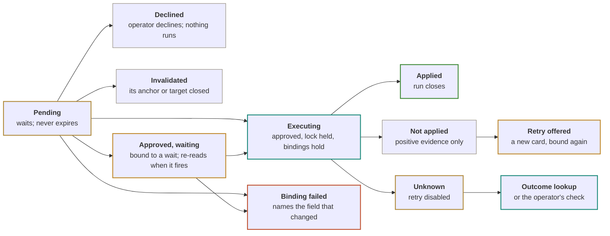
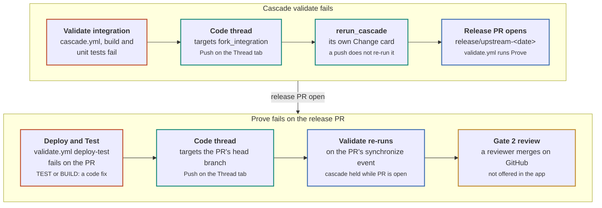

# SPI Code product requirements

*spi-code · product requirements · exploratory proposal*

What SPI Code must do at each milestone, how each requirement is checked, and which existing code each capability is built from.

Documents: [Product brief](spi-code-product-brief.md) · **Product requirements** (this page) · [Window design](spi-code-window-design.html) · [Visual design](spi-code-visual-design.html) · [Original combined design (PDF)](spi-code-design.pdf)

> The [original design](spi-code-design.pdf) describes SPI Code in one document: the product, its rules, its window and its build plan. It does not give requirements an ID, a milestone or a check. It also has a few claims that the source does not support, among them the fix path for a cascade that fails at Prove. That makes it hard to plan a milestone or know when one is done.
>
> This document restates the design as requirements. Each one has an ID, the milestone that ships it, and the check that proves it. It corrects the claims the source contradicts (appendix F). Appendix C maps each capability to the repository, file and symbol it comes from, and says whether SPI Code extracts, copies, ports, emulates or only references that code.
>
> Everything here is proposed; no SPI Code exists yet. Requirements say what must hold, not how a module is laid out, except where the boundary is the requirement. The questions in Open questions are not settled, and no requirement assumes an answer to them unless it says so.

**Diagram colors.** amber outline = Operator: asks, approves, reviews; teal outline = SPI Code: reads, plans, executes, records; blue outline = Outside systems: GitHub workflows; green, amber, red and gray outlines are card or run states.

**Tiers.** Every tool has one tier, which sets how it is approved.

| Tier | How it runs |
|---|---|
| **Read** | runs at once |
| **Local** | in a worktree only: at once in Auto-accept edits, after its approval row in Supervised |
| **Command** | one approval row per command, in the sandbox |
| **Change** | one card, one call |
| **Consequential** | card plus the typed target name |
| **Not offered** | no tool exists |

## How to read the requirements

IDs are an area prefix and a number, such as `AU-04`. The milestone column names the first milestone that must satisfy the requirement; later milestones keep it. "Verified by" names the test or observation that closes it. A requirement that depends on an open question names it. The milestone table's Threads row (epic spicode-xia) carries the thread and code-thread work the rows below once gave M3 and M5, and a requirement marked M3 or M5 that it covers is met there.

| Prefix | Area |
|---|---|
| `PS` | Program shape and views |
| `TH` | Threads and anchors |
| `CP` | Copilot runtime |
| `AU` | Authority, tiers and approvals |
| `EV` | Evidence and redaction |
| `RN` | Runs, intents and durability |
| `PB` | Playbooks |
| `CT` | Code threads, the command sandbox and SPI Code's own git |
| `ST` | Setup and tools |
| `PM` | Process model and packaging |
| `CO` | Core extraction and the rib |
| `NF` | Non-functional requirements |

## Program shape and views

The window is T3 Code's workbench for the SPI program, laid out as the [window design](spi-code-window-design.html) draws it, with panes, the top row and Settings as the [window layout](spi-code-window-layout.html) draws them. Work happens in threads. The window has three layers. The top row is one 44 px row each pane owns its part of, holding the title, chips and a pin control at the centre's right end; the sweep sits beside the footer gear, and the line's state is on the fixed status rows and the Upstream pin. The centre holds one thing: Today, a place or a thread. Outside a thread the window is the sidebar and the centre: a selection opens in place on Today or in a popover on its place, and Evidence is a page. In a thread the right panel holds the thread's context. The sidebar holds where the operator goes: Find or ask, a fixed block of Today, Line, Environment and Template, one removable Pinned list seeded with Upstream, Releases and Security, and threads by status. Attention has four tiers decided by core, and only a decision that is the operator's interrupts. Every text the window draws comes from the same core functions the rib uses. The check is reachability, not word-for-word parity with the rib console: every field the rib renders is within one click of its place, with no conflicting duplicate. Window text follows the window design's Text rules. Five values the layout needs are contract additions and a hard predecessor of the surfaces that need them; no M2 surface ships on a placeholder, and a feature that has not shipped takes no space.

The [visual design](spi-code-visual-design.html) holds the palette, the component kit and the thread and hand-off design. Where two pages disagree, the window layout wins, then the window design, then the visual design.

PS-01 is retired: the tree of page links it described is replaced by PS-08. The lenses are retired: the Line sheet (PS-10) and the place readings carry their fields. PS-16 to PS-20 are new. The Env, Templates, Forks and Sync segments are retired: their states are the sidebar's status marks (PS-08), and the sweep is a footer button beside the gear (PS-18, EV-03).

For PS-03, a GitLab source read that fails because glab is missing or signed out carries the existing `signin` code, so its row offers Open Settings to Readiness. Readiness can install glab or sign it in; a separate missing-tool stop code is not needed. Core tests cover both failures, recovery and unrelated transport failures; window tests cover Open Settings on the failed Upstream GitLab and Upstream radar rows (spicode-7zk). The action follows the code, never sign-in words in an unrelated error.

| ID | Requirement | Milestone | Verified by |
|---|---|---|---|
| **PS-02** | Every field the rib console renders from the `Briefing` object and the Releases pane input is reachable within one click of its place: on the place's reading, a row opened on Today, a popover on the place, or its Line sheet row. No two surfaces show conflicting values for the same field. Word-for-word parity and carrying the rib's lenses in full are not required. Parameterized places count per entity: the check opens every service and every release month in the fixture, and a field path is covered only when it is reachable for every entity that has it. The core regression checks on briefing output and the inspector and station oracle checks stay. | M2 | Reachability test on the `Briefing` object and the Releases pane input that `boards/console.ts` renders, from one recorded sweep with recorded release reads and notes: each field path is reachable within one click of its place, and every surface that shows it shows the same value; the core and oracle regression checks stay in the same suite |
| **PS-03** | Today is the operator's list of what is theirs to move, with the fleet flow and the Yours, Forks and Activity tabs ([service home and Today](spi-code-service-home.md)). An item is on Today when its next move is the operator's, whatever its tier. Items on the same PR are one member, with both moves in order. A blocked item's move is its blocker's, so PRs whose deploy lanes failed group under the lanes' re-run. Core groups the members into situation lines with a headline, ordered steps, a deadline and an age. The window draws them. The date is the lede. **A caveat band**, full width, only when a source's read failed or was cut, one line per such area ("GitHub issues and PRs read failed at 08:15; items from it may be missing." or "GitHub issues and PRs was read only in part at 08:15; items from it may be missing."), the area's name a link that opens Evidence, with no separate Evidence action, and "Open Settings ›" only when a failure's code is one Readiness fixes; a source that was only not read this sweep adds no line; then five sections in one row grid with the columns Fork, What, Link and Age. **Blocked** (a red dot and a red-tinted box) holds core's rung 0: something cannot move until the operator acts. **Waiting on you** (amber) holds everything else whose next move is theirs. **Can wait** (grey) is one row per pile that is the operator's but not today (Release PRs, Repositories, Security), as counts that leave out what is already on Today. **Moving without you** (blue) is at most three rows, each a thing in motion or scheduled, time first. **Last 24 hours** (a hollow ring and a dashed box) is one row per workflow with counts per outcome, failed in red and merged in green, names on hover; its heading names the window only as far as core vouches for it: "Since you last looked, 20:00" when core has a seen cursor, "Since 20:00" when the history core holds is shorter than a day, "24 hours to 22:00" when that history is stale and ends at an earlier read, and "Last 24 hours" otherwise. A single item is one row: its fork, its headline, its source pill, its age, and a clock when it has a deadline. A group is a header row ("5 forks", the shared headline, the oldest age) and one sub-row per member with its fork, pill and age. No verb label, rank, error code or restated fact shows (X1, X3, Y1); a member's age is the age of the object the operator acts on. Links are typed pills by kind (X5). A deadline is a clock by the age with its reason on hover and focus (X6). "⌀ n" by the age marks what was not read and opens Evidence for that row (Z4). A row in Blocked or Waiting on you opens in place (PS-04); a row in the lower three sections opens its place, and Line opens the Line sheet. A pile or workflow core did not read shows "not read", never 0. On a calm morning Blocked and Waiting on you are replaced by "Nothing is yours to move today." Today lifts the centre's 960 px content cap; in a centre under 640 px the Fork, Link and Age columns narrow, and nothing folds. Today states each fact once and says nothing the sidebar's status marks (PS-08) already say. Before the first sweep finishes, Today shows the sweep's sources live, in Evidence words, from `sweep.progress`: the eleven areas and releases in sweep order, each with what it reads and its state (waiting, reading, read, cut, put off or failed) with its time or plain reason, under one bar with a segment per source and no percentage or countdown, and no closing line under the list: the "Today is ready" notification (PS-19) covers a hidden window. A source this sweep did not read because it was not due says "not due", never "skipped". A cut source names the read kind from `cutKind` and counts from `incomplete` {count, total}: "6 run lists cut short; rest read" or "1 job log cut short; rest read", never only "n of m incomplete". A source where some reads failed while the rest read is partial, not failed: it takes the cut mark, counts the failed reads from `incomplete.failed` alongside any cut reads ("14 diffs cut short; 3 reads failed" or "2 reads failed"), and puts the host's safe `failure` sentence on the next line, naming the services from fleet ids ("Reads failed for 3 services: unit, crs-catalog, crs-conversion."), never core's failure text or command output. It says "rest read" only when other reads completed and none failed. Its hover and accessible description give the complete-read count and the safe cut reason with the read/total from completeness, for example "68 of 69 reads complete. Job log character limit: 64,000 of 92,438 characters read." Today and the retained list in Evidence use the same wording. A source that read nothing stays failed with its real reason code. A put-off or throttled source gives its resume time from `resumeAt`. A source that failed on sign-in offers Open Settings. Only `view.snapshot` hands over to the brief, in place; a sweep that finishes with some sources failed still hands over, and the caveat band names what failed. The completed list is kept after the hand-over, with each source's final state, time and reason, and is reached from the footer sweep's popover as Evidence (EV-03). When the first sweep fails outright, Today keeps the list under "The first sweep stopped." with the source it stopped on, the reason and the next attempt at `nextAttemptAt`, the real retry time (never `sweep.status.resetAt`, the budget reset), and offers Try again (`sweep.request`, through the non-forced sweep path and the readiness gate). The stopped panel and each stopped source offer Open Settings only when their reason code points at a Readiness fix: the current contract's set is `signin`. Readiness checks Copilot, git, gh and glab, not fleet configuration; no separate missing-tool or fleet stop code exists. Network, unavailable-forge, timeout, save and host errors offer Try again only, with their reason in plain words. The tray shows failed. The window never infers a time, count or Settings action from prose, and no raw field name is shown.. Next comes the fleet flow. Upstream counts forks stopped there, Sync PR counts forks with a sync PR open, Integration counts forks with an integration PR open, and Main counts green forks. Each counts forks in its station state, even when a fork has no member in Yours. Environment shows its state and version and opens its place. Main has no button. The doors are Template (sync PRs to review), Release, Dependabot and Other PRs. A station or door figure with missing reads shows its known count when it has one. One not-read line under the flow names the affected forks. Upstream, Sync PR, Integration and the Template door toggle a filter. It keeps matching rows and group members in Yours, hides Can wait and dims other columns in Forks. "Show all" clears it. Pressing a filter from Activity opens Yours. A filter with ⌀ shows its known rows and the not-read line. Release and Dependabot open their Can wait rows. Other PRs opens the cause with the most forks. A door with no target has no button. **Yours** counts the Blocked and Waiting on you members, the same count the sidebar, dock badge and tray use. Blocked (a red dot and red-tinted box) holds core's rung 0, things that cannot move until the operator acts. Waiting on you (amber) holds the rest whose next move is theirs. The table has four columns, Fork, What, Link and Age. A single item is one row: its fork, its headline, its source pill, its age, and a clock when it has a deadline. A group is a header row ("5 forks", the shared headline, the oldest age) and one sub-row per member with its fork, pill and age. No verb label, rank, error code or restated fact shows (X1, X3, Y1); a member's age is the age of the object the operator acts on. Links are typed pills by kind (X5). A deadline is a clock by the age with its reason on hover and focus (X6). "⌀ n" by the age marks what was not read and opens Evidence for that row (Z4). Headlines expand rows in place (PS-04). Fork names open the service page. On a calm morning Blocked and Waiting on you are replaced by "Nothing is yours to move today." **Can wait** (grey) lists causes with their forks inside and leaves out members already in Blocked or Waiting on you. One release row lists PR ages by fork. One Dependabot row lists counts by fork and names ecosystem/package pairs open on several forks regardless of version. Other PRs and actionable issues group separately by normalized title (trimmed, whitespace collapsed, case folded). One row lists high or critical alerts in shipped SPI and upstream code, with each fork's count, the rule with the most alerts and the rule on the most forks. A cause opens in place. Fork pills open the service page or its tab with the row open. Release and Security open their places. **Forks** carries the count of stopped forks (PS-10). **Activity** holds **Moving without you** (blue) is at most three rows, each a thing in motion or scheduled, time first. **Last 24 hours** (a hollow ring and a dashed box) is one row per workflow with counts per outcome, failed in red and merged in green, names on hover; its heading names the window only as far as core vouches for it: "Since you last looked, 20:00" when core has a seen cursor, "Since 20:00" when the history core holds is shorter than a day, "24 hours to 22:00" when that history is stale and ends at an earlier read, and "Last 24 hours" otherwise. An unread cause or workflow shows ⌀, never 0. Today lifts the centre's 960 px content cap. In a centre under 640 px the Fork, Link and Age columns narrow. The grid stays open. Before the first sweep finishes, Today shows the sweep's sources live, in Evidence words, from `sweep.progress`: the eleven areas and releases in sweep order, each with what it reads and its state (waiting, reading, read, cut, put off or failed) with its time or plain reason, under one bar with a segment per source and no percentage or countdown, and no closing line under the list: the "Today is ready" notification (PS-19) covers a hidden window. A source this sweep did not read because it was not due says "not due", never "skipped". A cut source names the read kind from `cutKind` and counts from `incomplete` {count, total}: "6 run lists cut short; rest read" or "1 job log cut short; rest read", never only "n of m incomplete". A source where some reads failed while the rest read is partial, not failed: it takes the cut mark, counts the failed reads from `incomplete.failed` alongside any cut reads ("14 diffs cut short; 3 reads failed" or "2 reads failed"), and puts the host's safe `failure` sentence on the next line, naming the services from fleet ids ("Reads failed for 3 services: unit, crs-catalog, crs-conversion."), never core's failure text or command output. It says "rest read" only when other reads completed and none failed. Its hover and accessible description give the complete-read count and the safe cut reason with the read/total from completeness, for example "68 of 69 reads complete. Job log character limit: 64,000 of 92,438 characters read." Today and the retained list in Evidence use the same wording. A source that read nothing stays failed with its real reason code. A put-off or throttled source gives its resume time from `resumeAt`. A source that failed on sign-in offers Open Settings. Only `view.snapshot` hands over to the brief, in place; a sweep that finishes with some sources failed still hands over, and the caveat band names what failed. The completed list is kept after the hand-over, with each source's final state, time and reason, and is reached from the footer sweep's popover as Evidence (EV-03). When the first sweep fails outright, Today keeps the list under "The first sweep stopped." with the source it stopped on, the reason and the next attempt at `nextAttemptAt`, the real retry time (never `sweep.status.resetAt`, the budget reset), and offers Try again (`sweep.request`, through the non-forced sweep path and the readiness gate). The stopped panel and each stopped source offer Open Settings only when their reason code points at a Readiness fix: the current contract's set is `signin`. Readiness checks Copilot, git, gh and glab, not fleet configuration; no separate missing-tool or fleet stop code exists. Network, unavailable-forge, timeout, save and host errors offer Try again only, with their reason in plain words. The tray shows failed. The window never infers a time, count or Settings action from prose, and no raw field name is shown. | M2, with the Today and service home pass of 2026-11-17 | `packages/core/test/today-lines.test.ts` and `today-summary.test.ts` assert the situation members and Can wait partitions. `views/today/table.test.tsx` covers fleet figures, filters, Yours counts and Activity. `views/today/today.test.tsx` covers failed-area Evidence and Read again. |
| **PS-04** | Outside a thread a selection's detail opens where it was clicked, never in a side panel (Z1 to Z3). On Today a row in Blocked or Waiting on you opens in place, under the row across What to Age. A fork row on Today and a service station or door with an Overview row also open in place. A rollout rung, an environment run or hold, a repository line, an Upstream hold or theme and a release month open popovers anchored under them. The exception is a place's new items outside its capped reading: one opens inline under its row, and clicking it again, Esc or a click outside the list closes it. All draw one body. The place link and the On Today chip retire. A popover starts with a title. The shared body gives the deadline in full; the cause as the first sentence and the effect as a muted second one, dropped when nothing waits on it or it restates the title; numbered steps only when there are two ordered moves; the source pills; and "⌀ n not read · Evidence ›" when something was not read (X9, X11). A group's body is the shared cause and its steps, with no single member's pill: its members are already the sub-rows, and a pill about one member names its fork. An opened row never repeats the pill in its own Open column. A rollout rung that holds a member shows that member, a Blocked one first, with its other members as rows. A repository line that is not on Today reads "Not on Today. Counted under Can wait." only when core counts its URL under Can wait; otherwise it reads "Not on Today.", and the window never infers either membership from a matching URL. A popover does not repeat what its place shows beside it. One row or popover is open at a time. Clicking it again, Esc, or a click anywhere else closes it, except the footer sweep, which opens Evidence for what is open (EV-03). A popover hangs under what was clicked, flips above when it would leave the window, stays inside the window, takes focus and returns it to what opened it. Sources open as outlined pills marked ↗, core's primary first; ⌘↵ opens the open row's or popover's primary source, and on a group header the pill in that row's Open column, or nothing when it has none. An SPI Code operation ("Queue the re-run of all 5 lanes", "Dispatch Sync Template to 7 forks") takes no space until the window can send it (M4 Act), and its step reads as a sentence; the accent-tinted ▸ button is kept for these operations (X12). A step the operator does by hand is a sentence naming the file or MR it touches. The one Copilot control is Ask about this, at the end of the source pills, which opens a draft thread with that row or popover as its context chip and sends nothing (TH-03); when a thread owns the row it reads that thread's title and status and opens it (TH-05). Nothing is drawn as a placeholder. The action assembly the rib does in `boards/inspect.ts` (`verbsOf`) and `boards/template.ts` moves to core with CO-05. | M2, with the Today and places pass of 2026-11-17; SPI Code operations M4; Ask about this with Threads | `views/today/table.test.tsx` opens a group and its member one at a time and sends ⌀ to row Evidence. `views/service/service-home.test.tsx` opens and focuses Overview from the flow. `components/opened-body/opened-body.test.tsx` covers shared steps, source order and duplicate links. |
| **PS-05** | A place is anything besides Today and a thread that the operator can open in the centre: a service, Upstream, the environment, Template, a release month, Security or a campaign. Places hold what Today can't show (PS-03). Upstream keeps the radar, per-fork commits, filters and ports; the environment its status, a timeline of 24 hours or 7 days with fork borrows and runs, and the stack repo from a pill by its title (PS-09); Template the rollout as a ladder of forks, with a stage per rung, and the repositories table with their issues, PRs and Dependabot bumps; Releases the months, notes, every release PR and each forming release's full change list; Security its rules, packages, owners and campaigns. The common place head shows the name and status, using the same status field as the sidebar. The place stepper and the rule that place head counts add up to Today retire. Core keeps each member's home. Every place leads with its reading (a headline, three tiles and at most five items, the rib's shape). A service lists its threads on a Threads tab after Security, and Template and Environment list theirs under their reading, each with its status. No place carries a composer: a thread starts as a draft in the centre (TH-03, [threads](spi-code-threads.md)). A part with nothing to show takes no space; there are no always-present empty sections. A service uses the [service home](spi-code-service-home.md) in place of the common head and reading. Its top bar carries the service name, repository, versions and bump, release PR, template state and pin. Its flow runs from Upstream through Sync PR and Integration to Main, with Release, Other PRs, Dependabot and, when it holds a sync PR, Template doors into main. Healthy Main is tinted green. Each open PR belongs to one station or door. A station or door with work to act on opens its row on Overview, which lists Blocked, Waiting on you, Shared work and Can wait. Upstream, Pull requests, Issues, Runs and Security have their own tabs with counts, or ⌀ when unread, and Threads counts the service's threads that are Waiting on you or Working. A service place is reached from Today's Yours or Forks tab, ⌘K or a pin. Before the first snapshot, places stay clickable in the sidebar's muted ink and each opens one line saying when it can be read ("Upstream opens after the first sweep. It is read 9th of 12."); Today's Forks tab says "Service rows appear after the first sweep." Settings, Find and the panel toggles stay live. | M2 reading; a place's threads with Threads; release and run facts after the contract additions bead | `packages/core/test/service-home.test.ts` covers the station and door partition, Overview membership and failure readings. `views/service/service-home.test.tsx` covers tab and row routes and retained reads. `app/reachability.test.tsx` checks place and member homes. |
| **PS-06** | The upstream hold for a SNAPSHOT toolchain shows the rib's "Take it anyway" variant of Prepare and Start, with the hold reason on the card. | M4 | Tool test with a SNAPSHOT fixture |
| **PS-07** | The Environment place labels live cluster reads (from `spi status --json`, Flux, pods) apart from state inferred from workflow runs. Before M6 its reading draws inferred state only, labeled inferred, and live reads take no space. | M6 | Screenshot test with both sources |
| **PS-08** | The sidebar is T3 Code's sidebar holding where the operator goes, with a muted line icon on every row. Top to bottom: Find or ask (⌘K); a fixed block with no header holding Today with its count of the members on Blocked and Waiting on you (PS-03), Environment and Template, in that order; one collapsible Pinned list (PS-17), hidden when empty, seeded on first run with Upstream, Releases and Security; then threads by status (Waiting on you, then Working) and the Settled shelf with its count once threads ship. The fixed block has no grip, menu or pin control anywhere and never moves. **The status rows carry the program's state** at their ends: Environment and Template in the fixed block, Upstream wherever the operator puts its pin, classified once from the snapshot as the strip classifies it: Template, a warning-ring count of template sync PRs waiting for review, the same figure as Today's Template door; Environment, a check in the success tone when it is ready, a wrench in the warning tone when it is in maintenance and nothing is running to clear it, or the refresh icon in the work tone while a lifecycle run clears it; Upstream, a warning-ring count of Today rows whose home is Upstream when it has any, including the port row once. Otherwise Upstream shows a clock in the upstream tone while the next sync is known and 2 hours away or less. Template keeps the known count and carries ⌀ when a read is missing. A fine count, an unread Environment state and an unknown, past or later sync draw no mark. Unread fields never draw a check. There is no red Environment state. A mark is a number or an icon, never words: an outlined count is the number in its tone's text colour inside a 1.75 px ring in the tone, the height of the 15 px icons, and Today keeps its filled count, the one count that means act. The sentence behind a mark, a fine Environment's included, is the row's hover and is in its accessible name: it names the forks behind a count and the open hold's length for maintenance, and a mixed snapshot keeps its proven count and names the members not read. Upstream's mark appears only on its pin. A pinned service uses the [service home mark](spi-code-service-home.md) for the count of Blocked plus Waiting rows. The count is filled red when any row is Blocked and ringed amber otherwise. With no rows it shows a check, or ⌀ if an area was not read. A known count stays visible and Shared work is counted on Upstream. Releases and Security carry nothing. Hover and focus add the background and, on Pinned rows, the grip (plus the focus ring for keyboard focus); the icon, label, mark and word never hide, move or swap. While the sidebar is hidden or off-canvas, its toggle carries one dot: error when an Interrupt is open (PS-19), a status mark is error or the sweep is bad; otherwise warning when a mark is warning or the sweep is warn; otherwise none, including an unread sweep when nothing else lights it. Error wins across sources. The dot keeps the meaning of its label, "Something needs you now": it counts Interrupts, not Today's members, so Waiting on you members do not light it (spicode-djg.29, R29-2, kept by the maintainer on 2026-11-17). The dock badge and the tray count Today's members, as this row does (AU-09). A collapsed Pinned header reads only its rows' marks. A service's filled red count is error, its ringed amber count warning, and its check or ⌀ gives no dot. A service appears in the sidebar only when pinned. The 44 px footer holds the Settings gear at its start and the sweep button at its end (EV-03); the gear's Readiness dot is unchanged, shown only when Readiness is known to need the operator. A pin notice sits just above the footer (PS-17). A code thread shows its branch under its title. Groups collapse and remember it. | M2 shell, fixed block, pins, footer sweep and dots; M3 threads and the Settled shelf | `components/sidebar/ProgramSidebar.test.tsx` checks the shared Today count and the pinned services and status marks. `components/sidebar/service-mark.test.ts` checks the mark from Service Home, including a retained count. |
| **PS-09** | Upstream (PS-16), Environment, Template, Releases and Security are places with the PS-05 shape. The environment's reading carries the stack repository's lines and Template's carries the template repository's lines. The Environment place says who has the environment and for how long, as [spi-code-environment.md](spi-code-environment.md) rules. It leads with a status line in place of the three tiles: In maintenance, In use, Usage unknown or Idle, with its length where core knows it and one muted reason, then a facts line. Then comes a timeline of the last 24 hours or 7 days, with maintenance, fork borrows and fork overlap on an Activity row, the Refresh, Reset, Upgrade and Smoke lanes, and each fork's borrows. Then come the reading's items, those that need the operator under "Waiting on you", and nothing else: the Stack runs fold goes, and the stack repository opens from a pill beside the place title. The place draws neither the flow context nor the run headline. The Version and Fork deploys rows go, and nothing on the place says "Lane", "Stopped" or "n of m" about fork borrows. The reading's headline reads "v0.35.5 is ready, green since 11-10 22:05.", "v0.35.5 in maintenance for 2 d 13 h, with no run in flight." or "v0.35.5 is in maintenance while an upgrade to v0.35.6 runs.", and without a length when core does not know when maintenance began. These words come from core; the window rewrites none. The reading and the verdict are app-only code and change directly. Every other string this design rewords is in code the rib also runs (among them `briefing.environment.facts`, the Stack runs headline, the availability line, the re-run item, and the place row's figure if the rib reaches it); those take the new words under the app's context while the rib's default context keeps its own. With no environment facts, or a Held lane that was not read, the status line never says In maintenance. A fork check to re-run after the environment failed it is the fork's item: its re-run lands on the fork's PR, so its scope is that fork (one item with a counted scope when several forks failed), its title leads with the ask once the environment is ready, and it is listed in that fork's reading, not the environment's; Template reads forks verified on the target template revision, not PRs merged. A release month is a place reached from Releases. Security's reading is SPI-owned findings across the fleet: tiles for high, total and upstream-origin counts, items grouped by rule, and each rule that spans forks shown as a detected campaign (TH-11). | M2 | Component test per place from a recorded sweep; core tests (spicode-eib.1) that the environment headline and the "Waiting on you" group read as above; that every reworded string in code the rib also runs (`briefing.environment.facts` with "ready" and "Ready · 21 days", the Stack runs headline, the availability line, the re-run item's title and scope, and the place row's figure if the rib reaches it) reads as above under the app's context, with one paired assertion per changed branch showing the string unchanged under the default context; and that the re-run item takes the fork's scope when one fork failed and a counted scope when several did, starts "Re-run" once the environment is ready, and is listed in the fork's reading and not the environment's; core and component tests in the beads of epic spicode-8q6 (spicode-8q6.2 to spicode-8q6.5) that the status line's precedence and lengths, Usage unknown naming the forks not read, estimated borrow ends, each Stack lane's cadence, last run and Reset age, and the summary line adding up to its range read as spi-code-environment.md says, that every `briefing.environment` and environment-reading leaf stays within one click in the reachability suite, and packaged smoke captures of the place at 24 h, at 7 days and on an opened day beside the mock; a component test in views/template/template.test.tsx (spicode-djg.30, :79) that the place's heading and accessible name read Template |
| **PS-10** | Today's Forks tab replaces the Line sheet and its sidebar row. ⌘L opens Forks. Existing links to the Line open Forks. The tab counts stopped forks. Its heading gives the fork count and the open PR total. The table has one row per service, with Upstream, Sync PR, Integration and Main using the service home's station words and glyphs (✕ stopped, ! waits on you, ◐ running, ◷ waits on time, ⌀ not read, · fine). A failed lane shows as a red integration PR. Lanes belong to Environment. Door columns show the Template sync PR number, Release PR age, Other PR count and red failure mark, and Dependabot count. Each row ends with the service's mark (PS-08). Forks with Blocked or Waiting rows come first in fleet order. Unread stations keep their fork visible. One fold counts the remaining forks and says what they hold. A selected station or Template door dims the other columns. The fork's name expands its Blocked and Waiting rows and Can wait facts in place. `Open <fork> ›` opens its service page. The Line's popovers, cell dots, overlay and dock controls retire. A stored Line pin is dropped with the other pins retained in order. | M2, with the Today and service home pass of 2026-11-17; wave column M4 | `views/today/table.test.tsx` checks fleet order, the quiet fold, disclosing fork rows, service navigation, one unread mark and station dimming. `app/navigation.test.tsx` covers the Forks shortcut from another place. |
| **PS-11** | The centre holds one thing: Today, a place or a thread. Threads occupy the centre. Outside a thread there is no right panel and no panel toggle: the window is the sidebar and the centre, with the Line sheet when it is docked; the panel's shortcut does nothing there, and a saved open panel stays closed. A selection opens in place on Today or in a popover on its place (PS-04), and Evidence is a page (EV-03). In a thread the right panel is the thread's context: the Thread tab (T3 Code's thread details) leads and the anchor's reading, Detail and Evidence stay as tabs, at every width; a thread can also dock the Line sheet, the lane or a diff's Detail there. No surface carries a second copy of the selection's detail. T3 Code's three toggles each sit by what they control: the sidebar toggle just after the window controls, whether the sidebar is shown, hidden or off-canvas; in a thread, the right-panel toggle at the end of the centre's part of the top row while the panel is closed and at the end of the panel's tabs while it is open; the terminal drawer's in a thread (CT-12). On Windows they sit clear of the caption buttons. Each pane's header is its part of the one top row (PS-18): 44 px tall from the window's top, with one shared bottom rule. The sidebar (232 px by default, 200 to 320 px), a thread's right panel (360 px by default, at least 280 px) and a docked sheet (360 px by default, at least 320 px) are resizable from a drag edge on their shared divider, which is a focusable separator moved by arrow keys and reset by double-click. The width a drag ends on is the pane's preferred width, saved per machine with whether the pane was open; PS-13 decides the displayed width. A pinnable place or service declares its pin control in the top row's end slot, last in the centre's part, clear of Windows caption buttons; in a thread it sits 6 px before the right-panel toggle while that panel is closed. It stays at every width; the title and chips use the room before it. | M2 sidebar, centre and toggles, with no panel outside a thread from the Today and places pass of 2026-11-17; M3 the right panel, its toggle, Log and Thread tab with threads in the centre; M5 the code-thread items | Component tests in components/place/Place.test.tsx and views/service/service-place.test.tsx (spicode-1l9.2) that place and service controls render in the end slot rather than beside the title; packaged geometry rule (spicode-1l9.2) at 1440, 900 and 740 px, panel open and closed, pinned and unpinned, on macOS and Windows, checks the control ends 6 px before the toggle or at the part's end within 1 px and rejects both the old under-800 px hide and beside-title proofs. Existing pane-header and separator tests remain (spicode-44k.5). Outside a thread (spicode-djg.14): app/pane-layout.test.tsx:184 that a saved open panel never draws the panel or its toggle at 1440, 900 or 740 px and keeps the saved preference; Shell tests that the shortcut does nothing and the eight drawn cases have no panel; panels/RightPanelFrame.test.tsx that the thread's context frame keeps its keyboard path and returns focus; packaged geometry that rejects any right panel or panel toggle on every probe. The panel tests retired with the panel are listed in docs/notes/detail-panel-removal.md |
| **PS-12** | ⌘K (Ctrl+K on Windows) opens one palette, ported from T3 Code's `CommandPalette.tsx`, that finds every place, service, campaign and Today item, and from M3 searches threads by title and turns a sentence into a question to Copilot about the selection (TH-03). Pinnable results use the single pin control at their end (PS-17): hollow on hover and on the highlighted row while unpinned, filled whenever pinned. Today, Environment, Template, release months and Queue results have no control. A click toggles in place without opening: query, highlight and focus stay unchanged. ⌘↩ (Ctrl+Enter) opens and pins, never unpins; on a fixed place it only opens and stores nothing. ⌘⇧P (Ctrl+Shift+P) toggles the highlighted result in place; the hint bar says '⌘⇧P pin' with the Windows equivalent. The option's accessible name says when it is pinned. Every unpin offers Undo, including inside Find (PS-17). A Today item opens Today's Yours tab with its row open: an item merged into one member opens that member's row, one shared by several members of a line opens the line's header, and one on rows of different lines, or on none, opens Today with nothing open. A service result carries the same mark as its pinned sidebar row (PS-08). Under a service, Find lists its open PRs and issues by number or title, then its tabs with their counts. A PR or issue result opens that tab with its row open. ⌘↵ opens that result on GitHub. Find has no Line result. ⌘L opens Today's Forks tab. There is no actions group. | M2 find and pin; M3 threads and ask | `palette/palette.test.tsx` checks shortcuts, pinning, service row deep links and Today's groups, labels and destinations. `app/navigation.test.tsx` covers history traversal and held keys. Packaged smoke exercises Back and Forward through Chromium input. |
| **PS-13** | Panes fold by the width left for the centre, which keeps at least 520 px; there is no single window breakpoint. When the panes at their preferred widths (PS-11) do not fit beside it, the window takes four steps in order and stops at the first that fits: narrow (a thread's right panel toward its minimum, then a docked sheet toward its own), a thread's right panel becomes a sheet over the right edge of the window, a docked context such as the Line sheet or the lane stacks under the centre, and the sidebar goes off-canvas behind a named toggle (⌘B). Outside a thread the panel takes no width, so only the docked sheet's narrowing and stacking and the sidebar's step apply. The window is never narrower than 740 px. Sheets open below the top row, open from their toggle (the right panel's, in a thread), and close with Escape or their named close button; opening either moves focus into it and closing returns focus to the control that opened it. Every control keeps its name and keyboard path at every width; there is no icon rail. | M2 | Unit test on the width budget as a pure function at the eight cases the [window layout](spi-code-window-layout.html) draws for a thread's panel and at the thresholds either side of each step, plus the outside-thread cases with no panel width and the centre at 520 px or more (app/width-budget.test.ts, spicode-djg.14); screenshot test at 1440, 900 and 740 px in light and dark on macOS and Windows; an accessibility test that every control at 740 px has a name and is reachable by keyboard with focus restored |
| **PS-14** | A context chip packs one selection for a thread: its stable id, kind and title, the compact inspect result, its read records or evidence references, the provenance areas with their states, the sweep time and completeness; never a raw page, log, diff or issue body. Chips are added by @ in a composer, which adds a place (@legal, @environment) as a context attachment and never as a second anchor, by a thread's toolbar (⌘⇧A), and from a multi-row selection; Ask about this on a Today row or a popover starts a draft with its subject as the chip (TH-03); in the composer a chip is a draft that shows a preview, can be removed and can be refreshed from the latest sweep; sending snapshots each chip's payload, sweep time and evidence references onto that message, and a sent chip never changes; drafts attach to a new thread or an existing one. By kind a chip carries what PS-04 gives that kind: the inspect result for every kind with an id (themes and environment events through the derived `theme:`, `hold:` and `run:` ids), a station's label, state, text and upstream inspect, and a place's reading; a repository line cannot be a chip until it has an id. A chip is at most 2,000 tokens and a message carries at most 8; an over-budget chip is trimmed to identity, class, cause, next and evidence references and says so. The seeded message is the structured payload. | M3 | Fake-session test asserting the seeded message is the structured payload, under budget, that a trimmed chip keeps its identity and evidence references, that an @ place leaves the anchor unchanged, and that a sent message keeps its payload after the draft chips change |
| **PS-15** | What a thread does returns to the view. A place's threads part and the sidebar show each thread's status (Working, Waiting on you, settled); an item a thread owns carries the thread's marker on Today, its place and the Line sheet. The host's thread store records every PR, run or issue a thread's tool call created, keyed by the URL or run id the tool result returned; a proposed write stays on its card and is never drawn as a row, and a branch, which has no such key, appears on the Thread tab only. The window joins snapshot rows to the store by key. Until a sweep has read the object its row or cell is drawn from the store, dashed and marked "pending · not yet in a sweep"; once a sweep row matches the key it is solid and sweep-confirmed. A pending card raised by a button opens the one place it is decided (AU-10); a pending card raised in a thread puts that thread under Waiting on you. | M3 join and status, M4 cards | Component test on the threads part, the item marker and the dashed-to-solid transition from a fixture; store test that a record needs a returned URL or run id |
| **PS-16** | Upstream is the place for the line's input: what GitLab hands each fork at the next sync. Its headline names the next sync and how many commits reach how many forks, and says how many need the operator first. Its tiles are commits incoming, toolchain moves and the largest incoming, each naming what it counts. Its items are the holds and halts due before the next sync and the detected toolchain moves. A subline qualifies the reading when the radar read was cut, from the per-read provenance. Its holds and halts open popovers (PS-04); an upstream member whose home is Upstream is counted and stepped by its head (PS-05), and one record shows on Today and here, so resolving one clears both. Its Line view is the Line sheet filtered to the Upstream column. It sits first among the places. | M2 | Fixture test from a recorded sweep with a cut radar read; component test that an item resolved on Today clears on Upstream |
| **PS-17** | Upstream, Releases, Security and services can be pinned to the sidebar's one Pinned list. Today, Line, Environment and Template form the fixed block (PS-08); release months have no pin control. **One borderless icon control** is used at the top row's right end (PS-11), at a Find result's end (PS-12), and directly after a service's name on the Line sheet (PS-10). It is 24 px in the top row, 22 px in lists, with a 14 px glyph: hollow in muted ink when unpinned, text ink and hover background on hover; filled in text ink when pinned, changing to pin-off on hover or focus. After a click the new glyph stays until pointer or focus leaves. Its accessible name and title are the same action string, including the item's name: 'Pin partition to sidebar (⌘⇧P)' or 'Unpin partition from sidebar (⌘⇧P)', with Ctrl+Shift+P on Windows where the shortcut acts. There is no aria-pressed because the action name changes. No control appears anywhere on the fixed block. ⌘⇧P toggles the open centre place or service, doing nothing on Today, a release month or a fixed place, while a dialog other than Find is open, or while Line overlays the centre; Find handles its highlighted result instead. The shell's state decides dialog exclusion. **Pinned rows** reorder only within Pinned, by drag with an insertion line, by Alt+Up/Down, or through the context menu (right click, long press, Shift-F10 or Menu key): Open, Move up, Move down, separator, Unpin from sidebar. A drop on the fixed block or outside Pinned does nothing. After Unpin, focus goes next, else previous, else Pinned's header, else the fixed block's last row, without a timed page query. **Feedback** comes from the pins store for every path. Every unpin shows 'Unpinned partition · Undo' for 8 s; Undo or ⌘Z (Ctrl+Z) restores its old index. A pin appends a row, whose accent background fades over about 1 s when the sidebar is visible and Pinned open; otherwise it shows 'Pinned partition · Undo', whose Undo unpins. A new notice replaces the last. The band sits inside the sidebar above its footer, or at the window's bottom left when the sidebar is hidden or off-canvas. Its status region is mounted empty before filling; the timer pauses on hover or focus and Undo is keyboard reachable. A shown notice owns ⌘Z, inside Find too, until another key is pressed; elsewhere ⌘Z keeps its usual meaning. Sidebar-owned state determines whether Pinned is on screen. **Storage** uses `spi-code.sidebar.pins.v3`: a readable v3 list wins; absent v3 falls back to present `spi-code.sidebar.pins.v2`, then legacy services `spi-code.sidebar.pins`, then the seed (Upstream, Releases, Security). Corrupt v3 (invalid JSON, null, non-list, non-name or empty name) yields the seed, never v2. Migration from v2 drops `sheet:line`, `place:environment` and `place:engineering-system`, retaining every other pin in order and respecting unpinned seed places. Legacy migration yields seed then legacy services in order; corrupt v2 or legacy yields seed. Migration writes v3 once and leaves the old keys untouched. Refused reads give seed and hold writes in the window; refused migration writes keep the migrated list in the window and retry migration next launch. Changes and Undo update the window immediately with best-effort writes: a refused write still restores the old index, keeps the notice and Undo with no saved claim, and reload reads what storage last accepted. A service the snapshot no longer names stays stored and is drawn only while it can open, as before. Threads' pinning waits for M3. | M2 pins, control and Undo; M3 threads | Store tests in store/pins.test.ts (spicode-1l9.1), one per storage ruling: readable/corrupt v3 precedence, v2 filtering and order with removed seed places, legacy order, corrupt older values, one migration write without touching old keys, refused reads and migration writes, fixed-id pin/unpin writing nothing and persisted moves. Sidebar tests (spicode-1l9.1) cover menu, keyboard moves, focus and drop boundaries. Pin-control component tests (spicode-1l9.2) cover names and titles by state, pin/unpin and excluded routes; top-row end-slot, Find and Line tests and ⌘⇧P tests cover open place/service, fixed/Today/month, Settings and overlay exclusions. Pin-off on hover is judged by capture. Feedback tests (spicode-1l9.3) cover every unpin path (sidebar menu, top-row control, Find control, Find ⌘⇧P, Line sheet), Undo and ⌘Z restoring the old index and persisting, visible-row flash versus hidden/collapsed notice, ⌘Z expiry and another-key release without swallowing normal Undo, the pre-mounted status region and paused 8 s timer, and refused writes restoring the window without changing words or claiming saved while a fresh read returns the last accepted list. Packaged notice captures (spicode-1l9.3) cover the sidebar band and hidden-sidebar notice, with contrast at rest and hovered, light/dark and both palettes; control geometry and negative proofs are PS-11's checks (spicode-1l9.2) |
| **PS-18** | Each pane owns its part of one 44 px top row (PS-11). The centre holds the title and chips, a pinnable place's or service's icon control at its right end, and, in a thread, the right-panel toggle while that panel is closed. Under 800 px the chips hide and the title shortens with an ellipsis, while the pin control remains; at 740 px the row stays on one line with at least a 48 px drag span. The sweep lives at the sidebar footer's end beside the Settings gear (EV-03); its 2 px running progress line stays across the full window under the top row even with the sidebar hidden or off-canvas. The program's states are the marks on the fixed Line, Environment and Template rows and the removable Upstream pin (PS-08), each with its sentence as hover and accessible name. The window reads the Environment fact, rollout slots, station sub-states, Held lane and next sync from the snapshot, classified once as fine, not fine with its worst count, or unread; unread never classifies as fine and nothing reads 'n of m'. The top row draws no service pips or due count: time is a fact (PS-03). The lane holder (M3) and approval-card count (M4) wait for spicode-cp0.1. A stopped fork stays in the fixed Line row's count until the line is green, whatever its thread does. Typed station sub-state and due are M2 contract data. | M2 shell, footer sweep and pin end slot; M3 lane holder and M4 waiting cards where spicode-cp0.1 places them | Classification table tests (spicode-44k.2) retain worst-count precedence and unread/unknown/empty cases; mapping tests (spicode-8i9.1) retain the marks. Shell, SweepSegment and navigation tests (spicode-1l9.7) prove no route or sheet has a top-row sweep, footer tones/spinner/popover, and the full-width progress line while the sidebar is hidden or off-canvas. The text rules, upstream-boundary selectors and reachability sweep case move to the footer (spicode-1l9.7), preserving coverage enforcement and the sidebar clock allowance. Packaged smoke (spicode-1l9.7) retires the capsule geometry and drag record but keeps the 740 px one-row and 48 px drag-span rules unedited and passing on macOS and Windows. Pin end geometry, its two rejected broken-rule proofs, widths and contrasts are PS-11's checks (spicode-1l9.2). The existing no-due-count test remains (spicode-f0s.4) |
| **PS-19** | Core assigns every state to one attention tier; the window draws the tier it is given. **Interrupt:** a card waiting on the operator's decision; a new or worsened P0; an owned item whose thread Failed, stalled or lost coverage; a failed recovery; an unowned item due within its lead time. Each notifies and lights the sidebar toggle's error dot while the sidebar is hidden or off-canvas (PS-08). The sidebar's Today count, the dock badge and the tray tooltip count Today's members instead (PS-03, AU-09), so an Interrupt reaches them when its next move is the operator's (spicode-djg.29). The sidebar's status marks follow their own classifiers (PS-08, PS-18) and are not a second Interrupt count. The hidden-sidebar dot also reads the sweep's bad or warn tone; error wins across all sources, and an unread sweep adds nothing. **Surface:** a new P1, a newly detected theme, a thread Done, an item due before the next sync but outside its lead time. Each shows on Today or at its place, with no notification. **Ambient:** work moving normally, successful retries, routine sweeps and items with no rush, shown on the sidebar's status rows, the Line sheet, Today's Moving without you and its place. **Background:** work that asks nothing of the operator today, counted in a Can wait pile or listed at its place, with no notification. On Today the tier does not choose the section: whose move it is does (PS-03). Every item whose next move is the operator's is one member of a line, under Blocked when it is core's rung 0 and otherwise under Waiting on you, whatever its tier; work that moves without the operator is under Moving without you or at its place; piles that can wait are Can wait's rows; and every other item is listed at its place reading. Each item has one Today row or one place, and Today never re-tiers an item. Core gives each item one of two origins. **In your system:** the SPI forks, their PRs, the environment, the template and the releases. **From upstream:** commits queued for the next sync or held in open sync PRs, and merged upstream provider changes not yet ported. Only upstream origin carries the upstream role: a GitLab MR pill, the Upstream place and the members whose home is Upstream. Upstream-owned findings already in the forks carry none. The lead time is a setting, 2 hours by default; its control is not part of the Sweep section in this pass. After the first sweep, a committed snapshot with an Interrupt in `seen.since` at a rung not yet notified this app run sends at most one coalesced OS notification per sweep, skipped while the window is focused. One item reads "Needs you · {scope}" / "{rank} {title}"; several read "{n} things need you" / the first two titles joined by "; ". Clicking opens Today with the item's row open, as ⌘K does (PS-12), or its owning thread once threads exist (TH-07). Dedupe by item id and rung lives in memory per app run, not a persisted notification store; the same item notifies again only when it worsens to another rung. After a relaunch, the first committed snapshot sends one summary of unacknowledged Interrupts, only when the window is not focused. A seen-state baseline records what the operator last acknowledged; acknowledging closes its banner and clears the open-on-Today trigger, never the Line row's count of stopped forks, and never Today's count, which falls only when an item is resolved. Ownership suppresses duplicates, not escalation: an item a thread owns keeps its home on Today with its thread's marker (PS-15) and its repeat notifications stop, and it interrupts again if its thread fails, stalls or loses coverage, or the item worsens. One "SPI Code can't read the program" notification per outage, also skipped while focused, covers a source that read in the previous sweep now failing with code `signin`, or no committed sweep for 15 minutes while the machine is awake. Its body reads "gh is signed out. Today is from 08:02." for gh sign-out, or "No sweep has finished since 08:02. Last: {reason}."; clicking opens Readiness for sign-in or Evidence for no committed sweep. A committed sweep clears the outage. Never notify for a routine sweep starting or finishing, Sweep now finishing, Surface or Ambient items, cut, put-off or throttled sources, a single failed sweep, budget changes, the forks' upstream sync, glab when it was never signed in, or the same item twice at the same rung. System notification settings control delivery, sound and quiet hours; there is no in-app notifications switch. On first launch the first sweep's hand-over still sets the tray tooltip to "Today is ready" and, if the window is hidden, sends one "Today is ready" notification whose body counts Today's members, as the dock badge and tray tooltip do: "18 need you." or "1 needs you."; zero members or missing Today lines give no body (spicode-djg.36). | M2 tiers, seen-state (local), due, sweep notifications and the first sweep's "Today is ready"; the Background tier and item origin with the Today briefing; the toggle's dot spicode-8i9.1; M3 ownership | Core test per tier rule from fixtures; the reachability suite's PS-19 case (app/reachability.test.tsx, spicode-djg.10) that every item the removed Today blocks carried has exactly one Today row or is listed at its place reading, on the 16 Nov, 6 Nov, calm, busy, bad and 59d6895 sweeps; members.test.tsx (spicode-djg.19, spicode-djg.26) that every Today member has exactly one home place; tray and notification route tests in app/destination.test.tsx (spicode-djg.28) that an item opens its Today row, an item shared by one line's members opens the line's header, and an item on rows of different lines or on none opens Today with nothing open; clock-driven test that an unowned due item becomes Interrupt inside its lead time; component test that acknowledging clears the banner but not the count; PanelControls dot tests (spicode-1l9.7) that bad sweep gives error, warn gives warning, error wins over warning from any source, and an unread sweep gives none with no other signal; notification tests for coalescing, copy, click targets, focus suppression, same-rung dedupe, worsening, relaunch summary, both outage triggers and reset on commit, and every never-notify case; test that a failed owning thread interrupts again; test (spicode-t1k.262) that the first sweep's hand-over sets the tray tooltip and fires one "Today is ready" notification, only when the window is hidden; tray tests in apps/desktop/src/tray.test.ts (spicode-djg.29) that the badge and tooltip count members, not Interrupts, on the 16 Nov brief (:598); tray tests (spicode-djg.36) that the hand-over notification reads "18 need you." once on the 16 Nov brief, only while hidden (:275), and "1 needs you." for one member and no body for zero members or missing Today lines (:302) |
| **PS-20** | Every capability added at M3 to M6 declares four things in its bead's acceptance: its anchor kind and reading, so it becomes a place; its attention rule, mapping each of its states to Interrupt, Surface or Ambient; whether it borrows the lane, so the lane queue (RN-09) and Lane watch cover it; and whether it is fleet-scoped, in which case it runs as a campaign (TH-11). That declaration replaces a new page or sidebar group. A new kind of work gains no authority until a typed tool exists for it. | M3 | Breakdown review: each M3 to M6 bead's acceptance names the four |

## Threads and anchors

| ID | Requirement | Milestone | Verified by |
|---|---|---|---|
| **TH-01** | Every thread has exactly one scope, set before its first message: the program, one of the 13 services, Template or the environment ([threads](spi-code-threads.md)). The scope fixes the folder the thread works in and the repositories it can reach, and it cannot change once a message is sent. The place, row or popover a thread started from is a context attachment (PS-14), not its identity, and a thread carries any number of attachments over its life. Where another row speaks of a thread's anchor, read its scope and the context it started from. | Threads | Store schema test |
| **TH-02** | A new session's first context is the anchor's reading and the sweep time it came from. A queue item uses `readItem`. `readItem` takes only a `QueueItem`, so core adds a reading of the same shape for the other anchor kinds in TH-01. The upstream anchor's reading is the Upstream place's reading (PS-16): the next sync, commits incoming, toolchain moves, holds and the radar's completeness. A campaign's reading is its plan record (TH-11). | M3 | Fake-session test per anchor kind inspects the seeded message |
| **TH-03** | No place carries a composer. A thread starts as a draft in the centre: the composer with its scope and any context chip, and nothing sent. Four ways lead to it. ⌘N, or New thread at the head of the sidebar's thread list, scopes it to the open service, Template or Environment and otherwise to the program, with the open row or popover as its chip. Ask about this, one control at the end of an opened row's or popover's source pills, scopes it to the row's fork when it has one and otherwise to the program, with that subject as its chip. A sentence typed into ⌘K, then ↵ on Ask Copilot, scopes it as ⌘N does, with the sentence as the draft's text. New thread on a service's Threads tab scopes it to that service. The scope chip changes the scope until the first message is sent. Threads the app starts itself (Lane watch findings, campaign children, Diagnose) say who started them in the thread header. | Threads | Component test per start path: each opens a draft with the scope and chip above and sends nothing |
| **TH-04** | A thread has no kind. Lands in decides where its change goes ([threads](spi-code-threads.md)): Asking reads the shared clone with no branch and pushes nothing; Fork · main and Fork · fork_integration work in a worktree on a `spi/` branch from that branch of the fork and end as a GitHub pull request into it; Upstream works in a worktree from upstream's default branch and ends as a GitLab merge request into upstream. A service offers all four, Template and Environment offer Asking and their repository's main, and the program offers Asking only. A thread started from an existing pull request or merge request works on that request's branch. A thread starts on Asking unless where it starts names a branch, and moves into a worktree later through the same chip with its history kept. A thread with a worktree is what other rows call a code thread; an Asking thread is what they call an operate thread. Shell and file tools are offered only while the thread's sandbox is engaged (CT-07), and an Asking thread writes nothing. | Threads | Fake-session test that an Asking thread's write is denied; a test that each Lands in choice gives the base, push remote and request kind in the threads page's table |
| **TH-05** | When a thread owns a piece of work, every surface that shows that work (a Today row, a place's items, a Line sheet cell, an opened row or popover) shows the thread and its status, and opens that thread instead of offering a new one. | M3 | Component test on a Today row, a Line sheet cell and a popover |
| **TH-06** | Tools that fit the anchor are offered first. Every tool stays reachable from any thread of the right kind. | M3 | Tool projection test |
| **TH-07** | Threads carry T3 Code's statuses (Working, Waiting on you, Done, Failed, Stopped). Working and Waiting on you threads are listed by status in the sidebar; the rest are Settled and sit in the Settled shelf with its count. The window opens on Today when an Interrupt item (PS-19) arrived since the operator last acknowledged. Otherwise it restores the last thread or place in the centre, and Today when there is neither. A notification opens the thread that owns its item, in the centre, and never replaces a thread the operator is typing in. | M2 landing, M3 statuses and threads | Store test on the status mapping; component test on the shelf and the landing rule with and without an unacknowledged Interrupt |
| **TH-08** | The composer follows T3 Code's, re-made: the scope chip, the Lands in chip, @ for places as context attachments (PS-14), the Copilot model picker as the window design draws it (CP-09), and the access mode. Supervised asks for each edit and each command; Auto-accept edits lets edits pass and still asks for each command. T3 Code's Auto and Full access, its Standard or Fast switch and its other runtime modes are not carried. Not built with Threads, and each left for later work: plan mode, the terminal drawer (CT-12), the diff panel (CT-14), Open in editor (CT-15), file and image attachments, @ for files, $ for playbooks as skills, and / for thread commands. The model and effort belong to the thread. A switch mid-thread leaves one line in the timeline. New threads start on Auto or the Settings default; Lane watch, Diagnose and campaign threads each take their own default from Settings, Auto unless set. | Threads; the deferred parts later | Component test on @ places, the model picker and the access mode; fake-session test that the picked model reaches the session, that an agent thread starts on its Settings default, and that a command asks in both access modes |
| **TH-09** | Playbooks and hand-offs that run as child threads show their lineage in the Thread tab: the thread they started from and the agents they delegated to. | M4 | Component test from a fixture with one parent and two children |
| **TH-10** | A watcher is a standing operate thread, started explicitly and never ambient: "Watch the lane" on the Environment place, or Start on a watcher's place. It has a scope, its last observation, a coverage state, and Pause and Stop. The host owns its durable waits (RN-05), deduplication and notifications; the model is called when an event needs diagnosis, not to narrate each sweep. Lane watch is anchored to the environment lane. It reads lane events (EV-08), reports an overlap as "possible contention" unless the failure log corroborates a cause, drafts one rerun card bound to the end of the restore and to lane admission, and reports the outcome once. It never reruns anything without an approved card and never calls the lane free from deployability alone. | M3 detection, M4 cards | Fake-session test that a sweep with no new event makes no model call; fixture test that an overlap without a corroborating log reads "possible contention"; component test on coverage, Pause and Stop |
| **TH-11** | A campaign is fleet-scoped work, such as a toolchain move or a template rollout (a campaign of kind engineering). Detected: core finds a fleet fact on several forks, such as a toolchain version on eight, and shows it once as a Today item and an Upstream item with Track, and as a Line sheet filter chip. Adopted: Track, a request in ⌘K, or Campaign from these on selected Line sheet rows starts a campaign thread anchored to a plan record (target, forks, pilot, waves, lane cap) that the operator edits; the right panel docks the Line sheet filtered to the campaign with its wave column and the lane queue. Waves: the thread brings the next eligible wave as one card at the tool's tier (`start_upstream` or `roll_out`, Consequential) with a ledger entry per fork (RN-04), admitted through the lane queue (RN-09). A single template PR outside a wave is one `merge_pr` Change card. Approving a plan approves no write. Children: a child code thread opens only for a fork that fails on its own code. The thread shows one meter, forks verified on the target. | M2 detected, M3 adopted, M4 waves, M5 children | Core detection test from a recorded sweep; store test on the plan record; tool test that approving a plan resolves no write card; component test on the meter |

## Copilot runtime

The host drives Copilot through `@github/copilot-sdk`, pinned. Keelson's Copilot provider already handles most session hazards and is the reference (appendix B).

| ID | Requirement | Milestone | Verified by |
|---|---|---|---|
| **CP-01** | The SDK's platform runtime is listed in `asarUnpack` and started over stdio by explicit path. In-process mode is never used. | M0 | Packaged smoke test on both platforms |
| **CP-02** | The client runs in empty mode with a `baseDirectory` under app data. MCP servers, agents, skills and instructions in the operator's `~/.copilot` are not visible to a session. | M0 | Smoke test with a user-level MCP server configured |
| **CP-03** | Each session gets its GitHub token from a `gitHubTokenProvider` that reads `gh auth token` and returns a short fixed `expiresIn`, so an account switch is picked up. The client sets `useLoggedInUser: false`. Model listing passes the same token explicitly through `client.rpc.models.list({ gitHubToken })`, because `client.listModels()` is a client-level call that never invokes the session provider and caches its result. If M0 shows the provider is unfit, the host passes the token at client level and drops the warm client and its model list when the credential changes. The runtime starts with an explicit `env` that has `GH_TOKEN`, `GITHUB_TOKEN` and `COPILOT_GITHUB_TOKEN` removed, because with `useLoggedInUser: false` it still accepts a token from its environment. No Copilot credential is written under app data. | M0 | M0 probe: start, list models, stream, account switch; the model list follows the switch; a launch with a stray `GH_TOKEN` set still signs in as the gh account |
| **CP-04** | `availableTools` lists every allowed SPI tool as `custom:<name>` and, only in a thread whose sandbox is engaged (CT-07), Copilot's built-in shell and file tools. No built-in URL fetch, memory or subagent tool is offered. Every SPI tool is registered with `defer: "never"`. | M0; built-in tools with Threads | M0: every appendix A tool name reaches the model as a stub; fake-session test that a thread without an engaged sandbox offers no built-in tool (spicode-xia.4) |
| **CP-05** | `onPermissionRequest` decides each request from its kind and its content, never its kind alone. A read inside the sandbox's read paths passes. An edit asks in Supervised and passes in Auto-accept edits (TH-08). A command asks in every mode (CT-10). An Asking thread's writes are denied. A request carrying a sandbox bypass or a path grant is denied whatever its kind, and so is a kind the host does not know. SPI tools set `skipPermission` and enforce policy in their handlers. | M0; built-in requests with Threads | Fake-session test per permission kind and access mode, with a bypass request and an unknown kind denied in every mode (spicode-xia.11) |
| **CP-06** | The system message is ported from the rib's Watch Officer prompt, then the anchor context and its sweep time. The port takes the fleet list as an argument, and its tool and authority lines match the thread kind and the tools shipped so far. The rib's prompt says it never writes and names only some read tools, so those lines are rewritten, not copied. | M3 | Fake-session test |
| **CP-07** | After every resume, the host calls `session.setModel` with both the model and the reasoning effort. | M3 | Fake-session test asserts both arguments |
| **CP-08** | A resumed session waits for the previous one to release first. Warm clients are reference counted. A connection error restarts the runtime, resumes the session and marks the in-flight tool call cancelled. | M3 | Fake-session tests per hazard |
| **CP-09** | The model picker is T3 Code's without the provider rail. It lists the models the operator's plan returns through `client.rpc.models.list` with the gh token (CP-03), with Auto first and the default. Starred models sit on top with ⌘1 to ⌘4. Each row shows its premium-request multiplier from `billing.multiplier` beside its shortcut. The reasoning column appears only when the chosen model supports it, with its levels and default from `supportedReasoningEfforts` and `defaultReasoningEffort`. A model whose `policy.state` is disabled or unconfigured is greyed, not hidden, with a pointer to GitHub settings. The footer shows the Copilot account, premium-request usage when Copilot reports a quota for the account ("usage unavailable" otherwise) and a refresh. | M3 | Smoke test; component test from a recorded model list with a disabled model, a model without reasoning levels and an account without a quota |

## Authority, tiers and approvals

Every action is a typed tool that builds its own command from validated arguments and declares one tier. A button, a playbook step and a Copilot call reach the same handler. Copilot's built-in shell and file tools are the exception: they run in the sandbox, each edit or command behind its approval row (CP-05, CT-10), and are the Local and Command rows of appendix A. Appendix A lists every tool with its binding and outcome lookup.

| ID | Requirement | Milestone | Verified by |
|---|---|---|---|
| **AU-01** | Each tool validates its arguments with zod, then runs the tier check in its handler before any outside call. Any error or unreadable answer in the check refuses the call. | M3 | Fake-session test per tier, with a throwing check |
| **AU-02** | A **Read** runs at once and is logged. A **Local** runs inside a code thread's worktree only: at once in Auto-accept edits, after its approval row in Supervised (TH-08). | M3, M5 | Tier table test |
| **AU-03** | A **Change** runs only after the operator approves its card. One card is one call. | M4 | Tier table test |
| **AU-04** | A **Consequential** tool runs only after the operator types the target's name into the card. A card with several targets is confirmed by typing its campaign and wave name ("Boot 4 wave 1"), never a bare "wave 1". The field starts empty. A Consequential card is never batched with another card. | M4 | Component and tool test |
| **AU-05** | Neither Copilot nor a playbook can approve a card. A button creates a card; it never writes. The exception is a thread's Commit, Push and Create PR or MR on the Thread tab, which the operator presses and which are themselves the decision (CT-13). | M4 | Fake-session test: no tool or playbook step resolves a card |
| **AU-06** | On approval, the host takes the target's named lock, re-reads every binding field, and runs only if all of them hold. Otherwise the card moves to binding failed and names the field that changed. A card bound to a wait reads approved, waiting until the wait fires; the lock and the re-read happen then, not at approval. | M4 | Stale-binding test, live and recorded, including a binding that changes while an approved card waits |
| **AU-07** | Merges are sent with `--match-head-commit`. `merge_pr` covers Dependabot and template PRs only. | M4 | Tool test moves the head between check and send |
| **AU-08** | Clearing maintenance checks what the lifecycle workflows check: no lifecycle run in flight, deployed ref equals the declared stack version, and `spi status` reports ready with maintenance as the only blocker. It does not require deployable. | M6 | Tool test with each condition false |
| **AU-09** | Each card has one id and one state in the approval store: pending, approved and waiting, binding failed, executing, applied, not applied, unknown, declined or invalidated. Pending cards raised by a button are Interrupts and are decided in the one place AU-10 names. The Interrupt count is the number of distinct Interrupt items (PS-19): a pending card counts once, and the thread waiting on that card and the P0 it owns are not counted again. The count falls when an item is resolved, not when it is acknowledged. Interrupt notifications and the hidden sidebar's dot read it (PS-08, PS-19). The macOS dock badge, the Windows tray tooltip and the first sweep's "Today is ready" notification read Today's count instead, the members on Blocked and Waiting on you, the same number as the sidebar's Today row (PS-03, PS-08), from the one `todayMembers` in `@spi-code/contracts` (spicode-djg.29). The badge reads "9+" past nine and clears at zero; the notification reads "18 need you." or "1 needs you." and has no body at zero (spicode-djg.36). When core sends no Today lines the badge clears and the tooltip never reads "All fresh": it reads "Today not read", unless a failed or warning area has its own words. The tray icon never shows a number. A thread's right panel has no Approvals tab. | M2 count and badge; M4 cards | Tray tests in apps/desktop/src/tray.test.ts (spicode-djg.29): the badge for zero, one, nine and more than nine members with no numbered tray icon (:554); the 16 Nov brief badged and tipped with its 18 members, not its 2 Interrupts, and "Today not read" with the badge cleared when lines are missing (:598); the tooltip's member wording (:483). Tray tests (spicode-djg.36): the hand-over notification's "18 need you." on the 16 Nov brief (:275), and "1 needs you." or no body for zero members or missing lines (:302). Store test and count test with a card, its waiting thread and its P0 |
| **AU-10** | A card requested in a thread is drawn and decided only in that thread's composer strip. A card requested by a button is decided in one place, named with M4 Act's design (open questions). Every other place a card appears (an opened row or popover, its run, a place, the Line sheet) shows its state and links to its decision place, with no Approve or Decline of its own. | M4 | Component test that no surface but the two decision places renders a live Approve or Decline |
| **AU-11** | No tool exists for anything in the **Not offered** row of appendix A, including merging cascade PRs, submitting review approvals, force pushes, reading Kubernetes Secrets and any guard bypass. | M3 | Tool registry test against the list |
| **AU-12** | No child process inherits `SPI_SKIP_GUARD` or another guard-bypass variable. | M4 | Environment test on every spawn path |

The lookup after Unknown resolves the card to Applied or Not applied. Time passing never counts as evidence that a write did not happen.

## Evidence and redaction

| ID | Requirement | Milestone | Verified by |
|---|---|---|---|
| **EV-01** | Every read result carries an envelope: source, observed time, completeness, and one state of fresh, stale, incomplete, failed or unread. | M2 | Collector tests |
| **EV-02** | A source is stale when its last good read is older than twice its sweep interval; incomplete when a page or size limit cut the read; failed when its latest read errored (in the sweep's source list, PS-03, a source whose other reads succeeded is partial instead); unread when no read has succeeded since start. | M2 | Clock-driven unit tests |
| **EV-03** | The sweep is said once, as a plain 28 px button at the end of the sidebar's footer, beside the Settings gear (PS-08, PS-18): the sweep time with an icon toned by the worst area, the refresh icon in muted ink when every area is fine, an amber alert when an area is stale, incomplete or cut, and a red alert when one failed. Failed wins over stale, incomplete or cut, which win over fine. No count follows the time; the counts by state are in its hover and accessible name ("Swept 08:58 · 1 failed, 1 incomplete, 1 stale"), which also give "next sweep 08:07" when scheduled, never an expired time as a promise. While a sweep runs the icon is a spinner in the accent (still under reduced motion) and the button reads "Sweeping", or "First sweep" before any snapshot; its hover and accessible name keep the count ("Swept 08:02 · sweeping, 4 of 12 sources done"), and a 2 px progress line runs across the window under the top row, filled by sources settled over sources, with no line when no progress was read, visible even when the sidebar is hidden or off-canvas. Clicking the button opens a 320 px popover upward, aligned to its end; Base UI may flip it to the button's start to keep it in the window: the sweep time with the failed or stale count, a progress row while a sweep runs, one row per source with its state from the snapshot's area envelopes, Next sweep, and Next upstream sync in a short form ("Sat 18:00 · in 22h", or "not read yet" when unknown); then Sweep now, which sends the same forced request as Sweep now in Settings › Sweep, and Evidence, which opens the sweep's Evidence, with the live list during a later sweep, or before any snapshot scrolls Today's list into view. While the first sweep is stopped, before any snapshot, the button reads "First sweep stopped" with the red alert, never "waiting for the first sweep". Cancelled first sweeps are stopped too. Sweep Evidence with no snapshot shows the same stopped panel as Today: the reason, source list, Try again and Open Settings only for Readiness-fixable stops (PS-03). Failed progress supplies the retry time from `nextAttemptAt`; cancelled progress says "The sweep was cancelled." and uses `sweep.status.nextSweepAt`. Neither promises an expired or unscheduled time. A new running first sweep replaces the stop with its live list. Its hover and accessible name keep the full wording; the popover's Evidence scrolls Today to the stopped panel with its reason and actions. Try again returns the footer button to its sweeping form when the host starts the retry. After the first sweep hands over, its completed list is kept and the popover's Evidence opens it, each source with its final state, time and reason. The brief stays and never reflows mid-sweep; only the footer button changes. The sweep's Evidence header reads "Swept 08:02 · next sweep 08:07" with Sweep now (ST-07), or with Read again when the last sweep has a failed source or one cut by failed reads; while running it reads "Sweeping since 08:07" alone, with no kicker, state line or button. Below it, the line carries the areas' state only ("all fresh", "1 area failed"), never the sweep's age or the forks' next sync, in the worst row's tone: amber for a partial read, red only for a failed area. Each source's row ends in one phrase holding only the facts that carry information: "read · 4 s" for a whole read this sweep; "not due · from 09:29" for a source this sweep did not read; "read · 4 s · 40 of 52 read" for a cut read; "read · 22 s · 5 reads failed" in amber when some reads failed and the rest read; and "failed · showing 09:26" or "failed · nothing kept" in red. A partial or failed row adds one muted line with the cause, the services and the kept data ("GitHub timed out: storage, indexer, search, workflow, indexer-queue. Showing data from 09:26."). Ruling J's facts, the state, observed time, age at the sweep's end and completeness, stay as the row's hover and in its accessible name ("Fresh, observed 01:05, 1 min before the sweep ended, complete."), and the page draws no "complete", "skipped" or "before the sweep ended". A failure is said once, in one tone: Failed reads lists only the failed reads no source row shows, and is absent when every failure is on its row. A reused read says "cached from {source}", and the budget names its reset only while the reset is still ahead. A place headline whose sources failed or were cut says so in its subline (PS-16); on Today a failed or cut area takes a line in the caveat band, and a row whose item has something not read carries ⌀ (PS-03). The Evidence page for a selection names each of its areas with the whole sweep's short phrase ("failed · showing 09:26", "cut · 40 of 52 read"); its state, observed time, age at the sweep's end and completeness are the row's hover and accessible name (spicode-djg.35). A context chip carries its sweep time. No section header or cell carries its own freshness mark until provenance maps a failed source to the values it feeds. The inferred label is coarse at M2: a surface, selection or chip is labeled "inferred" when every area it depends on is inferred, with per-value labels waiting on per-value provenance. A value from an unread area reads "not read yet", never zero. | M2 | SweepSegment, Shell, navigation, reachability and settings tests named in spicode-1l9.7 are rewritten, not deleted: no top-row sweep on any route or sheet, each footer tone and spinner, popover with Sweep now and Evidence working, progress line with sidebar hidden/off-canvas, and the toggle's bad/warn/unread cases. Packaged smoke (spicode-1l9.7) captures each footer tone, the upward popover, a running line with hidden sidebar and its tone dot, light/dark; rendered contrast measures the footer button at rest and hovered and its popover in both palettes and themes. The old capsule end rule is retired while the 740 px one-row and 48 px drag-span rules stay unedited. Existing tone-precedence, source-state, short-sync, retry-time, first-sweep hand-over and retained-list tests remain (spicode-44k.8, spicode-t1k.261, spicode-t1k.262, spicode-t1k.287, spicode-0i1), with their sweep target now the footer; Evidence-header, no-expired-promise, coarse-label and no-section-freshness checks remain. Component tests in components/evidence/evidence-page.test.tsx (spicode-djg.33): each source row's phrase with Ruling J's sentence as its title and in its accessible name, with and without a sweep list (:428, :563); the 17 Nov partial GitHub failure said once, in amber, with no Failed reads (:350); a failure no row shows kept in Failed reads (:369); Template's failed reads said once on its row beside an unrelated GitHub failure (:499); every cause of a failed source on its row (:533); a cut read's n of m (:478); and no "complete", "skipped" or "before the sweep ended" on the whole sweep's page. Component tests in the same file (spicode-djg.35): an item's areas each in one phrase with the sentence as its title and accessible name, on the sweep and selection pages alike (:563), a selection's failed areas said as "failed · showing" and "failed · nothing kept" (:283), and no old row wording on the whole sweep, item or group page across fresh, failed, cut, not-due and partial sweeps (:653). Component tests in components/sweep/SweepNow.test.tsx (spicode-djg.34): after a failed or partial read the button reads Read again and one click sends `sweep.request` with an empty payload (:186), and a limit-only cut keeps Sweep now while Read again stays disabled while running and during the force cooldown (:224) |
| **EV-04** | A write whose binding needs a deployable environment is refused when deployability is unread or sources disagree. The card names the disagreement and both values stay visible. Before M6 deployability comes only from workflow-run evidence; it binds when fresh and complete, and the card labels it inferred. | M4 | Tool test with conflicting fixtures |
| **EV-05** | Redaction strips tokens, keys, connection strings and kubeconfig credentials from every result before it is written to SQLite, and before it reaches Copilot from any SPI tool or from a built-in tool that succeeded. A built-in tool that fails inside the sandbox reaches Copilot as the runtime produced it, because the SDK lets the host replace only a successful result; its journal copy is still redacted, and the sandbox holds no sign-in, token variable or credential store for that output to carry (CT-09). | Threads | Redaction corpus test; a live note that a successful built-in result reaches the model redacted, and what a failed one held (spicode-xia.21) |
| **EV-06** | Pod logs and `kubectl get` results have size limits. Kubernetes Secrets have no reader. | M6 | Tool tests |
| **EV-07** | The sweeper keeps a GraphQL point budget and slows before the limit. Settings → Sweep, not Readiness, shows the points left and the reset time with a relative hint; Readiness keeps a one-line link to it. Below the 100-point floor, GitHub reads wait for the reset so sweeps leave room for the operator's own gh use. Sweep now keeps the floor: a source the budget cannot cover reads "waits for GitHub budget · after HH:MM". An unknown budget reads "GitHub budget not reported yet.", never stale points or an expired reset promise. | M2 | Collector test with a low budget, including Sweep now respecting the floor; component tests for the Sweep budget, Readiness link and unknown or expired reset time |
| **EV-08** | Lane events are Watch contract data: per fork, each borrow, prove and restore of the shared environment with its run id, job, times and result. Overlapping runs are flagged. An overlap alone is "possible contention"; a failure is attributed to the environment only when its log corroborates it, such as an error from a service the other run had replaced. Timing alone exonerates nothing. From M6 live cluster reads corroborate the lane. Until lane events exist, the Environment place reads borrows from fork deployments to the lane environment ([spi-code-environment.md](spi-code-environment.md)). | M3 contract, M6 live corroboration | Collector fixture test with an overlap, with and without a corroborating log |

## Runs, intents and durability

Everything that does work is a run: an SPI Code operation, a Copilot turn, a playbook, or a wait. A run is a SQLite row with an append-only event list, read by cursor.

| ID | Requirement | Milestone | Verified by |
|---|---|---|---|
| **RN-01** | Before any outside write, the host records an intent: tool, exact arguments, the binding it checked, and the facts that will identify the result. The intent closes with the result. | M4 | Crash test at each boundary |
| **RN-02** | If the app stops between intent and result, the run reopens as outcome unknown. Retry is offered only after the tool's outcome lookup says not applied. | M4 | Crash-test matrix for every write tool |
| **RN-03** | Text written to GitHub or GitLab (issue, MR, comment) carries the intent id in a hidden marker, so the lookup finds it exactly. | M4 | Lookup test |
| **RN-04** | A write to several targets keeps a ledger with one outcome per target and never retries a target that is applied or unknown. A target whose last write by the same tool is unknown is held out of new fleet actions and named. | M4 | Ledger test |
| **RN-05** | Waits (such as rerun-when-deployable) and pending verb or playbook cards survive a restart. A wait resumes its check on the next sweep. | M4 | Restart test |
| **RN-06** | A Copilot tool call in flight at a restart is marked cancelled, and Copilot is told so on the next turn. A sandboxed command stops with the host and needs a new approval. | M3, M5 | Restart test |
| **RN-07** | Every call, including a Read, is logged with arguments, result size and duration. | M3 | Run log test |
| **RN-08** | Dispatch and creation lookups only match items created by the operator's own account. | M4 | Lookup test with another actor's run |
| **RN-09** | Core admits work to the environment lane through one admission queue. Campaign waves from every campaign, reruns and ordinary proves enter it, ordered by core's pacing and ordering guards and capped by lane capacity; these are the bindings Consequential calls already re-read (appendix A). A campaign thread shows its own position in the queue. Lane watch reports on the queue and admits nothing. The stack's workflow sequencing guard enforces the same order for jobs the app did not start; whether the stack already has one is an open question. | M4 | Core queue test with two campaigns, a rerun and a prove under a lane cap of 1 |

## Playbooks

Playbooks are TypeScript state machines on the run store, not a YAML engine, because Keelson's workflow approval pause is held in process memory and does not survive a restart (`packages/workflows/src/handlers/approval.ts`).

| ID | Requirement | Milestone | Verified by |
|---|---|---|---|
| **PB-01** | **Diagnose a failure** runs as an operate thread from any incident or failed lane. It reads the failed job, step, reason, annotations and logs, then core's attribution, the image digest and the pin owner, and from M6 Flux, pods and jobs. Copilot's finding cites each tool result, names the cause and names the verb that clears it. Read only. | M3, M6 | On recorded incidents, the cause matches the item's class |
| **PB-02** | **Hand off a fix** applies to items whose fix is a change on the fork's main branch. Copilot drafts an issue with the cited evidence. After approval the host opens it, assigns the Copilot coding agent, follows the PR, offers `approve_runs` when its workflows wait, and links the PR to the item. | M4 | Live run on one fork |
| **PB-03** | For a fix on `fork_integration`, a release branch or a template-owned file, the item's opened row or popover offers Ask about this instead of a handoff, and the thread lands where the fix belongs (TH-04); Diagnose suggests one. | M5 | Component test per item kind |

## Code threads

A code thread fixes code where the Copilot coding agent cannot, because the agent opens PRs against the default branch. It works in an app-owned worktree, carries the finding as context, and pushes through SPI Code. A code thread is a thread whose Lands in is not Asking (TH-04).

### Where a cascade fix lands

The original design sent every cascade failure to `fork_integration` followed by a cascade re-run. The osdu-spi workflows at `d430769` show two different failure points, and only one of them is fixed that way.

The source for each step: `cascade.yml` runs Validate integration on `fork_integration` (line 400) and opens an issue when it fails (line 514). Its `check_state` job (lines 41 to 157) holds the cascade while any `release/upstream-*` PR is open. It creates the release branch as `release/upstream-$(date)` (lines 673 to 679). `validate.yml` runs the deploy gate (line 410) and Deploy and Test (line 486) on pull requests and pushes to `main`, `fork_integration` and `fork_upstream`. `integration-cleanup.yml` resets `fork_integration` to `main` after the release merges. An ENV or ACCESS failure at Prove is not a code fix; the rib offers a re-run once the stack is deployable, or names the image that cannot be pulled.

| ID | Requirement | Milestone | Verified by |
|---|---|---|---|
| **CT-01** | A code thread starts from a finding or from an item's row or popover, checks out the fork at the head the finding read, and carries the finding as context. Each fork is cloned once under app data and shared by its worktrees. | M5 | Worktree test |
| **CT-02** | The thread commits to a local `spi/*` branch and names its remote target. The target is `fork_integration` for a cascade validate failure and the release PR's head branch for a Prove failure on that PR. | M5 | Target-selection test per failure point |
| **CT-03** | One thread at a time holds the push lease for a remote branch. The header shows the branch, target, base and head. | M5 | Lease test with two threads |
| **CT-04** | `push_branch` pushes the exact commit, fast-forward only, refused unless the remote is still at the commit the Thread tab shows. A push that changes `.github/` needs the PR number typed before it is sent. | M5 | Push test moving the remote between the Thread tab's read and the push |
| **CT-05** | After a push, the thread watches the PR at the pushed commit: each required check and the review gate 2 needs. When checks pass it links to the PR for review. | M5 | Live run |
| **CT-06** | A worktree is kept until its branch merges, nothing in it is unpushed, and no thread, run or card uses it. | M5 | Cleanup test |
| **CT-07** | Copilot's built-in shell and file tools run inside the Copilot SDK's sandbox, set through the session's `sandboxConfig` on every create and every resume, because a session resumed without it runs unconfined. Commands the host spawns itself, such as fork scripts (CT-16), run under `@microsoft/mxc-sdk` with the same policy; the runtime's sandbox is the same library, so one policy format serves both. SPI Code writes no Seatbelt profile or Windows restricted token of its own. On Windows the sandbox needs Windows 11, and SPI Code accepts MXC's required Windows telemetry. Before each turn the host confirms the sandbox is engaged. If it is not, or it cannot start, the thread offers no shell or file tools and says why, and no host-run script is offered. | Threads; Windows once its checks pass | Sandbox checks on macOS (spicode-xia.4) and Windows (spicode-xia.17); host-run scripts under MXC (spicode-xia.18) |
| **CT-08** | A sandboxed command can write the thread's worktree and its own temp folder, and the clone's git folder only when the thread has a worktree. The git folder's hooks and config stay read-only to it. | Threads | Sandbox test writes each path (spicode-xia.4) |
| **CT-09** | A sandboxed command gets its own home folder and an allow-listed environment with no `GH_TOKEN`, `GITHUB_TOKEN`, `AZURE_*`, `ARM_*` or `SSH_AUTH_SOCK`, and no credential helper. It cannot read the keychain, `~/.ssh`, `~/.kube`, `~/.azure` or the gh config. | M5 | Sandbox test reads each path |
| **CT-10** | Every command Copilot runs waits for an approval row that shows the exact command and its folder, in every access mode; approving it runs that command once. Commands are not refused by name: the sandbox holds for every process a command starts. gh and glab have no sign-in inside the sandbox, so Copilot reads GitHub and GitLab through SPI tools and a command cannot push or write to a forge. The sandbox reaches only the hosts Settings lists: GitHub, the OSDU GitLab, Maven Central and the OSDU package registry. | Threads | Test that the approval row shows the string the runtime runs and that a command asks in both modes (spicode-xia.11); sandbox test that an unlisted host fails, with and without the proxy (spicode-xia.4) |
| **CT-11** | SPI Code's own commit, status, diff and push run outside the sandbox, name the clone's git folder directly, never follow the worktree's `.git` file, and run with hooks off and repository config ignored. | M5 | Test plants a hook, a config value and a repointed `.git` file |
| **CT-12** | Every thread has a terminal drawer, toggled from the top row, with the operator's own login shell outside the sandbox, labeled that way; a code thread adds a read-only tab of approved commands and their output. SPI Code re-reads the worktree before it makes any card. | After Threads (TH-08) | Component test and a manual commit picked up |
| **CT-13** | A code thread's right panel carries T3 Code's thread details, re-made. The Thread tab holds the scope and its remotes, Lands in with the branch and what it opens, the worktree path, lineage, and the git actions Commit, Push and Create PR or MR. The Changes tab lists files against the base with +/− per file, the owner tag and a diff per file. The git actions are buttons the operator presses, run by the host's own git, gh and glab outside the sandbox under the operator's sign-in (CT-11). Copilot has no commit, push or request tool, and a command it runs cannot push or open a request (CT-10). A request opens as a draft. Checks at the pushed commit join the tab with the PR watch (CT-05). | Threads | Component test from a worktree fixture; test that no tool or command reaches the commit, push or request routes (spicode-xia.13, spicode-xia.14) |
| **CT-14** | A changed file opens its diff on the Changes tab, with the scope's reading one tab away in the thread's right panel. T3 Code's diff panel over the timeline comes after Threads (TH-08). | Threads; the diff panel later | Component test |
| **CT-15** | Open in editor opens the worktree in VS Code or the system opener, as T3 Code's `OpenInPicker.tsx` does. | After Threads (TH-08) | Component test with a stub opener |
| **CT-16** | Fork scripts (build, test, verify) are offered from the Thread tab and run by the host when the operator presses them, under `@microsoft/mxc-sdk` with the thread's sandbox policy (CT-07). When MXC cannot start, no script is offered. | Threads | Live test that a script writing outside the worktree or reading `~/.ssh` fails and sees no token variable (spicode-xia.18) |

## Setup and tools

Setup is the Readiness section of the Settings dialog, as the [window layout](spi-code-window-layout.html) draws it. The dialog opens by itself on Readiness on first launch, over the Watch gate, and from ⌘, or the gear in the sidebar footer at any time; it closes with Escape or its close button without changing the place behind it, and the gate, not the dialog, keeps Watch places closed. While Watch tools are not ready a banner names what Watch still needs; it turns green with Go to Today once Watch is ready. Readiness groups tools by what they unlock (Watch, Code, Operate) and gives each one state: checking, install, sign in, ready or attention, with its reason and one action, and Check all in its header. Where a requirement below says Setup, it means this section. Settings holds Readiness, Sweep (ST-07) and Appearance (NF-07), in that order. The GitHub budget lives in Sweep (EV-07); Readiness keeps only a one-line link. Component tests cover ⌘, and the gear, focus moving into the dialog and returning on close, the first-launch open over the Watch gate, the banner turning green, and each row state. Appendix E is the tool manifest.

| ID | Requirement | Milestone | Verified by |
|---|---|---|---|
| **ST-01** | Single-binary tools install from a manifest with version, URL and SHA-256 per OS and architecture into the app's `tools/` folder. No Homebrew, WinGet or administrator rights. | M2 Watch tools, M5, M6 | Install test on a clean VM per platform |
| **ST-02** | uv provides Python under app data. The Azure CLI installs as `uv tool install azure-cli --with pip`, then the `k8s-configuration` extension. | M0 probe, M6 | Install test |
| **ST-03** | `spi` installs at the version the stack declares in `ops/environments/shared.yaml`. Setup flags a mismatch. | M6 | Mismatch fixture |
| **ST-04** | Tool processes get the app's tools first on PATH, then the PATH captured from the operator's login shell. `KUBECONFIG` and `AZURE_CONFIG_DIR` point at app-owned folders. Stray `GH_TOKEN` and `GITHUB_TOKEN` are removed unless Settings names one. M0 needs the login-shell PATH capture and the token removal for its gh spawn, because a Finder-launched app has a minimal PATH and `gh auth token` returns a stray `GH_TOKEN` in place of the OAuth token. M0 uses the gh already on that PATH; the gh install arrives with ST-01 at M2. | M0 gh spawn, M2 | Environment test |
| **ST-05** | Sign-ins use each tool's own flow: gh through the browser with repo and workflow scopes, glab against `community.opengroup.org`, `az login` with the stack's tenant filled in. Tokens stay in each tool's store or the OS keychain. | M2, M6 | Manual check per tool |
| **ST-06** | Setup confirms a Copilot seat with a real session probe, and explains when a classic `ghp_` token is configured instead of the gh OAuth sign-in. | M2 | Probe test |
| **ST-07** | Settings → Sweep has Schedule (this session's last sweep time, duration and outcome, and the next sweep with a relative hint), What a sweep reads (source, cadence and last read from snapshot area envelopes), GitHub budget (EV-07) and Notifications (PS-19). At 740 px the picker reads "Sweep ▾" and cadence and last read move under each source name. Sweeps run every 5 minutes while SPI Code is open; Sign-in, Fleet membership, GitHub issues and PRs, Workflow runs, Run approvals, Stack lifecycle runs, Template and Run details read every sweep; Upstream GitLab, Upstream radar and Security alerts read every 30 minutes; Release lines read every hour. A source whose last read failed, or was cut by failed reads, is due at the next sweep, scheduled or requested, before its interval. These fixed cadences preserve the budget and EV-02's stale-at-twice-the-interval rule. Sweep now is the only schedule control, also reached from Evidence and the tray. After a sweep with a failed source, or one cut by failed reads, the same button in Settings and Evidence reads Read again and sends the non-forced request (`sweep.request` without `now`): every due source is read, failed ones included, and the rest wait for their interval; the footer popover and the tray keep Sweep now. Sweep now reads every source through the readiness gate and budget floor, never starts a second concurrent sweep, and restarts the 5-minute timer from the end of the requested sweep. A second request within 60 seconds of a forced sweep joins as non-forced; the button is disabled then with hover "A sweep just ran.". While running it reads "Sweeping · 4 of 12", disabled, with "View live sweep →", which closes Settings and opens Evidence. Requested completions read "Sweep saved at 09:04.", "Sweep saved at 09:04 · 1 source failed. View sweep →", or "Sweep stopped. Next attempt at 09:09. View sweep →". Watch not ready disables the button with "Watch is not ready. Open Readiness."; before the first snapshot it reads "First sweep running · 9 of 12" with no Next line; host disconnection reads "Reconnecting to the host.". Never promise an expired time. Desktop main requests a non-forced sweep 15 seconds after resume or unlock when the last sweep is older than the interval; the schedule copy says "when this Mac wakes", or Windows on Windows, and distinguishes the forks' upstream sync, the Upstream pin's clock, from a sweep. `sweep.status` is extended, not replaced by a new event: nullable `nextSweepAt`, `schedule` with the sweep interval and GitLab, Security and Releases cadences, and nullable session-only `lastSweep {sweep, startedAt, endedAt, outcome, requested, code?}`. It is sent on every scheduler transition and replayed on `view.subscribe`; `sweep.request` gains optional `now: true`, with an empty payload still Try again on the non-forced path. Follow the protocol rules on `PROTOCOL_VERSION`. The tray uses status and progress for later sweeps: tooltip "SPI Code - All fresh · swept 08:02", "SPI Code - Sweeping 4 of 12 · last 08:02", "SPI Code - 2 need you · swept 08:02", or "SPI Code - Can't read: gh signed out"; the dot keeps its committed tone during routine sweeps, with no spinner. Its menu has a disabled "Swept 08:02 · next 08:07" or "Sweeping · 4 of 12" status line, Sweep now, View sweep, a separator, Open and Quit. There are no editable intervals, pause, quiet hours, per-source toggles, notifications switch, recent-sweeps list, history page, per-source next-due times, percentages or ETAs. Quitting is the pause; OS Focus or Do Not Disturb own quiet hours. No new durable store; last sweep is session-only. | M2 | Contract tests for the status extension, strict request payloads and protocol version rules; host tests for forced all-source reads, readiness and budget refusal, no concurrent sweep, timer restart, cooldown join, transition events and subscription replay without persistence; desktop clock tests for resume and unlock with fresh and old sweeps; component tests for every drawn Sweep now state, next-time expiry, last-read envelopes and the 740 px column fold; the Read again tests named in EV-03 (spicode-djg.34); a core test in packages/core/test/sweep/areas.test.ts (spicode-djg.34, :814) that a non-forced sweep re-reads an interval source whose last read failed or was cut by failures and skips one read whole and not due; tray tests for menu actions, tooltip states and committed dot tone |

## Process model and packaging

| ID | Requirement | Milestone | Verified by |
|---|---|---|---|
| **PM-01** | The host runs apart from the main process and talks to the window over a MessagePort with zod-validated messages. No local network port is opened. | M0 | Smoke test: the host and main report different process ids, a malformed message is rejected, and a port scan finds no listener |
| **PM-02** | The host is an Electron `utilityProcess` unless M0 shows the Copilot runtime or `node:sqlite` misbehave there on a signed build; then it is a Node child started with `ELECTRON_RUN_AS_NODE`. Only the chosen model is built. | M0 | M0 decision record |
| **PM-03** | A single-instance lock, a menu bar or tray presence, and a host restart after a crash that resumes from the last event cursor. | M2 | Kill-the-host test |
| **PM-04** | electron-builder produces dmg and zip for macOS arm64 and NSIS for Windows x64. macOS builds are Developer ID signed and notarized from M0. | M0 | CI artifacts |
| **PM-05** | Windows builds are signed with Azure Trusted Signing, and both platforms auto-update from GitHub releases. | M7 | Update from a prior release |
| **PM-06** | `node-pty` is rebuilt for the pinned Electron and signed with the app. | M3 | Packaged terminal smoke test, run by the milestone that ships the drawer |

## Core extraction and the rib

The SPI domain moves into `@spi-code/core`, in this repository, in two steps. The rib becomes a thin adapter that keeps its boards and Keelson lifecycle, so the live tab is the check that nothing changed.

| ID | Requirement | Milestone | Verified by |
|---|---|---|---|
| **CO-01** | Core holds Facts, the model, the briefing and `readItem`, with no Keelson, Bun or Electron dependency, and ships compiled JavaScript. At M1 that is `src/config.ts`, `facts.ts`, `rollout.ts`, `util.ts`, `model/*` and `brief/*`, plus the types and schemas they import from outside that set: `pinKey`, `BuildPins`, `ReleaseFact` and `ReleaseReads` from `collect/releases.ts` (imported by `model/releases.ts:9`), and `notesSchema`, `Notes` and `NotesRead` from `notes/file.ts` (imported by `brief/release.ts:18`). Both of those files import `z` from `@keelson/shared`, so only the named pieces move, importing `zod` directly. | M1 | Dependency lint; build in plain Node |
| **CO-02** | Fleet membership, rollout policy, configuration and the clock are arguments, not module globals. At M1: the fleet lists and `setFleet` (`config.ts` 135 to 144 and 207 to 230), the environment-read paths and lane override (`config.ts` 117 to 129, read by `model/lanes.ts:36`), and the active rollout (`src/rollout.ts` 91 to 100, `useRollout` and `activeRollout`). At M2, with the collectors: the applied fleet view (`collect/fleet.ts:235`). Rib modules that stay in the rib keep whatever module state they still need and pass it into core. | M1, M2 | Two fleets in one test process |
| **CO-03** | At M1, `CanvasTone` (`model/gates.ts:9`, `model/lines.ts:9` and 76) is replaced by a core-owned union of the same values, so tone output is unchanged, and `z` comes from `zod`. At M2, `Bun.YAML.parse` (`collect/fleet.ts:41`) is replaced by the `yaml` package, and `ActionItem`, derived from Keelson's `CanvasBoardView` at `act/verbs.ts:9`, is replaced by a core type. | M1, M2 | Type check without Keelson packages |
| **CO-04** | Tests whose subject is Facts, the model, the briefing or rollout move to core at M1 and run under vitest. Test files that mix those with boards, act or collect are split, so board assertions stay in the rib. `test/harness.ts` splits into a pure fixture module in core and the rib's board and context harness, which keeps the `@keelson/shared` imports. Collector and action-planning tests move at M2 with CO-05. No test is deleted. | M1, M2 | Core's and the rib's test counts add up to at least the rib runner's count at `59d6895`, and all pass |
| **CO-05** | Collectors and action planning move to core behind an exec port. | M2 | Replay test with a recorded exec log |
| **CO-06** | From M2 the rib's sweep is off by default and its tab reads the last Facts it recorded. From M4 the rib's verbs are off. | M2, M4 | Rib config test |
| **CO-07** | The rib depends on a tarball of core at a pinned version, vendored into the rib repository, and bumps only when asked. Vendoring keeps the rib's CI building whether or not this repository is private. | M1 | Rib lockfile |

## Non-functional requirements

| ID | Requirement | Milestone | Verified by |
|---|---|---|---|
| **NF-01** | **Security.** Copilot's built-in shell and file tools run only inside the SDK's sandbox (CT-07 to CT-10), each edit or command behind its approval (CP-05), with no sign-in for gh or glab inside it. Copilot never gets a built-in URL fetch, memory or subagent tool, and has no commit, push or request tool (CT-13). Where no sandbox is engaged, as on Windows until its checks pass, a thread asks and reads only, with no shell or file tools. | Threads | Fake-session test; the sandbox checks on macOS (spicode-xia.4) and Windows (spicode-xia.17) |
| **NF-02** | **Secrets.** No credential is stored by SPI Code. Tokens stay in gh, glab, az and the OS keychain. | M0 | App data scan after sign-in |
| **NF-03** | **Durability.** No outside write is sent twice because of a crash. | M4 | Crash-test matrix |
| **NF-04** | **Store.** `node:sqlite` with tables for threads, messages, runs, run events, intents, approvals, waits, worktrees, leases and Facts snapshots. Facts snapshots are kept seven days. | M2 | Migration test |
| **NF-05** | **Platforms.** macOS arm64 and Windows x64. Windows is built and smoke-tested in CI from M0; hands-on Windows use starts at M7. | M0 | CI matrix |
| **NF-06** | **API budget.** One sweeper per fleet. The host shares GitHub's GraphQL budget with nothing else once the rib's sweep is off. | M2 | Budget log over a day |
| **NF-07** | **Appearance.** Two palettes, Neutral, the default, and Warm, Keelson's Shore, each in a light and a dark appearance. The theme follows the system unless Settings pins one, and Settings › Appearance sets palette and theme independently. Text meets WCAG AA contrast in all four. See the [visual design](spi-code-visual-design.html). | M2; Neutral spicode-44k.4 | Palette validator in CI over both palettes in both appearances |
| **NF-08** | **Licensing.** SPI Code is MIT. Every source file written for SPI Code, or extracted or ported from Keelson and the rib, carries an MIT header naming Daniel Scholl as copyright holder (see `AGENTS.md`). Files copied or ported from T3 Code keep T3 Tools Inc.'s MIT copyright and permission notice; a ported file adds the Daniel Scholl line above it. Code from Keelson and the rib is relicensed to MIT by its author, who holds its copyright. The packaged app ships a third-party notices file covering T3 Code, the Copilot SDK and every bundled package. The same rules hold after the repository goes private. | M0 | License check in CI |
| **NF-09** | **SDK upgrades.** The SDK pin moves only after the fake-session suite and the packaged smoke test pass on both platforms. | M0 | CI gate |

## Milestone acceptance

Each milestone closes when its proof is observed. The proofs come from the original design, with the environment dispatch split made explicit.

M0 needs, before it starts: an Apple Developer ID certificate and notarization credentials for CI, a GitHub account with a Copilot seat for the live macOS run, and a Windows x64 CI runner. A live turn on Windows CI is optional and runs only if a Copilot-seat token is provided as a CI secret.

| Milestone | Ships | Proof |
|---|---|---|
| **M0 Spike** | The pnpm monorepo scaffold in appendix D, which M1 builds into. Electron shell, host, MessagePort contract, the SDK runtime unpacked and started by path, one gated SPI tool, `node:sqlite`, the fake-session harness, login-shell PATH capture for gh (ST-04). Signed and notarized macOS arm64; Windows x64 CI build. Install-only probe of uv, Python, azure-cli with pip and the k8s-configuration extension. A sandbox probe that runs `java -version` from a JDK on the probe machine (the managed JDK arrives at M5) with the keychain and home config unreadable. | On a clean Mac with no `~/.copilot`, the notarized build signs in through gh, lists models with the gh token (CP-03), streams a turn, reaches a stub for every appendix A tool, and refuses a denied call. A second run with a user-level MCP server configured shows it is not visible. The Windows CI build passes the packaged smoke test against the stub model. In the macOS and Windows packages, the host and main report different process ids, a malformed message is rejected, and a SQLite row survives a host restart. The install probe succeeds; the sandbox probe passes on macOS and its Windows result is recorded. The host model and the runtime signing approach are recorded. |
| **M1 Core** | `@spi-code/core` with Facts, model, briefing and `readItem`. The rib consumes its vendored tarball. | Core's and the rib's tests pass under CO-04's count rule. `consoleHtml` rendered from one recorded Facts file (`RIB_SPI_FACTS_FILE`), recorded release reads and notes for a populated Releases pane, a fixed `now` and a pinned `TZ` is byte-identical before and after the rib switches to core, and the live Keelson tab still renders Today on a live sweep. |
| **M2 Watch** | Collectors in core, sweeps in the host with a rate budget, the evidence envelope, the five contract additions, and the new contract data: typed station sub-state, typed due and a local seen-state. The window: the top row with its pin end slot, Today as a table, the Line sheet, the fixed status block and removable pins, the footer sweep and Undo, place readings for Upstream, services, the environment, Template, releases and Security, rows that open in place on Today and popovers on the places, the Evidence page, no right panel outside a thread, ⌘K find and pin, attention tiers with due escalation, detected campaigns, the top row, resizable panes in the width budget, the text rules and no placeholders. Settings with Readiness for Copilot, git, gh and glab, Sweep with the budget and Sweep now, and Appearance. Next-sweep status, wake sweeps, the tray menu and tooltip, the Today dock badge, coalesced Interrupt notifications and the can't-read outage notification. | Every field the rib console renders from the `Briefing` object and the Releases pane input is reachable within one click of its place with no conflicting duplicate, on one recorded sweep (PS-02); the core and oracle regression checks pass; no surface shows a placeholder or an empty section; Sweep now, schedule and tray states pass ST-07, budget placement passes EV-07, notifications pass PS-19 and the badge passes AU-09; then a day of live use with no Keelson sweeping. |
| **Threads** | Copilot threads on SPI Code's own engine ([threads](spi-code-threads.md), epic spicode-xia). The engine as its own package, `@spi-code/threads`, with its journal, turns, stop, queued messages and restart recovery. Sixteen scopes, one clone per repository with both remotes, and Lands in with worktrees and one thread per branch. Threads in the centre, started as drafts from ⌘N, New thread, Ask about this, ⌘K and a service's Threads tab; thread results in ⌘K; threads by status and the Settled shelf; the thread view with its timeline, work log, composer, model picker and access mode; the right panel's Thread, Changes, Reading and Evidence tabs. Scope instructions, context chips with preview, budget and refresh, and SPI read tools. Copilot's built-in shell and file tools in the SDK's sandbox with approval rows, command ownership, redaction and the run log. Commit, push and draft requests from the Thread tab, the owner tag, the artifact join, fork scripts under MXC, and the sandbox checks on Windows. | The maintainer runs the packaged macOS app against a live sweep and starts a thread from a Today row with its context; quits and continues it; lands a change in a fork worktree with approvals; pushes it and opens a draft pull request from the Thread tab; and a command that tries to write outside the worktree or read `~/.ssh` fails. The sandbox blocks every path in CT-08 and CT-09, and a push is refused when the remote moved. A fake session shows the seeded message is the structured chip payload under budget (PS-14), and a PR a thread opened shows dashed until the next recorded sweep confirms it (PS-15). |
| **M3 Ask** | Built on Threads. Ownership and notification routing to owning threads; sweep notifications ship at M2. Lane events, Lane watch detection, Diagnose a failure on Actions evidence. Adopted campaigns as threads with a plan record. | On recorded incidents, Diagnose names the item's cause and every claim cites a tool result; a recorded lane overlap without a corroborating log reads "possible contention" (EV-08); an owned item whose thread fails interrupts again (PS-19). |
| **M4 Act** | Approval cards in thread composer strips and the one decision place for a button's card (AU-10). The rib's eleven verbs plus `merge_pr`, `comment`, `open_issue` and `assign_coding_agent`, with bindings, locks, intents, lookups and durable waits. Rerun-after-restore waits. Wave cards with ledgers, admitted through the lane queue. The stack's workflow sequencing guard, rolled out as a template change if the stack lacks one. Hand off a fix. The rib's verbs off. Includes `dispatch_env_refresh` and `dispatch_env_upgrade`, which are rib verbs. | A stale binding is refused, a rerun-when-deployable wait survives a restart, an approved rerun card bound to a restore re-reads its bindings when the wait fires, and an interrupted write is resolved by lookup, not re-sent. |
| **M5 Code** | Built on Threads. Campaign children, Checks on the Thread tab and the PR watch, JDK and Maven in Setup. | One real fix goes from finding to green checks without leaving the app. |
| **M6 Operate** | Operate tools in Setup, `dispatch_env_reset` (new; no rib verb), maintenance, reconcile, service pin and reset through `spi`, read tools through `kubectl` and `flux`, GitLab MR tools, live cluster evidence, live cluster reads that corroborate the lane. | One environment refresh and one service pin and reset run end to end with every Consequential step carded. Live reads are labeled apart from inferred state. |
| **M7 Team** | Azure Trusted Signing on Windows, auto-update, first-run welcome. | A second engineer installs from a release and reaches Watch without help. |

## Validation plan

None of these tests exist yet. Core keeps the rib's fixture tests for attribution, incident folding, pacing, release naming and briefing wording. The host is tested against recorded Facts replays, so a sweep is reproducible without GitHub. The agent runtime is tested against a fake SDK session that scripts tool calls: every tier answers as appendix A says, a tool missing from `availableTools` cannot be reached, and a policy error refuses the call. Durability tests stop the host before an intent is written, after it is written but before the call, and after the call but before the result. Sandbox tests try each blocked path and each git tamper, then check that SPI Code's commit and push ignore them. A packaged smoke test on both platforms starts the app, completes a scripted turn against a stub model, and screenshots each primary surface in both appearances.

## Decisions

The maintainer settled the first seven with the window design on 2026-11-06, the Today briefing rows on 2026-11-10, the design pass and shell pass rows on 2026-11-13, the pinned status marks row on 2026-11-14, the Today and places rows on 2026-11-17, and the threads row on 2026-11-19.

| Decision | Where it lands |
|---|---|
| Word-for-word parity with the rib console is retired. Every field the rib renders is reachable within one click of its place, with no conflicting duplicate; the core and oracle regression checks stay. The parity beads, spicode-t1k.59 and spicode-t1k.62, are rescoped to reachability and held until the new layout lands. | PS-02, PS-10, M2 acceptance |
| The window opens on Today only when an Interrupt item arrived since the operator last acknowledged. Otherwise it restores the last thread or place. | TH-07, PS-19 |
| Every write keeps its own card for v1, and there are no standing orders. Lane watch drafts each card so it is one click. | AU-03 unchanged, TH-10 |
| Whether the stack's workflows already stop two forks borrowing the lane at once is a question to establish first. If they do not, the guard is a template change rolled out at M4. | RN-09, open questions |
| Services appear in the sidebar only when pinned. They are reached from the Line sheet, Today or ⌘K. | PS-08, PS-17 |
| The due lead time, how long before a deadline an unowned item interrupts, is a setting with a default of 2 hours. | PS-19 |
| Agent threads (Lane watch, Diagnose and campaign threads) take their default model from Settings, and use Auto unless one is set. | TH-08, CP-09 |
| Today is a table of what is the operator's to move: Blocked, Waiting on you, Can wait, Moving without you and Last 24 hours, with the columns Fork, What, Open and Age. Lines group by situation and show no verbs. The verdict, the attention band, On the horizon, the place cards, the Releases block and In motion leave Today; places hold what Today can't show. | PS-03, PS-05, [today and places](spi-code-today-and-places.md), [window design](spi-code-window-design.html) |
| No word on Today, an opened row or a popover that doesn't do work: no verb labels, ranks, core codes, restated ages or links, and no field labels in the shared body. Upstream holds and themes and service selections keep their labelled facts under that body, where the sweep carries them as facts rather than a story. Links are typed pills, a deadline is a clock with its reason on hover, and what was not read is ⌀ n. | PS-03, PS-04, [visual design](spi-code-visual-design.html) |
| Whose move it is decides Today, not the tier: an item is on Today when its next move is the operator's; items on one object are one member; a blocked item's move is its blocker's. The sidebar's Today count, the dock badge, the tray tooltip and the first sweep's "Today is ready" notification are those members, and each place's head counts its home members, which add up to it; the Line sheet dots only cells holding its home members. The hidden sidebar's dot keeps "Something needs you now": Interrupts, red marks and a bad sweep. | PS-03, PS-05, PS-08, PS-10, PS-19, AU-09 |
| What exists in the operator's system and what is coming from upstream GitLab are told apart by one mark: the upstream role, distinct from agent, used only for upstream origin. | PS-19, [visual design](spi-code-visual-design.html) |
| The top row drops its count of items due before the next sync. The next upstream sync is shown only within 2 hours of it, as the Upstream pin's clock. | PS-08, PS-18 |
| Today lifts the centre's 960 px content cap and uses the full centre width; places keep the cap. | PS-03, [window layout](spi-code-window-layout.html) |
| There is no right panel outside a thread. A Today row opens in place, a place opens a popover on what was clicked, both with one body, and Evidence is a page opened from ⌀ n or the footer sweep. The right panel stays as a thread's context pane. | PS-04, PS-11, PS-13, EV-03, [window layout](spi-code-window-layout.html) |
| One Copilot control on rows and popovers, Ask about this, from the threads design of 2026-11-19, and no other Copilot actions. An SPI Code operation takes no space until M4 Act gives the window a request to send it; until then its step is a sentence. Sources are outlined ↗ pills, core's primary first and the ⌘↵ target. | PS-04, PS-14, TH-03 |
| The maintainer approved a design pass on 2026-11-13 after running its prototype against a live sweep. Environment, Templates and Forks are stated with a count of what is not fine, no pips and no "n of m"; the pinned status marks below set where and how. The environment's state is Ready or Maintenance, never "deployable" or "held". Today draws nothing the sidebar's status marks say. Its band, verdict and Stops the line left Today with the Today and places rows of 2026-11-17. The Environment place leads with its own state and an open 24-hour timeline. An item lives where its action lands. Pinning from a top-row pip goes with the pips. | PS-03, PS-05, PS-09, PS-17, PS-18, [window design](spi-code-window-design.html) |
| Each pane owns its part of one top row, with toggles by their panes. The centre holds title and chips and a pinnable place's or service's icon control at its right end. Find or ask leads the sidebar; Settings is a gear, opposite the footer sweep. The running progress line spans the window under the top row. Icons are one line set and Neutral joins Warm. | PS-08, PS-11, PS-17, PS-18, EV-03, NF-07; shell and fixed-block reference tables in appendix C |
| The status rows carry outlined counts rather than filled ones: fixed Line and Template count what is not fine, Environment shows check, wrench or refresh, and removable Upstream shows a clock within 2 h of sync. Today keeps its filled count. Hover never replaces a mark or word. The fixed block (Today, Line, Environment, Template) has no header, grip, menu or pin control; Pinned holds only removable pins, seeded with Upstream, Releases and Security. One hollow/filled/pin-off control works at the top-row end, in Find and after a Line-sheet service name; ⌘⇧P toggles, ⌘↩ in Find opens and pins, and every unpin offers Undo. Line's toolbar uses Dock/Undock. The sweep is beside the footer gear, and the hidden-sidebar dot reads its bad/warn tone too. | PS-08, PS-10, PS-11, PS-12, PS-17, PS-18, PS-19, EV-03; spicode-1l9 and its build-bead rulings in appendix C |
| Copilot threads run on SPI Code's own engine, in the host, on the Copilot SDK ([threads](spi-code-threads.md), spicode-xia.1). A thread has a scope, not an anchor, and Lands in decides where its change goes. No place carries a composer: a thread starts as a draft, and Ask about this is the one Copilot control on a row or popover. Copilot's built-in shell and file tools run in the SDK's sandbox, each edit or command behind an approval, in Supervised or Auto-accept edits, and a command always asks. gh and glab have no sign-in in the sandbox, which reaches GitHub, the OSDU GitLab, Maven Central and the OSDU package registry. Commands the host spawns run under `@microsoft/mxc-sdk`, with Windows 11 as the minimum and its required telemetry accepted. Program threads are Asking only. A failed built-in tool's output inside the sandbox reaches Copilot unredacted. The threads epic carries what M3 and M5 split, and M3's Diagnose, Lane watch and campaigns build on it. | TH-01, TH-03, TH-04, TH-08, PS-05, CP-04, CP-05, NF-01, EV-05, CT-07, CT-10, CT-13, CT-14, milestone acceptance |

## Open questions

| Question | Consequence | Decided by, when |
|---|---|---|
| Should a Prove fix pushed to the release PR's head branch also be applied to `fork_integration`? | `integration-cleanup.yml` resets `fork_integration` to `main` after the release, so a back-port may be redundant. If the release PR is closed instead of merged, the fix is lost. | Maintainer, with the osdu-spi workflow owners, before M5 |
| utilityProcess or Node child for the host | PM-02 builds only one | M0 spike |
| Does the per-session `gitHubTokenProvider` hold up? | CP-03 falls back to a client-level token | M0 spike |
| Re-sign the SDK's runtime binary or keep GitHub's signature | Notarization and Gatekeeper prompts | M0 spike |
| Does the SDK's sandbox engage on Windows 11, and does command ownership hold there? | Until both are observed, a Windows thread asks and reads, with no shell or file tools (CT-07, NF-01) | The Windows checks bead (spicode-xia.17) |
| Tier of `dispatch_env_refresh` and `dispatch_env_upgrade`: Change, as appendix A has them, or Consequential, as the original design had them | Consequential needs the typed target name on every card; the binding is the same either way | Maintainer, before M4 |
| When the rib retires | Two codebases carry adapters until then | Maintainer, after a release cycle of daily use |
| Thread-wide approvals or standing orders for repeated Change calls on one target | Fewer cards, wider grants; either changes AU-03 | After v1, only if per-card approval proves tiring |
| Does the stack's workflow already stop two forks borrowing the lane at once? | If not, the sequencing guard is a template change rolled out at M4, so jobs the app did not start follow the lane queue's order (RN-09) | Maintainer, with the osdu-spi-stack owners, before M4 |
| When the repository goes private | Commits and builds published before then stay usable under MIT; only later versions are closed | Maintainer, by M7 |
| Change rib-flavored strings in core ("1 press in the rib") to app wording | They are model output, so the change regenerates the regression oracle for the rib and the app; a core bead with the next tarball bump, not a window change | Maintainer, before the reachability suite is written |
| The context chip budget: 2,000 tokens per chip and 8 chips per message, or one budget per message | A single budget lets one large chip crowd out the rest; per-chip limits trim predictably | Maintainer, at the M3 breakdown |
| Where a card raised by a button is decided | AU-09 and AU-10 need one decision place; Today has no group for it | Maintainer, with M4 Act's design |
| The five Watch contract additions (station inspect ids, workflow runs with their facts, per-service release rows, repo-line ids and URLs, an inspect title) | A hard predecessor of PS-04 and PS-05 for the kinds that need them; none changes model output | Maintainer, at the M2 replan |

## Reference detail

### Appendix A: operator tools, tiers, bindings and outcome lookups

| Tier | Tools | Binding re-read before running | Outcome lookup after an interruption |
|---|---|---|---|
| **Read** | `spi_brief`, `spi_watchstand`, `spi_incidents`, `spi_line`, `spi_stack`, `spi_template`, `spi_prs`, `spi_issues`, `spi_security`, `spi_radar`, `spi_release_notes`, `read_artifact`, `run_log`, `pr_diff`, `mr_diff`, `stack_status`, `stack_info`, `flux_state`, `pod_logs`, `k8s_get`, `az_show` | None | None; a read is repeated |
| **Local** | `read_file`, `search_files`, `edit_file`: Copilot's built-in read, search and edit tools, inside the sandbox (CT-07); `worktree_diff` and `commit`, which the host runs from the Thread tab (CT-13) | Paths inside the sandbox's read or write paths; an edit waits for its approval row in Supervised (TH-08); a commit goes to the thread's `spi/*` branch | Applied if the branch head is the new commit |
| **Command** | `run_command`: Copilot's built-in shell, inside the sandbox (CT-07) | The exact command and folder on its approval row, in every access mode (CT-10); the sandbox engaged before the turn | None; a stopped command needs a new approval (RN-06) |
| **Change** | `push_branch`, the Thread tab's Push, never offered to Copilot (CT-13) | Worktree clean; remote at the expected commit; fast-forward; no `.github/` change unless the PR number is typed; this thread holds the lease | Remote at the pushed commit is applied; at the expected commit is not applied; else unknown |
| **Change** | `approve_runs` | The run waits for approval; the PR is open and its head matches the held run | Applied if the run left the waiting state after the intent time |
| **Change** | `rerun` (failed lanes) | Run id, attempt number, conclusion | Applied if the attempt number is higher than the bound one |
| **Change** | `merge_pr` (Dependabot or template PR) | Head and base SHA, mergeable, required checks green, required reviews present, not draft; sent with `--match-head-commit` | Merged at the bound head is applied; open and unmerged at the bound head with no merge queued is not applied; else unknown |
| **Change** | `sync_template` (one fork), `sync_upstream` (prepare, including the SNAPSHOT "take it anyway" variant), `dispatch_cascade`, `rerun_cascade`, `fleet_release` | No run of the same workflow queued or running; template main SHA; the tracking issue is open | The run URL from `gh workflow run` is stored and read back. Without one, a matching run by the operator after the intent time is a candidate and the outcome stays unknown until confirmed |
| **Change** | `dispatch_env_refresh`, `dispatch_env_upgrade` | No lifecycle run in flight; declared version; tenant, subscription and cluster on the card; deployability evidence fresh, complete and in agreement | The dispatch lookup above, on the stack repository |
| **Change** | `open_issue`, `open_pr`, `open_upstream_mr`, `comment` | Target repository or thread exists and is open | Applied if an item with the intent marker exists |
| **Change** | `assign_coding_agent` | Issue open; not already assigned to the agent | Applied if the agent is an assignee |
| **Consequential** | `sync_all_forks`, `roll_out`, `start_upstream` (including "take it anyway") | Per target: head SHA and checks, `--match-head-commit` where it merges; core's pacing and ordering guards; lane capacity | Per target, by the merge and dispatch lookups, in the run's ledger |
| **Consequential** | `dispatch_env_reset` | Same as refresh and upgrade | The dispatch lookup |
| **Consequential** | `stack_reconcile` (plain, refresh-images) | Cluster on the card; no lifecycle run in flight; variant on the card | Intent records the reconcile annotation (and the image lock for refresh-images). Applied if the annotation now parses to a later time (spi writes local time) and differs; else unknown. A resend is offered once confirmed, since reconcile is a trigger |
| **Consequential** | `stack_reconcile` (resume) | Cluster on the card; source suspended; no lifecycle run in flight | Applied if the source reads not suspended |
| **Consequential** | `maintenance_set`, `maintenance_clear` | Set: maintenance not set, no lifecycle run. Clear: AU-08 | Applied if `spi status` reports the new state |
| **Consequential** | `service_pin`, `service_reset` | Cluster, service, digest, current pin owner; deployability evidence fresh, complete and in agreement | Applied if live digest and pin owner match the intent |
| **Not offered** | Copilot's built-in tools outside the sandbox, or a request to leave it; a sign-in for gh, glab, az or kubectl inside the sandbox; built-in URL fetch, memory and subagent tools; a commit, push or request tool for Copilot; merging a cascade PR; submitting a review approval; squash-merging release or upstream branches; force push; repository secrets; reading Kubernetes Secrets; `spi info --show-secrets`; `stack_reconcile --suspend`; any guard bypass | | |

*Environment refresh and upgrade move from Consequential in the original design to Change here, because the rib already ships them as single-target GitHub dispatches at M4. Whether they should stay Consequential is an open question, decided before M4; the binding is the same either way. When a lookup itself fails, the outcome is unknown and retry stays disabled.*

### Appendix B: Copilot session checklist

| Behavior | Handling | Reference |
|---|---|---|
| Disconnect is asynchronous | Wait for the previous session to release before resuming. Resuming early closes the new session. | `provider.ts` `waitForSessionRelease`, lines 982 to 1004 |
| Resume ignores model and effort | Call `session.setModel(model, { reasoningEffort })` after every resume. | `provider.ts` lines 685 to 688 |
| Warm clients are shared | Reference count, so a retry on one thread never stops a client another thread is streaming on. | `provider.ts` lines 98 to 113 and 280 to 350 |
| Connection errors | Match the SDK's connection errors, restart the runtime, resume, mark the in-flight call cancelled. | `provider.ts` lines 571 to 574 |
| Operator's own Copilot setup | Empty mode, app-owned base directory, `availableTools` on every session. | SDK `types.d.ts` lines 236 to 305 and 2247 to 2255 |
| Sign-in under empty mode | Per-session token provider reading `gh auth token`; fallback to a client-level token. | SDK `types.d.ts` lines 24 to 36 and 2625 to 2638; Keelson `factory.ts` `createClient` |
| Thread kinds | `availableTools` set from the kind at session start. | Keelson `permission-gate.ts` `buildSessionToolFilter` |
| Tool deferral | `defer: "never"` on every SPI tool. | SDK `types.d.ts` lines 583 to 604 |
| Cold resume | Re-supply every session option, including `sandboxConfig`, which a resume without it drops silently (CT-07). | SDK `types.d.ts` lines 2602 to 2608 and 2791 to 2810 |

### Appendix C: source and borrow map

Each row names where a capability already exists and what SPI Code does with it. Line numbers were read at the commits in the brief's Built from table. Paths are relative to each repository's root.

*Extract: move with tests into `@spi-code/core`. Copy: take the file, keep its notice. Port: rewrite without the source's framework. Emulate: build the concept fresh. Depend: pinned package. Reference: read only.*

### SPI domain, from keelson-rib-spi

| Capability | Source | Action | Notes |
|---|---|---|---|
| Facts and the sweep | `src/facts.ts` (453 lines), `src/sweep.ts` (564) | **Extract** | Cadence in `src/config.ts` lines 232 to 236 |
| Fleet configuration | `src/config.ts` lines 24 to 112 (13 services) | **Extract** | Module globals become arguments (CO-02) |
| GitHub collector | `src/collect/github.ts` (495) | **Extract** M2 | GraphQL budget at lines 115 and 143 to 155 |
| Fleet collector | `src/collect/fleet.ts` (243) | **Extract** M2 | `Bun.YAML.parse` at line 41 becomes `yaml` |
| Queue and gates | `src/model/queue.ts` (1,337) | **Extract** | Gate 2 is the `release/upstream-*` PR, lines 550 to 568 |
| Service lines and stations | `src/model/lines.ts` (462), stations at line 37 | **Extract** | Drop `CanvasTone` at lines 9 and 76 |
| Failure attribution | `src/model/attribution.ts` (195), `FailureClass` | **Extract** | Ten classes: ENV, ACCESS, TEST, HALT, TOOLCHAIN, CONFLICT, POLICY, INFRA, BUILD, UNREAD |
| Next action wording | `src/model/next.ts` (227), `failureNext` | **Extract** | INFRA names a GitHub re-run; TEST names the Prove suites |
| Radar, upstream, rollout, stack | `src/model/radar.ts` (465), `upstream.ts` (725), `rollout.ts` (607), `stack.ts` (748) | **Extract** | `model/lanes.ts:36` reads the lane override and the active rollout |
| Rollout policy and run judgment | `src/rollout.ts`, `useRollout` and `activeRollout` at lines 91 to 100, `judgeRun` | **Extract** M1 | The active rollout becomes an argument (CO-02) |
| Shared helpers | `src/util.ts` | **Extract** M1 | No imports |
| Release and notes types | `src/collect/releases.ts` `pinKey`, `BuildPins`, `ReleaseFact`, `ReleaseReads`; `src/notes/file.ts` `notesSchema`, `Notes`, `NotesRead` | **Extract** M1, these pieces only | Both files import `z` from `@keelson/shared`; core imports `zod` (CO-01) |
| Briefing and thread context | `src/brief/index.ts` (1,392), `buildBriefing`, `readItem` | **Extract** | `readItem` seeds every thread (TH-02) |
| Verb planning | `src/act/verbs.ts` (143), `path.ts` (178), `approve.ts`, `flow.ts`, `rerun.ts`, `rollout.ts`, `upstream.ts` | **Extract** M2 | Eleven verbs: `APPROVE_RUNS`, `FLEET_RELEASE`, `RERUN_LANES`, `DISPATCH_REFRESH`, `DISPATCH_UPGRADE`, `SYNC_FORKS`, `ROLL_OUT`, `PREPARE`, `START`, `DISPATCH_CASCADE`, `RERUN_CASCADE`. SNAPSHOT "take it anyway" in `upstream.ts` lines 347 to 380 |
| gh execution | `src/forge.ts` lines 44 to 80; `src/act/path.ts` lines 141 to 145 | **Port** | Becomes the host's exec port with the scoped environment |
| Read tools | `src/tools.ts` (581), eleven `spi_*` tools | **Extract** | Register as Read-tier SPI tools |
| System prompt | `src/agent.ts` lines 12 to 48, Watch Officer | **Port** | CP-06; line 17 reads `FORKS` at import, lines 46 to 48 say it never writes |
| Console views | `src/boards/console.ts` (785), views at line 764, `consoleHtml` at line 738 | **Reference** | Field source for the PS-02 reachability check and the M1 byte check; boards stay in the rib |
| Inspector action assembly | `src/boards/inspect.ts` `verbsOf`; `src/boards/template.ts` | **Extract** M2 | PS-04; the rest of the boards stay in the rib |
| Tests | 469 tests in 28 files, bun:test (run at `59d6895`); `test/harness.ts` imports `@keelson/shared`; `releases.test.ts` uses `Bun.sleep` | **Extract** | Switch to vitest; split mixed files and the harness (CO-04) |

### Agent runtime and durability, from Keelson and the SDK

| Capability | Source | Action | Notes |
|---|---|---|---|
| Session lifecycle | Keelson `packages/providers/src/copilot/provider.ts` | **Port** | Appendix B line references; the provider is 2,510 lines across its folder |
| Client and token | Keelson `packages/providers/src/copilot/factory.ts` `createClient`, lines 575 to 590 | **Port** | Client-level token fallback (CP-03) |
| Permission gate and tool filter | Keelson `copilot/permission-gate.ts` (144) `buildPermissionGate`, `buildSessionToolFilter`; `tool-names.ts` (156) `GATED_KINDS` | **Port** | SPI Code decides by kind and content, and denies bypass requests and unknown kinds (CP-05) |
| Pre and post tool hooks | Keelson `copilot/hooks-shim.ts` (140) | **Reference** | For run logging (RN-07) |
| SDK sandbox mapping | Keelson `copilot/sandbox.ts` (113) `toCopilotSandboxConfig` | **Reference** | The thread's `sandboxConfig` (CT-07) |
| Auth probe | Keelson `copilot/registration.ts` (72) | **Port** | Seat check (ST-06) |
| Agent runtime | `@github/copilot-sdk` 1.0.26, `dist/types.d.ts`; `SandboxConfig` in `dist/generated/rpc.d.ts` | **Depend** | MIT; ships `docs/` with examples |
| Sandbox for host-run commands | `@microsoft/mxc-sdk` | **Depend** | Fork scripts the host spawns (CT-07, CT-16); Windows 11 minimum and its required telemetry; listed in the third-party notices (NF-08) |
| Durable ops with cursor reads | Keelson `apps/server/src/op-store.ts` (302) `createOpStore`, `OpStatus`; `op-tools.ts` (255); `packages/shared/src/memory.ts` lines 402 to 431 | **Emulate** | Keelson uses `bun:sqlite`; SPI Code uses `node:sqlite` |
| Client effects from actions | Keelson `packages/shared/src/rib.ts` `ribClientEffectSchema`, around line 961 | **Emulate** | Open a Today row, a popover, a run or a thread |
| Playbook shapes | Keelson `packages/workflows/assets/workflows/investigate.yaml`, `plan-act-evaluate.yaml` | **Emulate** | As TypeScript state machines (PB) |
| Workflow approval pause | Keelson `packages/workflows/src/handlers/approval.ts` lines 10 to 24 | **Reference** | Process-local; the reason not to port the engine |
| Copilot over ACP | T3 Code `packages/provider-acp-registry/src/server/copilotAcp.ts` | **Reference** | Alternative not chosen (appendix H) |

### Desktop shell and Setup, from T3 Code

| Capability | Source | Action | Notes |
|---|---|---|---|
| Login-shell PATH capture | `apps/desktop/src/shell/DesktopShellEnvironment.ts` (677 lines, 16 Effect imports) | **Port** | ST-04 |
| App lifecycle, single instance | `apps/desktop/src/electron/ElectronApp.ts` (253, 5 Effect imports) | **Port** | PM-03 |
| Backend supervision and restart | `apps/desktop/src/backend/DesktopBackendManager.ts` (1,168), `DesktopBackendConfiguration.ts` | **Port** | T3 runs a Node child; PM-02 |
| PTY | `apps/server/src/terminal/NodePtyAdapter.ts` (285) | **Port** | CT-12, PM-06 |
| Verified installs and readiness | `apps/server/src/provider/CodexInstallation.ts` (837), `AntigravityInstallation.ts`, `providerInstallation.ts` | **Port** | ST-01; readiness states for Setup |
| Release, signing, notarization | `.github/workflows/release-desktop.yml`, `scripts/build-desktop-artifact.ts`, `docs/operations/release.md` | **Emulate** | PM-04, PM-05; electron 44.10.1, electron-builder 26.16.1 |
| License notices | `docs/internals/open-source-licenses.md` | **Reference** | NF-08 |

*Window components and theme sources are mapped in the [visual design](spi-code-visual-design.html), appendix A.*

### Sweep settings decision

| Capability | Source | Action | Notes |
|---|---|---|---|
| Sweep schedule, Sweep now, budget placement, tray, badge and notifications | The sweep-settings council decision of 2026-11-09, pre-approved by the maintainer | **Reference** | ST-07, EV-07, EV-03, PS-19, AU-09 and M2/M3; overrides earlier PRD wording. The [window layout](spi-code-window-layout.html) draws the dialog and its states. |

### Today briefing decision

| Capability | Source | Action | Notes |
|---|---|---|---|
| Today as the daily briefing: the verdict, attention band, On the horizon, place cards, Releases, In motion and Can wait, with the slot grammar, item rows and micro-visuals | The Today daily-briefing council decision, draft 7 (`decision.md`, council 9/9/9), approved by the maintainer on 2026-11-10; its ruling tables are part of it. Ruling R1 on epic spicode-f0s, one home per item by tier, fills the gap it leaves for in-system Surface items. | **Reference** | PS-03, PS-05, PS-18, PS-19 and the Decisions; overrides earlier PRD wording, and is itself replaced on Today by the Today and places pass below. The [window design](spi-code-window-design.html) draws Today, the [window layout](spi-code-window-layout.html) gives its width, and the [visual design](spi-code-visual-design.html) adds the upstream role and the slot shapes. |

### Design pass of 2026-11-13

| Capability | Source | Action | Notes |
|---|---|---|---|
| The top row's states, Today without what the top row says, Stops the line, the Environment place leading with its own state, and an item living where its action lands | Epic spicode-eib, approved by the maintainer on 2026-11-13 after running prototype spicode-q10 against a live sweep; its rulings R1 to R4 are part of it | **Reference** | PS-03, PS-05, PS-09, PS-17, PS-18 and the window design's text rules; overrides the Today briefing decision's since pips and band place marks and earlier wording of each. Not part of it: 7-day and 21-day hold rows, a usual-hold baseline, the sidebar's place figures, Today's place cards, one re-run item per fork, and the overlap between Decisions waiting and Failing for one PR. |

### Today and places pass of 2026-11-17

| Capability | Source | Action | Notes |
|---|---|---|---|
| Today as a table, rows that open in place, popovers on the places, one opened body, Evidence as a page, no right panel outside a thread, typed link pills, the five-station Line sheet, the place heads with their steppers, the rollout ladder and the repositories table | [Today and places](spi-code-today-and-places.md) and its mock, settled by the maintainer on 2026-11-17 after seven council rounds; epic spicode-djg's breakdown rulings R1 to R4 and O4 and its build rulings, recorded on its beads, are part of it | **Reference** | PS-02 to PS-05, PS-08, PS-10 to PS-16, PS-18, PS-19, TH-03, TH-05, AU-09, AU-10 and the three design pages; replaces the Today briefing decision and the 2026-11-13 design pass on Today and every Detail panel outside a thread. The maintainer settled its last questions on 2026-11-17: a Line cell holding a Today item homed elsewhere gets no dot and no second mark (R27-2, option A); the hidden sidebar's dot keeps Interrupts; the dock badge, the tray tooltip and the first sweep's "Today is ready" notification count Today's members (spicode-djg.29, spicode-djg.36). |
| The place named Template, no closing line on the first sweep, caveat areas that link to Evidence, Evidence rows that say one phrase and a failure once, and Read again | The maintainer's rulings of 2026-11-17 on spicode-djg.15, built as spicode-djg.30 to spicode-djg.34 | **Reference** | PS-03, PS-05, PS-08, PS-09, PS-12, PS-17, PS-18, EV-03, ST-07 and the design pages. The Appearance option System keeps its name. The selection Evidence page's Areas table takes the same phrases (spicode-djg.35). |

### Shell pass of 2026-11-13

| Capability | Source | Action | Notes |
|---|---|---|---|
| One top row each pane owns its part of, the pane headers, sweep feedback, popover and progress line, toggles by what they control, the sidebar of pins with a gear, the line icon set and the Neutral palette | Epic spicode-44k, approved by the maintainer on 2026-11-13 at checkpoint spicode-8bk after running prototype spicode-bx8 against a live sweep | **Reference** | PS-08, PS-11, PS-17, PS-18, EV-03, NF-07 and the three design pages; overrides the design pass's fine words, the strip's next sync and freshness fields, the Places group and Settings as a footer row. The prototype is unreviewed: builders take its design, not its code as written. |

### Pinned status marks of 2026-11-14

| Capability | Source | Action | Notes |
|---|---|---|---|
| The sidebar's outlined status counts and icons, the sidebar toggle's dot and in-place pinning in Find or ask | Epic spicode-8i9, approved by the maintainer on 2026-11-14 from a mock of the outlined counts | **Reference** | PS-08, PS-10, PS-12, PS-17, PS-18, PS-19, EV-03 and the three design pages; supplies the unchanged status-mark meanings; the fixed block and pinning decision below govern the sidebar structure and sweep placement. The mock is unreviewed: builders take its design, not its markup. |

### Fixed block, one pin control and footer sweep

| Capability | Source | Action | Notes |
|---|---|---|---|
| Fixed status block, removable Pinned list, one pin control at the top row's end and in Find and Line rows, Undo band, Dock naming, footer sweep and hidden-sidebar dot | Epic spicode-1l9, approved by the maintainer on 2026-11-16; prototype spicode-e2z at e7386a6d on fd519740 and both notes, with the rulings and acceptance in spicode-1l9.1, spicode-1l9.7, spicode-1l9.2 and spicode-1l9.3 taking precedence over its shortcuts | **Reference** | PS-08, PS-10, PS-11, PS-12, PS-17, PS-18, PS-19, EV-03 and the three design pages. The window layout wins, then the window design, then the visual design. Storage moves to v3, with explicit corrupt and refused-write behaviour; fixed rows have no pin affordance; the sweep sits beside the gear, and its progress line stays under the top row. Builders take the prototype's design, replacing its shortcuts and rewriting the old tests. Threads and missing-service pins stay outside this pass. |

### Fork workflows and the stack CLI

| Capability | Source | Action | Notes |
|---|---|---|---|
| Cascade | osdu-spi `.github/template-workflows/cascade.yml` | **Reference** | `check_state` lines 41 to 157; Validate integration line 400; failure issue line 514; release branch lines 673 to 679 |
| Prove | osdu-spi `.github/template-workflows/validate.yml` | **Reference** | Deploy gate line 410; Deploy and Test line 486; the push trigger ignores most of `.github/`; PR triggers have no path filter |
| Integration reset | osdu-spi `.github/template-workflows/integration-cleanup.yml` | **Reference** | Resets `fork_integration` to `main` |
| Recovery procedure | osdu-spi `doc/src/workflows/cascade.md` | **Reference** | Source for Diagnose's next steps |
| `spi` commands | osdu-spi-stack `src/spi/cli.py` | **Depend** | status, info, reconcile, maintenance set and clear, service pin, reset, refresh, update |
| Guard bypass | osdu-spi-stack `src/spi/guard.py` lines 18, 91, 94 `SPI_SKIP_GUARD` | **Reference** | AU-12 |
| Declared stack version | osdu-spi-stack `ops/environments/shared.yaml` `stackVersion` | **Reference** | ST-03 |

### Appendix D: repository layout and stack

| Part | Choice |
|---|---|
| Repository | `spi-code`, a pnpm monorepo: `apps/desktop` (Electron main and preload), `apps/window` (renderer), `packages/core`, `packages/host` (sweeper, runtime, policy, runs, store), `packages/contracts` (zod message schemas), `packages/tools` (manifest and installers) |
| Runtime and tests | Node as shipped in a pinned Electron. pnpm with a hoisted layout for electron-builder. vitest across the repository. Bun cannot load `node:sqlite`, so it is not used. |
| Window | React 19, Vite, Tailwind v4, Base UI primitives wrapped as T3 Code wraps them, Zustand stores fed by host events. No Effect, so zod is the one validation style. |
| Lint and format | Biome, matching the rib and Keelson (`biome.json`). |

### Appendix E: tool manifest

| Tool | Group | Install | Sign-in |
|---|---|---|---|
| Copilot runtime | Watch | Inside the app (SDK platform package) | The gh OAuth token, per session; needs a Copilot seat |
| git | Watch | macOS: Xcode command line tools prompt. Windows: PortableGit into `tools/` | gh as credential helper for SPI Code's own git; none in the sandbox |
| gh | Watch | Release archive into `tools/`, checksum verified | `gh auth login --web`, repo and workflow scopes |
| glab | Watch | Release archive, checksum verified | Login against `community.opengroup.org` |
| JDK 25, Maven | Code | Release archives, checksum verified; one Maven repository under app data | None |
| uv, Python | Operate | uv binary into `tools/`; uv-managed Python under app data | None |
| az | Operate | `uv tool install azure-cli --with pip`; `az extension add -n k8s-configuration` | `az login --tenant` with an app-owned `AZURE_CONFIG_DIR` |
| spi | Operate | uv tool install of the stack release wheel at the declared version (`v0.35.1` at `32a7949`) | Uses az and the app kubeconfig |
| kubectl, kubelogin, flux, helm | Operate | Release binaries, checksum verified; kubectl matched to the cluster's version skew | Azure session, app kubeconfig |

### Appendix F: corrections to the original design

| Original claim | What the source shows | Where it lands here |
|---|---|---|
| A Prove failure is fixed on `fork_integration`, then the cascade is re-run | Prove runs on the release PR, and the cascade is held while that PR is open. Only a Validate integration failure is fixed on `fork_integration`. | Code threads, CT-02, open question on back-porting |
| Re-run is offered for an "Environment" failure | The class is `ENV`; `INFRA` also names a re-run; `BUILD` is a tenth class | Appendix C, visual design's opened rows and popovers |
| Call `setModel` after every resume | Keelson passes reasoning effort with it; the original omitted effort | CP-07 |
| `dispatch_env_reset` is a rib verb moved at M4 | The rib has refresh and upgrade only | Milestone acceptance M4 and M6 |
| Prepare and Start have no hold override | The rib offers "Take it anyway" for a SNAPSHOT hold | PS-06, appendix A |
| T3 Code is about 650k lines | About 810k TypeScript lines at `43bf0babd4` | Appendix H |
| The role set is T3 Code's, cut down, and includes success | T3 Code's `THEME_COLOR_ROLES` (`packages/shared/src/themePalettes.ts:30`) has error, warning and update roles but no success role; SPI Code adds one | Visual design, roles |

### Appendix G: after version 1

| Item | Shape |
|---|---|
| Drive a PR to green | Playbook: read checks, classify with core attribution, re-run ENV-class failures once, hand code fixes to the coding agent, wait, repeat up to a round limit. The merge stays its own card. |
| Upgrade the stack | Playbook: declaration diff, bump PR, wait for merge, env-upgrade card, follow maintenance, verify revision, gateway and smoke, draft the consumer note. |
| Provisioning and data writes | `spi up` (including `--dry-run`, which creates a resource group), `spi down`, Bicep, entitlements, data loads. First provisioning needs a binding that expects the environment to be absent. |
| Container builds | A container engine for local `spi build` and paired tests. |
| macOS x64, release-notes PDF | The SDK ships a darwin-x64 runtime. A PDF would use `webContents.printToPDF`. |

### Appendix H: alternatives not chosen

| Alternative | Why not |
|---|---|
| Fork T3 Code and strip it | About 810k TypeScript lines built for many providers and remote use, with Effect throughout and heavy upstream churn. Its packages are private, so nothing can be depended on. Copying Effect-free files and porting the rest gets the same pieces. |
| Tauri, or Swift and WinUI | The domain, the SDK and the rib's tests are TypeScript on Node. Tauri would still need a Node sidecar; two native UIs double the window work. |
| Copilot through ACP, as T3 Code does | ACP takes client tools only as an MCP HTTP server. The SDK registers tools in the host with no server to secure. |
| Host as a localhost WebSocket server | Only needed for remote clients. A MessagePort gives the same separation with no port and no token. |
| Port Keelson's YAML workflow engine | Bound to Bun, and its approval pause does not survive a restart. |
| A typed command tool classified by binary and verb | A wrapper, interpreter or script defeats classification by binary and verb. Copilot's built-in shell runs in the sandbox instead, each command behind its approval row (CT-10). |
| No shell, typed tools only | Copilot could not run a build or a test, and each capability would wait for a tool to be written. The SDK's sandbox gives the containment the rule was for ([threads](spi-code-threads.md)). |
| Core inside the rib repository | From M2 the host drives core's changes; every host change would wait on a rib release. |
| Copy the domain and retire the rib now | Loses the live tab as the check that core's output is unchanged, and leaves two diverging copies. |
| Code changes only through the coding agent | The agent opens PRs against main, so it cannot fix `fork_integration`, release branches or template-owned files. |
| A command allowlist by name | A started command and its children run anything; the sandbox holds for every process. |
| Merging cascade PRs in the app | Gate 2 is a human review on GitHub. |
| Homebrew and WinGet installs | A clean Mac has no Homebrew, and WinGet can need elevation. |
| The rib's six console views as pages in the window | One stopped service appeared in four shapes, each page carried a detail pane beside the inspector, and a service had no page. The visual design's "What changed from v1 and why" has the full list. |
| An Approvals tab in a thread's right panel | Two places for the same cards with two counts; AU-10 keeps one decision place per card. |
| A composer on every place | It takes room on every place for a start that the four ways into a draft already give (TH-03). |
| Today as a dashboard: the 13 × 6 grid, three bands and a queue in one view | Busier than the rib console, and it still left the operator to coordinate the work across pages. The grid is the Line sheet, one keystroke away. |
| Word-for-word parity with the rib console | It held the window to the rib's report shape and lenses. Reachability checks the same fields without the shape (PS-02). |
| Standing orders, such as a bounded rule to rerun environment-overlap failures once per run | It changes AU-03. For v1 every write keeps its own card, and Lane watch drafts each card so it is one click. |
| A digest thread written by an agent each sweep | No model needs to narrate a sweep. Today is a deterministic brief, and the model is called on events that need diagnosis. |
| The SPI views as the base with chat as one shape of the middle panel | The operator works with AI and code in SPI Code, so the base is T3 Code's workbench (threads, composer, a thread's right panel, terminal, worktrees, approvals) and the views are its SPI awareness. The views exist to hand Copilot state as chips instead of having it re-read GitHub. |
| Hand Copilot the anchor id only | Every thread would start by re-reading GitHub, the spend the view removes. Chips carry the reading and its evidence; raw pages never. |
| Tag thread artifacts in the Watch contract | The sweep would have to know about threads. A window-side join on URL and run id keeps the contract about the program. |
| T3 Code's Auto and Full access | Auto runs commands the operator has not seen, and Full access leaves the sandbox. Supervised and Auto-accept edits keep every command behind its approval row (TH-08). |
| A Runs lens, a 1180 px icon rail, template version per fork, a ⌘K Actions group | Bare run ids; unnamed dots; fleet counts suffice; a palette card has no decision place. |

### Appendix I: risks

| Risk | Handling |
|---|---|
| Copilot runtime in a signed, packaged app | Proved at M0 on a notarized build. A Node child is the host fallback. |
| SDK shape changes | Pinned version, fake-session suite, Keelson's provider as a second reference. |
| GitHub API budget | Core keeps its batching; the host budget slows sweeps first; Settings → Sweep shows points left. |
| Coding agent cannot do the work | Handoff only for main-branch changes; the issue carries the evidence for a code thread to take over. |
| Windows sandbox | The SDK's sandbox and MXC are checked on Windows 11 (spicode-xia.17). Until they pass, a Windows thread asks and reads, with no shell or file tools. |
| Data leaving through an approved command | The sandbox reaches only the hosts Settings lists. Each approval row shows the exact command, and the sandbox holds no credentials to send. A failed built-in tool's output reaches Copilot unredacted (EV-05). |
| Rib and app both acting | Rib verbs off at M4; both pin the same core. |
| Porting Effect code introduces bugs T3 Code fixed | Port from the file at a recorded commit, and carry T3 Code's tests for that behavior where they exist. |
