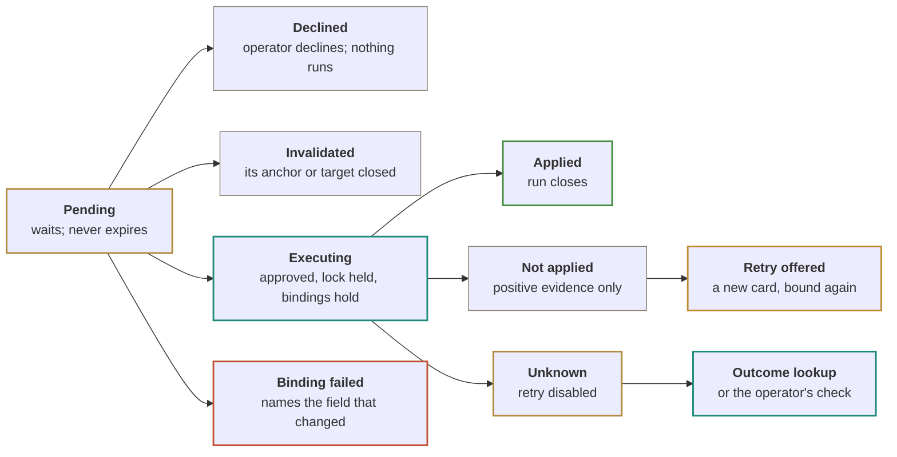
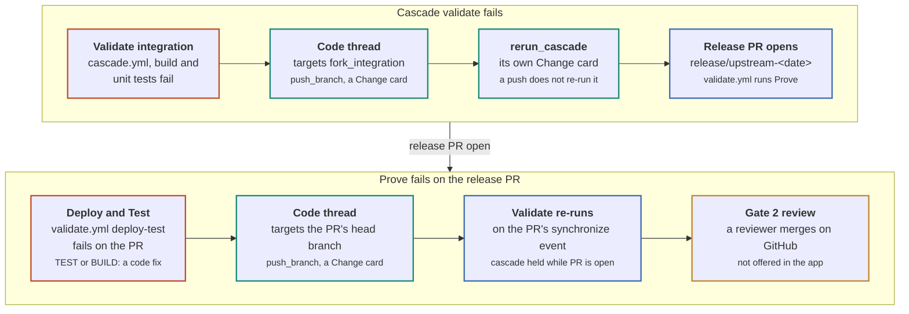

# SPI Code product requirements

*spi-code · product requirements · exploratory proposal*

What SPI Code must do at each milestone, how each requirement is checked, and which existing code each capability is built from.

Documents: [Product brief](spi-code-product-brief.md) · **Product requirements** (this page) · [Visual design](spi-code-visual-design.html) ([PDF](spi-code-visual-design.pdf)) · [Original combined design (PDF)](spi-code-design.pdf)

> The [original design](spi-code-design.pdf) describes SPI Code in one document: the product, its rules, its window and its build plan. It does not give requirements an ID, a milestone or a check. It also has a few claims that the source does not support, among them the fix path for a cascade that fails at Prove. That makes it hard to plan a milestone or know when one is done.
>
> This document restates the design as requirements. Each one has an ID, the milestone that ships it, and the check that proves it. It corrects the claims the source contradicts (appendix F). Appendix C maps each capability to the repository, file and symbol it comes from, and says whether SPI Code extracts, copies, ports, emulates or only references that code.
>
> Everything here is proposed; no SPI Code exists yet. Requirements say what must hold, not how a module is laid out, except where the boundary is the requirement. The questions in Open questions are not settled, and no requirement assumes an answer to them unless it says so.

**Diagram colors.** amber outline = Operator: asks, approves, reviews; teal outline = SPI Code: reads, plans, executes, records; blue outline = Outside systems: GitHub workflows; green, amber, red and gray outlines are card or run states.

**Tiers.** Every tool has one tier, which sets how it is approved.

| Tier | How it runs |
|---|---|
| **Read** | runs at once |
| **Local** | runs at once in a worktree |
| **Command** | one card per command, sandboxed |
| **Change** | one card, one call |
| **Consequential** | card plus the typed target name |
| **Not offered** | no tool exists |

## How to read the requirements

IDs are an area prefix and a number, such as `AU-04`. The milestone column names the first milestone that must satisfy the requirement; later milestones keep it. "Verified by" names the test or observation that closes it. A requirement that depends on an open question names it.

| Prefix | Area |
|---|---|
| `PS` | Program shape and views |
| `TH` | Threads and anchors |
| `CP` | Copilot runtime |
| `AU` | Authority, tiers and approvals |
| `EV` | Evidence and redaction |
| `RN` | Runs, intents and durability |
| `PB` | Playbooks |
| `CT` | Code threads, the command sandbox and SPI Code's own git |
| `ST` | Setup and tools |
| `PM` | Process model and packaging |
| `CO` | Core extraction and the rib |
| `NF` | Non-functional requirements |

## Program shape and views

The left tree follows the program's three nouns. Every view is rendered from the same core functions the rib uses, so parity with the rib console is the check.

| ID | Requirement | Milestone | Verified by |
|---|---|---|---|
| **PS-01** | The tree has Today, System (Template, Repositories, Releases), Stack (Shared environment), Services (Flow and Horizon, then one entry per service line), Threads, Runs and Setup, each with a status dot from the latest sweep. | M2 | Screenshot test on recorded Facts |
| **PS-02** | The six rib console views (Today, Repositories, Environment, Flow, Horizon, Releases) render in the middle panel with the same content the rib produces from the same Facts. | M2 | Parity test against `boards/console.ts` output on one recorded sweep |
| **PS-03** | Today shows the `buildBriefing` headline, facts, focus items in P0, P1, P2 order, and the ready line. | M2 | Fixture test on briefing output |
| **PS-04** | Selecting a queue item opens the inspector with its class, cause, effect and next action, and the actions the item offers. A disabled action states why, in place. | M2 | Component test per failure class |
| **PS-05** | Each service line shows its six stations as the rib defines them in `model/lines.ts`. | M2 | Parity test |
| **PS-06** | The upstream hold for a SNAPSHOT toolchain shows the rib's "Take it anyway" variant of Prepare and Start, with the hold reason on the card. | M4 | Tool test with a SNAPSHOT fixture |
| **PS-07** | The Stack view labels live cluster reads (from `spi status --json`, Flux, pods) apart from state inferred from workflow runs. | M6 | Screenshot test with both sources |

## Threads and anchors

| ID | Requirement | Milestone | Verified by |
|---|---|---|---|
| **TH-01** | Every thread has one anchor: the program, a tree branch, a service line, the stack, a queue item or a PR. | M3 | Store schema test |
| **TH-02** | A new session's first context is the anchor's `readItem` text and the sweep time it came from. | M3 | Fake-session test inspects the seeded message |
| **TH-03** | Typing in the composer on a console view starts a thread anchored to the current selection. The composer always shows the anchor. | M3 | Component test |
| **TH-04** | A thread's kind (operate or code) is fixed when it starts and shown in its header. The kind sets the session's `availableTools`. | M3 operate, M5 code | Fake-session test: an operate session cannot call a worktree tool |
| **TH-05** | When a thread owns a piece of work, every view that shows that work opens the thread instead of offering a new one. | M3 | Component test on queue row and inspector |
| **TH-06** | Tools that fit the anchor are offered first. Every tool stays reachable from any thread of the right kind. | M3 | Tool projection test |

## Copilot runtime

The host drives Copilot through `@github/copilot-sdk`, pinned. Keelson's Copilot provider already handles most session hazards and is the reference (appendix B).

| ID | Requirement | Milestone | Verified by |
|---|---|---|---|
| **CP-01** | The SDK's platform runtime is listed in `asarUnpack` and started over stdio by explicit path. In-process mode is never used. | M0 | Packaged smoke test on both platforms |
| **CP-02** | The client runs in empty mode with a `baseDirectory` under app data. MCP servers, agents, skills and instructions in the operator's `~/.copilot` are not visible to a session. | M0 | Smoke test with a user-level MCP server configured |
| **CP-03** | Each session gets its GitHub token from a `gitHubTokenProvider` that reads `gh auth token`. If M0 shows the provider is unfit, the host passes the token at client level and drops the warm client when the credential changes. No Copilot credential is written under app data. | M0 | M0 probe: start, list models, stream, account switch |
| **CP-04** | `availableTools` lists every allowed tool as `custom:<name>` and no built-in tool. Every SPI tool is registered with `defer: "never"`. | M0 | M0: every appendix A tool name reaches the model as a stub |
| **CP-05** | `onPermissionRequest` denies every kind. SPI tools set `skipPermission` and enforce policy in their handlers. | M0 | Fake-session test: a built-in tool request is refused |
| **CP-06** | The system message is seeded from the rib's Watch Officer prompt, then the anchor context and its sweep time. | M3 | Fake-session test |
| **CP-07** | After every resume, the host calls `session.setModel` with both the model and the reasoning effort. | M3 | Fake-session test asserts both arguments |
| **CP-08** | A resumed session waits for the previous one to release first. Warm clients are reference counted. A connection error restarts the runtime, resumes the session and marks the in-flight tool call cancelled. | M3 | Fake-session tests per hazard |
| **CP-09** | The model picker lists the models the operator's plan returns, with auto as the default. | M3 | Smoke test |

## Authority, tiers and approvals

Every action is a typed tool that builds its own command from validated arguments and declares one tier. A button, a playbook step and a Copilot call reach the same handler. Appendix A lists every tool with its binding and outcome lookup.

| ID | Requirement | Milestone | Verified by |
|---|---|---|---|
| **AU-01** | Each tool validates its arguments with zod, then runs the tier check in its handler before any outside call. Any error or unreadable answer in the check refuses the call. | M3 | Fake-session test per tier, with a throwing check |
| **AU-02** | A **Read** runs at once and is logged. A **Local** runs at once inside a code thread's worktree only. | M3, M5 | Tier table test |
| **AU-03** | A **Change** runs only after the operator approves its card. One card is one call. | M4 | Tier table test |
| **AU-04** | A **Consequential** tool runs only after the operator types the target's name into the card. It is never batched with another card. | M4 | Component and tool test |
| **AU-05** | Neither Copilot nor a playbook can approve a card. A button creates a card; it never writes. | M4 | Fake-session test: no tool or playbook step resolves a card |
| **AU-06** | On approval, the host takes the target's named lock, re-reads every binding field, and runs only if all of them hold. Otherwise the card moves to binding failed and names the field that changed. | M4 | Stale-binding test, live and recorded |
| **AU-07** | Merges are sent with `--match-head-commit`. `merge_pr` covers Dependabot and template PRs only. | M4 | Tool test moves the head between check and send |
| **AU-08** | Clearing maintenance checks what the lifecycle workflows check: no lifecycle run in flight, deployed ref equals the declared stack version, and `spi status` reports ready with maintenance as the only blocker. It does not require deployable. | M6 | Tool test with each condition false |
| **AU-09** | Each card has one id and one state in the approval store: pending, binding failed, executing, applied, not applied, unknown, declined or invalidated. The Approvals tab is one inbox with the same count everywhere. | M3 | Store test and screenshot test |
| **AU-10** | A card requested in a thread is decided in that thread's composer strip. A card requested by a button is decided on the card, in its run or in the inbox. | M4 | Component test |
| **AU-11** | No tool exists for anything in the **Not offered** row of appendix A, including merging cascade PRs, submitting review approvals, force pushes, reading Kubernetes Secrets and any guard bypass. | M3 | Tool registry test against the list |
| **AU-12** | No child process inherits `SPI_SKIP_GUARD` or another guard-bypass variable. | M4 | Environment test on every spawn path |

The lookup after Unknown resolves the card to Applied or Not applied. Time passing never counts as evidence that a write did not happen.

## Evidence and redaction

| ID | Requirement | Milestone | Verified by |
|---|---|---|---|
| **EV-01** | Every read result carries an envelope: source, observed time, completeness, and one state of fresh, stale, incomplete, failed or unread. | M2 | Collector tests |
| **EV-02** | A source is stale when its last good read is older than twice its sweep interval; incomplete when a page or size limit cut the read; failed when its latest read errored; unread when no read has succeeded since start. | M2 | Clock-driven unit tests |
| **EV-03** | Every view that draws a value shows its envelope. A value drawn only from inferred sources says "inferred" wherever it appears, including the title bar. | M2 | Screenshot test |
| **EV-04** | A write whose binding needs a deployable environment is refused when deployability is unread or sources disagree. The card names the disagreement and both values stay visible. | M4 | Tool test with conflicting fixtures |
| **EV-05** | Redaction strips tokens, keys, connection strings and kubeconfig credentials from every result before it reaches Copilot or SQLite. | M3 | Redaction corpus test |
| **EV-06** | Pod logs and `kubectl get` results have size limits. Kubernetes Secrets have no reader. | M6 | Tool tests |
| **EV-07** | The sweeper keeps a GraphQL point budget and slows before the limit. Setup shows the points left. | M2 | Collector test with a low budget |

## Runs, intents and durability

Everything that does work is a run: a verb from the inspector, a Copilot turn, a playbook, or a wait. A run is a SQLite row with an append-only event list, read by cursor.

| ID | Requirement | Milestone | Verified by |
|---|---|---|---|
| **RN-01** | Before any outside write, the host records an intent: tool, exact arguments, the binding it checked, and the facts that will identify the result. The intent closes with the result. | M4 | Crash test at each boundary |
| **RN-02** | If the app stops between intent and result, the run reopens as outcome unknown. Retry is offered only after the tool's outcome lookup says not applied. | M4 | Crash-test matrix for every write tool |
| **RN-03** | Text written to GitHub or GitLab (issue, MR, comment) carries the intent id in a hidden marker, so the lookup finds it exactly. | M4 | Lookup test |
| **RN-04** | A write to several targets keeps a ledger with one outcome per target and never retries a target that is applied or unknown. A target whose last write by the same tool is unknown is held out of new fleet actions and named. | M4 | Ledger test |
| **RN-05** | Waits (such as rerun-when-deployable) and pending verb or playbook cards survive a restart. A wait resumes its check on the next sweep. | M4 | Restart test |
| **RN-06** | A Copilot tool call in flight at a restart is marked cancelled, and Copilot is told so on the next turn. A sandboxed command stops with the host and needs a new card. | M3, M5 | Restart test |
| **RN-07** | Every call, including a Read, is logged with arguments, result size and duration. | M3 | Run log test |
| **RN-08** | Dispatch and creation lookups only match items created by the operator's own account. | M4 | Lookup test with another actor's run |

## Playbooks

Playbooks are TypeScript state machines on the run store, not a YAML engine, because Keelson's workflow approval pause is held in process memory and does not survive a restart (`packages/workflows/src/handlers/approval.ts`).

| ID | Requirement | Milestone | Verified by |
|---|---|---|---|
| **PB-01** | **Diagnose a failure** runs as an operate thread from any incident or failed lane. It reads the failed job, step, reason, annotations and logs, then core's attribution, the image digest and the pin owner, and from M6 Flux, pods and jobs. Copilot's finding cites each tool result, names the cause and names the verb that clears it. Read only. | M3, M6 | On recorded incidents, the cause matches the inspector's class |
| **PB-02** | **Hand off a fix** applies to items whose fix is a change on the fork's main branch. Copilot drafts an issue with the cited evidence. After approval the host opens it, assigns the Copilot coding agent, follows the PR, offers `approve_runs` when its workflows wait, and links the PR to the item. | M4 | Live run on one fork |
| **PB-03** | For a fix on `fork_integration`, a release branch or a template-owned file, the inspector offers a code thread instead of a handoff, and Diagnose suggests one. | M5 | Component test per item kind |

## Code threads

A code thread fixes code where the Copilot coding agent cannot, because the agent opens PRs against the default branch. It works in an app-owned worktree, carries the finding as context, and pushes through SPI Code.

### Where a cascade fix lands

The original design sent every cascade failure to `fork_integration` followed by a cascade re-run. The osdu-spi workflows at `d430769` show two different failure points, and only one of them is fixed that way.

The source for each step: `cascade.yml` runs Validate integration on `fork_integration` (line 400) and opens an issue when it fails (line 514). Its `check_state` job (lines 41 to 157) holds the cascade while any `release/upstream-*` PR is open. It creates the release branch as `release/upstream-$(date)` (lines 673 to 679). `validate.yml` runs the deploy gate (line 410) and Deploy and Test (line 486) on pull requests and pushes to `main`, `fork_integration` and `fork_upstream`. `integration-cleanup.yml` resets `fork_integration` to `main` after the release merges. An ENV or ACCESS failure at Prove is not a code fix; the rib offers a re-run once the stack is deployable, or names the image that cannot be pulled.

| ID | Requirement | Milestone | Verified by |
|---|---|---|---|
| **CT-01** | A code thread starts from a finding or inspector action, checks out the fork at the head the finding read, and carries the finding as context. Each fork is cloned once under app data and shared by its worktrees. | M5 | Worktree test |
| **CT-02** | The thread commits to a local `spi/*` branch and names its remote target. The target is `fork_integration` for a cascade validate failure and the release PR's head branch for a Prove failure on that PR. | M5 | Target-selection test per failure point |
| **CT-03** | One thread at a time holds the push lease for a remote branch. The header shows the branch, target, base and head. | M5 | Lease test with two threads |
| **CT-04** | `push_branch` pushes the exact commit, fast-forward only, refused unless the remote is still at the commit the card names. A push that changes `.github/` needs the PR number typed into the card. | M5 | Push test moving the remote between card and approval |
| **CT-05** | After a push, the thread watches the PR at the pushed commit: each required check and the review gate 2 needs. When checks pass it links to the PR for review. | M5 | Live run |
| **CT-06** | A worktree is kept until its branch merges, nothing in it is unpushed, and no thread, run or card uses it. | M5 | Cleanup test |
| **CT-07** | Commands run in an OS sandbox: Seatbelt on macOS, a restricted token on Windows. If the sandbox cannot start, the thread offers no commands. | M5 | Sandbox probe on both platforms |
| **CT-08** | A sandboxed command can write the worktree checkout only. The clone's git folder, hooks and config are read-only to it. | M5 | Sandbox test writes each path |
| **CT-09** | A sandboxed command gets its own home folder and an allow-listed environment with no `GH_TOKEN`, `GITHUB_TOKEN`, `AZURE_*`, `ARM_*` or `SSH_AUTH_SOCK`, and no credential helper. It cannot read the keychain, `~/.ssh`, `~/.kube`, `~/.azure` or the gh config. | M5 | Sandbox test reads each path |
| **CT-10** | Commands named `git push`, `gh`, `az`, `kubectl`, `spi`, `flux` or `helm` are refused. Network access stays on for Maven, and Settings states that limit. | M5 | Refusal test |
| **CT-11** | SPI Code's own commit, status, diff and push run outside the sandbox, name the clone's git folder directly, never follow the worktree's `.git` file, and run with hooks off and repository config ignored. | M5 | Test plants a hook, a config value and a repointed `.git` file |
| **CT-12** | Each worktree has a terminal drawer with two tabs: a read-only view of approved commands and their output, and the operator's own login shell outside the sandbox, labeled that way. SPI Code re-reads the worktree before it makes any card. | M5 | Component test and a manual commit picked up |

## Setup and tools

Setup is the first screen on first launch. It groups tools by what they unlock (Watch, Code, Operate) and gives each one state: checking, install, sign in, ready or attention. Appendix E is the tool manifest.

| ID | Requirement | Milestone | Verified by |
|---|---|---|---|
| **ST-01** | Single-binary tools install from a manifest with version, URL and SHA-256 per OS and architecture into the app's `tools/` folder. No Homebrew, WinGet or administrator rights. | M2 Watch tools, M5, M6 | Install test on a clean VM per platform |
| **ST-02** | uv provides Python under app data. The Azure CLI installs as `uv tool install azure-cli --with pip`, then the `k8s-configuration` extension. | M0 probe, M6 | Install test |
| **ST-03** | `spi` installs at the version the stack declares in `ops/environments/shared.yaml`. Setup flags a mismatch. | M6 | Mismatch fixture |
| **ST-04** | Tool processes get the app's tools first on PATH, then the PATH captured from the operator's login shell. `KUBECONFIG` and `AZURE_CONFIG_DIR` point at app-owned folders. Stray `GH_TOKEN` and `GITHUB_TOKEN` are removed unless Settings names one. | M2 | Environment test |
| **ST-05** | Sign-ins use each tool's own flow: gh through the browser with repo and workflow scopes, glab against `community.opengroup.org`, `az login` with the stack's tenant filled in. Tokens stay in each tool's store or the OS keychain. | M2, M6 | Manual check per tool |
| **ST-06** | Setup confirms a Copilot seat with a real session probe, and explains when a classic `ghp_` token is configured instead of the gh OAuth sign-in. | M2 | Probe test |

## Process model and packaging

| ID | Requirement | Milestone | Verified by |
|---|---|---|---|
| **PM-01** | The host runs apart from the main process and talks to the window over a MessagePort with zod-validated messages. No local network port is opened. | M0 | Port scan during smoke test |
| **PM-02** | The host is an Electron `utilityProcess` unless M0 shows the Copilot runtime or `node:sqlite` misbehave there on a signed build; then it is a Node child started with `ELECTRON_RUN_AS_NODE`. Only the chosen model is built. | M0 | M0 decision record |
| **PM-03** | A single-instance lock, a menu bar or tray presence, and a host restart after a crash that resumes from the last event cursor. | M2 | Kill-the-host test |
| **PM-04** | electron-builder produces dmg and zip for macOS arm64 and NSIS for Windows x64. macOS builds are Developer ID signed and notarized from M0. | M0 | CI artifacts |
| **PM-05** | Windows builds are signed with Azure Trusted Signing, and both platforms auto-update from GitHub releases. | M7 | Update from a prior release |
| **PM-06** | `node-pty` is rebuilt for the pinned Electron and signed with the app. | M5 | Packaged terminal smoke test |

## Core extraction and the rib

The SPI domain moves into `@spi-code/core`, in this repository, in two steps. The rib becomes a thin adapter that keeps its boards and Keelson lifecycle, so the live tab is the check that nothing changed.

| ID | Requirement | Milestone | Verified by |
|---|---|---|---|
| **CO-01** | Core holds Facts, the model, the briefing and `readItem`, with no Keelson, Bun or Electron dependency, and ships compiled JavaScript. | M1 | Dependency lint; build in plain Node |
| **CO-02** | Fleet membership, rollout policy, configuration and the clock are arguments, not module globals (today at `config.ts` 135 to 144 and 207 to 230, `model/rollout.ts` 91 to 95, `collect/fleet.ts` 237). | M1 | Two fleets in one test process |
| **CO-03** | `Bun.YAML.parse` (`collect/fleet.ts:41`) is replaced by the `yaml` package. `CanvasTone` (`model/gates.ts`, `model/lines.ts`) leaves the model. The Keelson `Verb` type (`act/verbs.ts:9`) is replaced by a core type. | M1, M2 | Type check without Keelson packages |
| **CO-04** | The domain tests move to core and run under vitest. Board and adapter tests stay in the rib. | M1 | All moved tests pass |
| **CO-05** | Collectors and action planning move to core behind an exec port. | M2 | Replay test with a recorded exec log |
| **CO-06** | From M2 the rib's sweep is off by default and its tab reads the last Facts it recorded. From M4 the rib's verbs are off. | M2, M4 | Rib config test |
| **CO-07** | The rib depends on a release tarball of core at a pinned version and bumps only when asked. | M1 | Rib lockfile |

## Non-functional requirements

| ID | Requirement | Milestone | Verified by |
|---|---|---|---|
| **NF-01** | **Security.** Copilot never gets a built-in shell, file, URL fetch, memory or subagent tool. In an operate thread it reads logs and reports only through `read_artifact`, which reads files the host saved for the current run. | M3 | Fake-session test |
| **NF-02** | **Secrets.** No credential is stored by SPI Code. Tokens stay in gh, glab, az and the OS keychain. | M0 | App data scan after sign-in |
| **NF-03** | **Durability.** No outside write is sent twice because of a crash. | M4 | Crash-test matrix |
| **NF-04** | **Store.** `node:sqlite` with tables for threads, messages, runs, run events, intents, approvals, waits, worktrees, leases and Facts snapshots. Facts snapshots are kept seven days. | M2 | Migration test |
| **NF-05** | **Platforms.** macOS arm64 and Windows x64. Windows is built and smoke-tested in CI from M0; hands-on Windows use starts at M7. | M0 | CI matrix |
| **NF-06** | **API budget.** One sweeper per fleet. The host shares GitHub's GraphQL budget with nothing else once the rib's sweep is off. | M2 | Budget log over a day |
| **NF-07** | **Appearance.** Light and dark Shore appearances, following the system unless Settings pins one. Text meets WCAG AA contrast in both. See the [visual design](spi-code-visual-design.html). | M2 | Palette validator in CI |
| **NF-08** | **Licensing.** SPI Code is MIT. Files copied from T3 Code keep T3 Tools Inc.'s MIT copyright and permission notice. Code from Keelson and the rib is relicensed to MIT by its author, who holds its copyright. The packaged app ships a third-party notices file covering T3 Code, the Copilot SDK and every bundled package. The same rules hold after the repository goes private. | M0 | License check in CI |
| **NF-09** | **SDK upgrades.** The SDK pin moves only after the fake-session suite and the packaged smoke test pass on both platforms. | M0 | CI gate |

## Milestone acceptance

Each milestone closes when its proof is observed. The proofs come from the original design, with the environment dispatch split made explicit.

| Milestone | Ships | Proof |
|---|---|---|
| **M0 Spike** | Electron shell, host, MessagePort contract, the SDK runtime unpacked and started by path, one gated SPI tool, `node:sqlite`. Signed and notarized macOS arm64; Windows x64 CI build. Install-only probe of uv, Python, azure-cli with pip and the k8s-configuration extension. A sandbox probe that runs `java -version` with the keychain and home config unreadable. | On a clean machine with no `~/.copilot`, both builds sign in through gh, list models through the per-session token, stream a turn, reach a stub for every appendix A tool, and refuse a denied call. A user-level MCP server is not visible. The host model and the runtime signing approach are recorded. |
| **M1 Core** | `@spi-code/core` with Facts, model, briefing and `readItem`. The rib consumes its tarball. | The moved tests pass under vitest, and the live Keelson tab renders the same Today on the same sweep. |
| **M2 Watch** | Collectors in core, sweeps in the host with a rate budget, the tree, six views, inspector, evidence envelope, Setup for Copilot, git, gh and glab. | Every view matches the rib console on one recorded sweep, then a day of live use with no Keelson sweeping. |
| **M3 Ask** | Anchored threads, read tools, redaction, approval cards, run log, Diagnose a failure on Actions evidence. | On recorded incidents, Diagnose names the inspector's cause and every claim cites a tool result. |
| **M4 Act** | The rib's eleven verbs plus `merge_pr`, `comment`, `open_issue` and `assign_coding_agent`, with bindings, locks, intents, lookups and durable waits. Hand off a fix. The rib's verbs off. Includes `dispatch_env_refresh` and `dispatch_env_upgrade`, which are rib verbs. | A stale binding is refused, a rerun-when-deployable wait survives a restart, and an interrupted write is resolved by lookup, not re-sent. |
| **M5 Code** | Worktrees and the push lease, worktree tools, the sandbox on both platforms, Command cards, `commit` and `push_branch`, the terminal drawer, JDK and Maven in Setup, the PR watch. | The sandbox blocks every path in CT-08 and CT-09, a push is refused when the remote moved, and one real fix goes from finding to green checks without leaving the app. |
| **M6 Operate** | Operate tools in Setup, `dispatch_env_reset` (new; no rib verb), maintenance, reconcile, service pin and reset through `spi`, read tools through `kubectl` and `flux`, GitLab MR tools, live cluster evidence. | One environment refresh and one service pin and reset run end to end with every Consequential step carded. Live reads are labeled apart from inferred state. |
| **M7 Team** | Azure Trusted Signing on Windows, auto-update, first-run welcome. | A second engineer installs from a release and reaches Watch without help. |

## Validation plan

None of these tests exist yet. Core keeps the rib's fixture tests for attribution, incident folding, pacing, release naming and briefing wording. The host is tested against recorded Facts replays, so a sweep is reproducible without GitHub. The agent runtime is tested against a fake SDK session that scripts tool calls: every tier answers as appendix A says, a tool missing from `availableTools` cannot be reached, and a policy error refuses the call. Durability tests stop the host before an intent is written, after it is written but before the call, and after the call but before the result. Sandbox tests try each blocked path and each git tamper, then check that SPI Code's commit and push ignore them. A packaged smoke test on both platforms starts the app, completes a scripted turn against a stub model, and screenshots each view in both appearances.

## Open questions

| Question | Consequence | Decided by, when |
|---|---|---|
| Should a Prove fix pushed to the release PR's head branch also be applied to `fork_integration`? | `integration-cleanup.yml` resets `fork_integration` to `main` after the release, so a back-port may be redundant. If the release PR is closed instead of merged, the fix is lost. | Maintainer, with the osdu-spi workflow owners, before M5 |
| utilityProcess or Node child for the host | PM-02 builds only one | M0 spike |
| Does the per-session `gitHubTokenProvider` hold up? | CP-03 falls back to a client-level token | M0 spike |
| Re-sign the SDK's runtime binary or keep GitHub's signature | Notarization and Gatekeeper prompts | M0 spike |
| Windows restricted-token sandbox | Without it, Windows code threads offer no commands (CT-07) | Probe at M0, proof at M5 |
| The SDK's `sandboxConfig` session option | It confines Copilot's built-in tools, not host-run commands. SPI Code exposes no built-in tools, so it may add nothing, or it may be a second wall if one slips through. It needs runtime support and must be re-supplied on a cold resume. | M0 spike, revisited at M5 |
| When the rib retires | Two codebases carry adapters until then | Maintainer, after a release cycle of daily use |
| Thread-wide approvals for repeated Change calls on one target | Fewer cards, wider grants | After v1, only if per-card approval proves tiring |
| When the repository goes private | Commits and builds published before then stay usable under MIT; only later versions are closed | Maintainer, by M7 |

## Reference detail

### Appendix A: operator tools, tiers, bindings and outcome lookups

| Tier | Tools | Binding re-read before running | Outcome lookup after an interruption |
|---|---|---|---|
| **Read** | `spi_brief`, `spi_watchstand`, `spi_incidents`, `spi_line`, `spi_stack`, `spi_template`, `spi_prs`, `spi_issues`, `spi_security`, `spi_radar`, `spi_release_notes`, `read_artifact`, `run_log`, `pr_diff`, `mr_diff`, `stack_status`, `stack_info`, `flux_state`, `pod_logs`, `k8s_get`, `az_show` | None | None; a read is repeated |
| **Local** | `read_file`, `search_files`, `edit_file`, `worktree_diff`, `commit` | Path resolves inside the worktree after links; commit goes to the thread's `spi/*` branch | Applied if the branch head is the new commit |
| **Command** | `run_command` | Worktree, folder and exact arguments on the card; sandbox profile started | None; a stopped command needs a new card |
| **Change** | `push_branch` | Worktree clean; remote at the expected commit; fast-forward; no `.github/` change unless the PR number is typed; this thread holds the lease | Remote at the pushed commit is applied; at the expected commit is not applied; else unknown |
| **Change** | `approve_runs` | The run waits for approval; the PR is open and its head matches the held run | Applied if the run left the waiting state after the intent time |
| **Change** | `rerun` (failed lanes) | Run id, attempt number, conclusion | Applied if the attempt number is higher than the bound one |
| **Change** | `merge_pr` (Dependabot or template PR) | Head and base SHA, mergeable, required checks green, required reviews present, not draft; sent with `--match-head-commit` | Merged at the bound head is applied; open and unmerged at the bound head with no merge queued is not applied; else unknown |
| **Change** | `sync_template` (one fork), `sync_upstream` (prepare, including the SNAPSHOT "take it anyway" variant), `dispatch_cascade`, `rerun_cascade`, `fleet_release` | No run of the same workflow queued or running; template main SHA; the tracking issue is open | The run URL from `gh workflow run` is stored and read back. Without one, a matching run by the operator after the intent time is a candidate and the outcome stays unknown until confirmed |
| **Change** | `dispatch_env_refresh`, `dispatch_env_upgrade` | No lifecycle run in flight; declared version; tenant, subscription and cluster on the card; deployability evidence fresh, complete and in agreement | The dispatch lookup above, on the stack repository |
| **Change** | `open_issue`, `open_pr`, `open_upstream_mr`, `comment` | Target repository or thread exists and is open | Applied if an item with the intent marker exists |
| **Change** | `assign_coding_agent` | Issue open; not already assigned to the agent | Applied if the agent is an assignee |
| **Consequential** | `sync_all_forks`, `roll_out`, `start_upstream` (including "take it anyway") | Per target: head SHA and checks, `--match-head-commit` where it merges; core's pacing and ordering guards; lane capacity | Per target, by the merge and dispatch lookups, in the run's ledger |
| **Consequential** | `dispatch_env_reset` | Same as refresh and upgrade | The dispatch lookup |
| **Consequential** | `stack_reconcile` (plain, refresh-images) | Cluster on the card; no lifecycle run in flight; variant on the card | Intent records the reconcile annotation (and the image lock for refresh-images). Applied if the annotation now parses to a later time (spi writes local time) and differs; else unknown. A resend is offered once confirmed, since reconcile is a trigger |
| **Consequential** | `stack_reconcile` (resume) | Cluster on the card; source suspended; no lifecycle run in flight | Applied if the source reads not suspended |
| **Consequential** | `maintenance_set`, `maintenance_clear` | Set: maintenance not set, no lifecycle run. Clear: AU-08 | Applied if `spi status` reports the new state |
| **Consequential** | `service_pin`, `service_reset` | Cluster, service, digest, current pin owner; deployability evidence fresh, complete and in agreement | Applied if live digest and pin owner match the intent |
| **Not offered** | Commands outside a code thread's sandbox; `git push`, `gh`, `az`, `kubectl`, `spi`, `flux` or `helm` as commands; merging a cascade PR; submitting a review approval; squash-merging release or upstream branches; force push; repository secrets; reading Kubernetes Secrets; `spi info --show-secrets`; `stack_reconcile --suspend`; any guard bypass | | |

*Environment refresh and upgrade move from Consequential in the original design to Change here, because the rib already ships them as single-target GitHub dispatches at M4. Whether they should stay Consequential is a tier decision for the maintainer; the binding is the same either way. When a lookup itself fails, the outcome is unknown and retry stays disabled.*

### Appendix B: Copilot session checklist

| Behavior | Handling | Reference |
|---|---|---|
| Disconnect is asynchronous | Wait for the previous session to release before resuming. Resuming early closes the new session. | `provider.ts` `waitForSessionRelease`, lines 982 to 1004 |
| Resume ignores model and effort | Call `session.setModel(model, { reasoningEffort })` after every resume. | `provider.ts` lines 685 to 688 |
| Warm clients are shared | Reference count, so a retry on one thread never stops a client another thread is streaming on. | `provider.ts` lines 98 to 113 and 280 to 350 |
| Connection errors | Match the SDK's connection errors, restart the runtime, resume, mark the in-flight call cancelled. | `provider.ts` lines 571 to 574 |
| Operator's own Copilot setup | Empty mode, app-owned base directory, `availableTools` on every session. | SDK `types.d.ts` lines 236 to 305 and 2247 to 2255 |
| Sign-in under empty mode | Per-session token provider reading `gh auth token`; fallback to a client-level token. | SDK `types.d.ts` lines 24 to 36 and 2625 to 2638; Keelson `factory.ts` `createClient` |
| Thread kinds | `availableTools` set from the kind at session start. | Keelson `permission-gate.ts` `buildSessionToolFilter` |
| Tool deferral | `defer: "never"` on every SPI tool. | SDK `types.d.ts` lines 583 to 604 |
| Cold resume | Re-supply every session option, including `sandboxConfig` if adopted. | SDK `types.d.ts` lines 2602 to 2608 and 2791 to 2810 |

### Appendix C: source and borrow map

Each row names where a capability already exists and what SPI Code does with it. Line numbers were read at the commits in the brief's Built from table. Paths are relative to each repository's root.

*Extract: move with tests into `@spi-code/core`. Copy: take the file, keep its notice. Port: rewrite without the source's framework. Emulate: build the concept fresh. Depend: pinned package. Reference: read only.*

### SPI domain, from keelson-rib-spi

| Capability | Source | Action | Notes |
|---|---|---|---|
| Facts and the sweep | `src/facts.ts` (453 lines), `src/sweep.ts` (564) | **Extract** | Cadence in `src/config.ts` lines 232 to 236 |
| Fleet configuration | `src/config.ts` lines 24 to 112 (13 services) | **Extract** | Module globals become arguments (CO-02) |
| GitHub collector | `src/collect/github.ts` (495) | **Extract** M2 | GraphQL budget at lines 115 and 143 to 155 |
| Fleet collector | `src/collect/fleet.ts` (243) | **Extract** M2 | `Bun.YAML.parse` at line 41 becomes `yaml` |
| Queue and gates | `src/model/queue.ts` (1,337) | **Extract** | Gate 2 is the `release/upstream-*` PR, lines 550 to 568 |
| Service lines and stations | `src/model/lines.ts` (462), stations at line 37 | **Extract** | Drop `CanvasTone` at lines 9 and 76 |
| Failure attribution | `src/model/attribution.ts` (195), `FailureClass` | **Extract** | Ten classes: ENV, ACCESS, TEST, HALT, TOOLCHAIN, CONFLICT, POLICY, INFRA, BUILD, UNREAD |
| Next action wording | `src/model/next.ts` (227), `failureNext` | **Extract** | INFRA names a GitHub re-run; TEST names the Prove suites |
| Radar, upstream, rollout, stack | `src/model/radar.ts` (465), `upstream.ts` (725), `rollout.ts` (607), `stack.ts` (748) | **Extract** | `rollout.ts` globals at lines 91 to 95 |
| Briefing and thread context | `src/brief/index.ts` (1,392), `buildBriefing`, `readItem` | **Extract** | `readItem` seeds every thread (TH-02) |
| Verb planning | `src/act/verbs.ts` (143), `path.ts` (178), `approve.ts`, `flow.ts`, `rerun.ts`, `rollout.ts`, `upstream.ts` | **Extract** M2 | Eleven verbs: `APPROVE_RUNS`, `FLEET_RELEASE`, `RERUN_LANES`, `DISPATCH_REFRESH`, `DISPATCH_UPGRADE`, `SYNC_FORKS`, `ROLL_OUT`, `PREPARE`, `START`, `DISPATCH_CASCADE`, `RERUN_CASCADE`. SNAPSHOT "take it anyway" in `upstream.ts` lines 347 to 380 |
| gh execution | `src/forge.ts` lines 44 to 80; `src/act/path.ts` lines 141 to 145 | **Port** | Becomes the host's exec port with the scoped environment |
| Read tools | `src/tools.ts` (581), eleven `spi_*` tools | **Extract** | Register as Read-tier SPI tools |
| System prompt | `src/agent.ts` lines 12 to 48, Watch Officer | **Copy** | CP-06 |
| Console views | `src/boards/console.ts` (785), views at line 764 | **Reference** | Parity target for PS-02; boards stay in the rib |
| Tests | 469 tests in 28 files, bun:test (run at `59d6895`) | **Extract** | Switch to vitest (CO-04) |

### Agent runtime and durability, from Keelson and the SDK

| Capability | Source | Action | Notes |
|---|---|---|---|
| Session lifecycle | Keelson `packages/providers/src/copilot/provider.ts` | **Port** | Appendix B line references; the provider is 2,510 lines across its folder |
| Client and token | Keelson `packages/providers/src/copilot/factory.ts` `createClient`, lines 575 to 590 | **Port** | Client-level token fallback (CP-03) |
| Permission gate and tool filter | Keelson `copilot/permission-gate.ts` (144) `buildPermissionGate`, `buildSessionToolFilter`; `tool-names.ts` (156) `GATED_KINDS` | **Port** | SPI Code denies every kind (CP-05) |
| Pre and post tool hooks | Keelson `copilot/hooks-shim.ts` (140) | **Reference** | For run logging (RN-07) |
| SDK sandbox mapping | Keelson `copilot/sandbox.ts` (113) `toCopilotSandboxConfig` | **Reference** | Open question on `sandboxConfig` |
| Auth probe | Keelson `copilot/registration.ts` (72) | **Port** | Seat check (ST-06) |
| Agent runtime | `@github/copilot-sdk` 1.0.26, `dist/types.d.ts`; `SandboxConfig` in `dist/generated/rpc.d.ts` | **Depend** | MIT; ships `docs/` with examples |
| Durable ops with cursor reads | Keelson `apps/server/src/op-store.ts` (302) `createOpStore`, `OpStatus`; `op-tools.ts` (255); `packages/shared/src/memory.ts` lines 402 to 431 | **Emulate** | Keelson uses `bun:sqlite`; SPI Code uses `node:sqlite` |
| Client effects from actions | Keelson `packages/shared/src/rib.ts` `ribClientEffectSchema`, around line 961 | **Emulate** | Open the inspector, a run or a thread |
| Playbook shapes | Keelson `packages/workflows/assets/workflows/investigate.yaml`, `plan-act-evaluate.yaml` | **Emulate** | As TypeScript state machines (PB) |
| Workflow approval pause | Keelson `packages/workflows/src/handlers/approval.ts` lines 10 to 24 | **Reference** | Process-local; the reason not to port the engine |
| Copilot over ACP | T3 Code `packages/provider-acp-registry/src/server/copilotAcp.ts` | **Reference** | Alternative not chosen (appendix H) |

### Desktop shell and Setup, from T3 Code

| Capability | Source | Action | Notes |
|---|---|---|---|
| Login-shell PATH capture | `apps/desktop/src/shell/DesktopShellEnvironment.ts` (677 lines, 16 Effect imports) | **Port** | ST-04 |
| App lifecycle, single instance | `apps/desktop/src/electron/ElectronApp.ts` (253, 5 Effect imports) | **Port** | PM-03 |
| Backend supervision and restart | `apps/desktop/src/backend/DesktopBackendManager.ts` (1,168), `DesktopBackendConfiguration.ts` | **Port** | T3 runs a Node child; PM-02 |
| PTY | `apps/server/src/terminal/NodePtyAdapter.ts` (285) | **Port** | CT-12, PM-06 |
| Verified installs and readiness | `apps/server/src/provider/CodexInstallation.ts` (837), `AntigravityInstallation.ts`, `providerInstallation.ts` | **Port** | ST-01; readiness states for Setup |
| Release, signing, notarization | `.github/workflows/release-desktop.yml`, `scripts/build-desktop-artifact.ts`, `docs/operations/release.md` | **Emulate** | PM-04, PM-05; electron 44.10.1, electron-builder 26.16.1 |
| License notices | `docs/internals/open-source-licenses.md` | **Reference** | NF-08 |

*Window components and theme sources are mapped in the [visual design](spi-code-visual-design.html), appendix A.*

### Fork workflows and the stack CLI

| Capability | Source | Action | Notes |
|---|---|---|---|
| Cascade | osdu-spi `.github/template-workflows/cascade.yml` | **Reference** | `check_state` lines 41 to 157; Validate integration line 400; failure issue line 514; release branch lines 673 to 679 |
| Prove | osdu-spi `.github/template-workflows/validate.yml` | **Reference** | Deploy gate line 410; Deploy and Test line 486; the push trigger ignores most of `.github/`; PR triggers have no path filter |
| Integration reset | osdu-spi `.github/template-workflows/integration-cleanup.yml` | **Reference** | Resets `fork_integration` to `main` |
| Recovery procedure | osdu-spi `doc/src/workflows/cascade.md` | **Reference** | Source for Diagnose's next steps |
| `spi` commands | osdu-spi-stack `src/spi/cli.py` | **Depend** | status, info, reconcile, maintenance set and clear, service pin, reset, refresh, update |
| Guard bypass | osdu-spi-stack `src/spi/guard.py` lines 18, 91, 94 `SPI_SKIP_GUARD` | **Reference** | AU-12 |
| Declared stack version | osdu-spi-stack `ops/environments/shared.yaml` `stackVersion` | **Reference** | ST-03 |

### Appendix D: repository layout and stack

| Part | Choice |
|---|---|
| Repository | `spi-code`, a pnpm monorepo: `apps/desktop` (Electron main and preload), `apps/window` (renderer), `packages/core`, `packages/host` (sweeper, runtime, policy, runs, store), `packages/contracts` (zod message schemas), `packages/tools` (manifest and installers) |
| Runtime and tests | Node as shipped in a pinned Electron. pnpm with a hoisted layout for electron-builder. vitest across the repository. Bun cannot load `node:sqlite`, so it is not used. |
| Window | React 19, Vite, Tailwind v4, Base UI primitives wrapped as T3 Code wraps them, Zustand stores fed by host events. No Effect, so zod is the one validation style. |
| Lint and format | Biome, matching the rib and Keelson (`biome.json`). |

### Appendix E: tool manifest

| Tool | Group | Install | Sign-in |
|---|---|---|---|
| Copilot runtime | Watch | Inside the app (SDK platform package) | The gh OAuth token, per session; needs a Copilot seat |
| git | Watch | macOS: Xcode command line tools prompt. Windows: PortableGit into `tools/` | gh as credential helper for SPI Code's own git; none in the sandbox |
| gh | Watch | Release archive into `tools/`, checksum verified | `gh auth login --web`, repo and workflow scopes |
| glab | Watch | Release archive, checksum verified | Login against `community.opengroup.org` |
| JDK 25, Maven | Code | Release archives, checksum verified; one Maven repository under app data | None |
| uv, Python | Operate | uv binary into `tools/`; uv-managed Python under app data | None |
| az | Operate | `uv tool install azure-cli --with pip`; `az extension add -n k8s-configuration` | `az login --tenant` with an app-owned `AZURE_CONFIG_DIR` |
| spi | Operate | uv tool install of the stack release wheel at the declared version (`v0.35.1` at `32a7949`) | Uses az and the app kubeconfig |
| kubectl, kubelogin, flux, helm | Operate | Release binaries, checksum verified; kubectl matched to the cluster's version skew | Azure session, app kubeconfig |

### Appendix F: corrections to the original design

| Original claim | What the source shows | Where it lands here |
|---|---|---|
| A Prove failure is fixed on `fork_integration`, then the cascade is re-run | Prove runs on the release PR, and the cascade is held while that PR is open. Only a Validate integration failure is fixed on `fork_integration`. | Code threads, CT-02, open question on back-porting |
| Re-run is offered for an "Environment" failure | The class is `ENV`; `INFRA` also names a re-run; `BUILD` is a tenth class | Appendix C, visual design inspector |
| Call `setModel` after every resume | Keelson passes reasoning effort with it; the original omitted effort | CP-07 |
| `dispatch_env_reset` is a rib verb moved at M4 | The rib has refresh and upgrade only | Milestone acceptance M4 and M6 |
| Prepare and Start have no hold override | The rib offers "Take it anyway" for a SNAPSHOT hold | PS-06, appendix A |
| T3 Code is about 650k lines | About 810k TypeScript lines at `43bf0babd4` | Appendix H |
| The role set is T3 Code's, cut down, and includes success | T3 Code's `THEME_COLOR_ROLES` (`packages/shared/src/themePalettes.ts:30`) has error, warning and update roles but no success role; SPI Code adds one | Visual design, roles |

### Appendix G: after version 1

| Item | Shape |
|---|---|
| Drive a PR to green | Playbook: read checks, classify with core attribution, re-run ENV-class failures once, hand code fixes to the coding agent, wait, repeat up to a round limit. The merge stays its own card. |
| Upgrade the stack | Playbook: declaration diff, bump PR, wait for merge, env-upgrade card, follow maintenance, verify revision, gateway and smoke, draft the consumer note. |
| Provisioning and data writes | `spi up` (including `--dry-run`, which creates a resource group), `spi down`, Bicep, entitlements, data loads. First provisioning needs a binding that expects the environment to be absent. |
| Container builds | A container engine for local `spi build` and paired tests. |
| macOS x64, release-notes PDF | The SDK ships a darwin-x64 runtime. A PDF would use `webContents.printToPDF`. |

### Appendix H: alternatives not chosen

| Alternative | Why not |
|---|---|
| Fork T3 Code and strip it | About 810k TypeScript lines built for many providers and remote use, with Effect throughout and heavy upstream churn. Its packages are private, so nothing can be depended on. Copying Effect-free files and porting the rest gets the same pieces. |
| Tauri, or Swift and WinUI | The domain, the SDK and the rib's tests are TypeScript on Node. Tauri would still need a Node sidecar; two native UIs double the window work. |
| Copilot through ACP, as T3 Code does | ACP takes client tools only as an MCP HTTP server. The SDK registers tools in the host with no server to secure. |
| Host as a localhost WebSocket server | Only needed for remote clients. A MessagePort gives the same separation with no port and no token. |
| Port Keelson's YAML workflow engine | Bound to Bun, and its approval pause does not survive a restart. |
| A general command tool | A wrapper, interpreter or script defeats classification by binary and verb. |
| Copilot's built-in file reads with path limits | A second file policy beside the tools. `read_artifact` keeps one boundary. |
| Core inside the rib repository | From M2 the host drives core's changes; every host change would wait on a rib release. |
| Copy the domain and retire the rib now | Loses the live tab as the parity check and leaves two diverging copies. |
| Code changes only through the coding agent | The agent opens PRs against main, so it cannot fix `fork_integration`, release branches or template-owned files. |
| A command allowlist by name | A started command and its children run anything; the sandbox holds for every process. |
| Merging cascade PRs in the app | Gate 2 is a human review on GitHub. |
| Homebrew and WinGet installs | A clean Mac has no Homebrew, and WinGet can need elevation. |

### Appendix I: risks

| Risk | Handling |
|---|---|
| Copilot runtime in a signed, packaged app | Proved at M0 on a notarized build. A Node child is the host fallback. |
| SDK shape changes | Pinned version, fake-session suite, Keelson's provider as a second reference. |
| GitHub API budget | Core keeps its batching; the host budget slows sweeps first; Setup shows points left. |
| Coding agent cannot do the work | Handoff only for main-branch changes; the issue carries the evidence for a code thread to take over. |
| Windows command sandbox | Probed at M0, proved at M5. Without it, no commands on Windows. |
| Data leaving through an approved command | Network stays on for Maven. Each card shows the exact command; the sandbox holds no credentials to send. |
| Rib and app both acting | Rib verbs off at M4; both pin the same core. |
| Porting Effect code introduces bugs T3 Code fixed | Port from the file at a recorded commit, and carry T3 Code's tests for that behavior where they exist. |
