# SPI Code product brief

*spi-code · product brief · exploratory proposal*

A macOS and Windows desktop app for running the OSDU SPI program, with GitHub Copilot as its only agent, built from the SPI domain already proven in keelson-rib-spi.

Documents: **Product brief** (this page) · [Product requirements](spi-code-prd.md) · [Visual design](spi-code-visual-design.html) ([PDF](spi-code-visual-design.pdf)) · [Original combined design (PDF)](spi-code-design.pdf)

> Running SPI today takes four tools and an agent that knows nothing about the program. The keelson-rib-spi console in Keelson reads the program well: about 23,000 lines and 469 tests cover failure attribution, incident folding, the upstream radar and template rollout. It writes only to GitHub, and only through board buttons. Stack work happens in a terminal with `spi`, `kubectl` and `az`. Upstream work happens in `glab` or the browser. Rerun-when-deployable waits and workflow approval pauses are lost when Keelson restarts. Setup means installing Bun, Keelson and seven command-line tools by hand.
>
> SPI Code is one Electron app. The SPI domain moves out of the rib into `@spi-code/core`, which the rib and the app both use. A host process runs the sweeps, drives Copilot through `@github/copilot-sdk`, runs every operator action as a typed tool with a declared tier, and records runs, approvals and write intents in SQLite so a restart never loses a wait or repeats a write. A three-pane window shows the program tree, a console view or an agent thread, and an inspector. The app installs, versions and signs in the tools it needs.
>
> SPI Code supports one agent provider and has no MCP server, CLI or plugin system. It does not target Linux, replace the `spi` CLI or the fork workflows, or stand in for a human review gate. Its picture of the environment is no stronger than its evidence: every view says when a source is unread, and a write that needs a deployable environment is refused while evidence is missing or in conflict. The design is a proposal; nothing in this repository is built yet.

**Diagram colors.** amber outline = Operator: asks, approves, decides; teal outline = SPI Code: reads, plans, executes, records; violet outline = Copilot: reasons and proposes tool calls; blue outline = Outside systems: GitHub, GitLab, Azure, the cluster; dashed outline = installed and carried by SPI Code, not its own logic.

## Who it serves

The first user is the SPI program operator: the person who keeps 13 service forks in step with upstream OSDU, keeps the shared `spi-stack` environment deployable, and moves template and dependency changes across the fleet. That person already works the rib's Today queue every day. The second user, from M7, is another engineer who installs a signed release and reaches the same view without help.

Both users already hold the sign-ins the work needs: a GitHub account with a Copilot seat and write access to the forks, a GitLab account on `community.opengroup.org`, and Azure access to the stack's tenant. SPI Code uses those sign-ins and adds none of its own.

## What changes for the operator

| Job | Today | With SPI Code (proposed) |
|---|---|---|
| See what needs attention | Keelson SPI tab: briefing, queue, six console views | The same views, from the same domain code, in the app's program tree |
| Understand a failure | Read the inspector, then open Actions logs by hand | An anchored thread where Copilot reads the job, logs and attribution and cites each result |
| Act on GitHub | Eleven board verbs, no record that survives a restart | Typed tools with tiers, bindings re-read under a lock, and an intent ledger |
| Fix code on `fork_integration` or a release branch | Clone, edit, test and push from a terminal | A code thread in an app-owned worktree, commands in an OS sandbox, the push as an approval card |
| Operate the stack | `spi`, `kubectl`, `flux` and `az` in a terminal | Read tools at once; Consequential tools only after the operator types the target's name |
| Work upstream | `glab` or the GitLab web UI | MR reads and typed MR tools in the same thread |
| Set up a machine | Bun, Keelson and seven CLIs installed by hand | Setup installs each tool from a checksum manifest and walks each sign-in |

## Product shape

The window renders state that lives in the host. The host owns every outside call, so the window and Copilot never reach GitHub, GitLab or Azure directly.

```mermaid
flowchart LR
  OP["<b>Operator</b><br/>asks, approves,<br/>types target names"]:::operator
  WIN["<b>Window</b><br/>Program tree<br/>Console view or thread<br/>Inspector, Approvals, Log<br/>Composer with anchor<br/><small>React, Base UI, Zustand</small>"]:::spi
  subgraph HOST["Host process"]
    direction TB
    CORE["<b>@spi-code/core</b><br/>Facts, model,<br/>attribution, briefing"]:::spi
    COP["<b>Copilot runtime</b><br/>copilot-sdk over stdio,<br/>proposes tool calls"]:::copilot
    POL["<b>Policy and tools</b><br/>tiers, bindings, named locks,<br/>intents, redaction"]:::spi
    DB["<b>SQLite store</b><br/>runs, approvals, waits"]:::spi
    CLI["<b>Installed tools</b><br/>gh, glab, az, spi,<br/>kubectl, flux, helm"]:::carried
  end
  EXT["<b>Outside systems</b><br/>GitHub: 13 forks, template, stack repo<br/>GitLab upstream<br/>Azure and the AKS cluster behind spi-stack<br/>Copilot service"]:::outside
  OP --> WIN
  WIN -- MessagePort --> HOST
  HOST --> EXT
  classDef operator stroke:#c08a2e,stroke-width:2px
  classDef spi stroke:#1b8a7a,stroke-width:2px
  classDef copilot stroke:#7e4cba,stroke-width:2px
  classDef outside stroke:#3f6fb0,stroke-width:2px
  classDef carried stroke:#8a8270,stroke-width:1px,stroke-dasharray:4 3
  classDef bad stroke:#c0502f,stroke-width:2px
  classDef warn stroke:#b08a3a,stroke-width:2px
  classDef ok stroke:#3f8a37,stroke-width:2px
  classDef mute stroke:#8a8270,stroke-width:1px
```

The program tree follows the program's three nouns, not repositories or chat sessions: **System** (the osdu-spi template, fork repositories, releases), **Stack** (the shared environment) and **Services** (13 service lines, Flow, Horizon), with Today on top and Threads, Runs and Setup below. The [visual design](spi-code-visual-design.html) shows the window.

## Product rules

These rules hold across every feature. The [PRD](spi-code-prd.md) states each as a requirement with its test.

- **Copilot proposes; it never approves.** A Copilot tool call, a playbook step and a button press all go through the same handler check. Neither Copilot nor a playbook can approve a card.
- **A button never writes.** It creates an approval card, and the card holds the decision.
- **Every action is a typed tool with one tier.** Read, Local, Command, Change or Consequential. Anything not in the tool table has no tool.
- **Bindings are checked twice.** A write runs only if the facts it was approved against still hold when the target's lock is taken.
- **Evidence carries its age.** Fresh, stale, incomplete, failed or unread, shown wherever a value is drawn. Inferred values say so.
- **A write is never re-sent blind.** After an interruption, the host looks up the outcome first.
- **Code runs without credentials.** Commands in a code thread run in an OS sandbox with no tokens, keychain, SSH agent or kube config. SPI Code makes the commits and the push.

## Built from

SPI Code is assembled from code that already runs. The table names each source and what SPI Code takes from it. The PRD's appendix C maps every capability to a file and symbol in these sources.

| Source | Where | License | What SPI Code takes, and how |
|---|---|---|---|
| **keelson-rib-spi** 1.6.0 | `github.com/danielscholl-osdu/keelson-rib-spi` at `59d6895`; local `/Users/danielscholl/keelson/keelson-rib-spi` | Apache-2.0; MIT in SPI Code (same author) | **Extract** The whole SPI domain into `@spi-code/core`: Facts, model, attribution, briefing and `readItem`, collectors, verb planning, the Watch Officer prompt. The live rib tab stays the check that nothing changed. |
| **Keelson** | `github.com/danielscholl/keelson` at `da5da474`; local `/Users/danielscholl/keelson/keelson` | Apache-2.0; MIT in SPI Code (same author) | **Copy** Shore design tokens and the palette validator. **Port** Copilot provider session handling. **Emulate** durable ops with cursor-read events, rib client effects, workflow shapes. |
| **T3 Code** | `github.com/pingdotgg/t3code` at `43bf0babd4`; local `/Users/danielscholl/source/github/t3code` | MIT | **Copy** Effect-free React components: right-panel tabs, approval strip and row, work log, changed-files tree. **Port** code that imports Effect: the command palette, terminal drawer and sidebar, plus desktop and server code (login-shell PATH, installers, backend supervision, PTY). **Emulate** layout, theme role model, release pipeline. |
| **@github/copilot-sdk** 1.0.26 | npm; read at `keelson/node_modules/.bun/@github+copilot-sdk@1.0.26` | MIT | **Depend** The agent runtime, pinned, with its platform binary unpacked and started over stdio. |
| **osdu-spi** | `github.com/Azure/osdu-spi` at `d430769` | Apache-2.0 | **Reference** The fork workflows SPI Code reads and dispatches: cascade, validate, sync, integration cleanup. SPI Code does not change them. |
| **osdu-spi-stack** | `github.com/Azure/osdu-spi-stack` at `32a7949` | Apache-2.0 | **Depend** The `spi` CLI, installed at the version the stack declares, called by the Operate tools. |

*Extract: move the code with its tests. Copy: take the file and keep its license notice. Port: rewrite the behavior without the source's framework (T3 Code's Effect, Keelson's Bun). Emulate: build the same concept from scratch. Depend: ship as a pinned package. Reference: read, never modify.*

## License

SPI Code is MIT-licensed from its first commit. Keelson and keelson-rib-spi are Apache-2.0, and SPI Code's author holds their copyright: every human commit in both repositories is his, and the rest are Dependabot and GitHub Actions. Code extracted, copied or ported from them enters SPI Code under MIT, with an MIT header naming Daniel Scholl in each file; `AGENTS.md` gives the header. The source repositories keep Apache-2.0. T3 Code and the Copilot SDK are MIT already. osdu-spi and osdu-spi-stack are read and called, not copied, so their terms do not reach SPI Code's source.

The plan is to make SPI Code private if it works. MIT allows that. Copied T3 Code files keep T3 Tools Inc.'s copyright and permission notice, and the packaged app ships a third-party notices file, whether the repository is public or private. Making the repository private stops only later versions: any commit or build published under MIT stays usable under MIT by whoever has it. If no public window is wanted, the repository starts private.

## Milestones

Each milestone ships something the operator uses. M0 and M1 run in parallel. Signing starts at M0 because hardened-runtime failures on the Copilot binary only appear in a signed build.

| Milestone | The operator gets | Done when |
|---|---|---|
| **M0 Spike** | Nothing yet; the risky parts are proven | A notarized macOS build signs in through gh, streams a Copilot turn, reaches every tool stub and refuses a denied call; the Windows CI build passes the packaged smoke test against a stub model |
| **M1 Core** | The rib running on `@spi-code/core` | No test is lost in the move, and the rib's console renders byte-identical output from recorded Facts before and after the switch |
| **M2 Watch** | The app replaces the Keelson tab for reading | Every view matches the rib console on the same Facts, then a day of live use with no Keelson sweeping |
| **M3 Ask** | Anchored threads and Diagnose a failure | On recorded incidents, Diagnose names the inspector's cause and cites a tool result for every claim |
| **M4 Act** | GitHub actions with approvals, bindings and durable waits; Hand off a fix | A stale binding is refused, a wait survives a restart, an interrupted write is resolved by lookup |
| **M5 Code** | Code threads with sandboxed commands and app-made pushes | One real fix goes from finding to green checks without leaving the app |
| **M6 Operate** | Stack, cluster and GitLab tools | One environment refresh and one service pin and reset run end to end, every Consequential step carded |
| **M7 Team** | Signed Windows build, auto-update, first-run welcome | A second engineer installs from a release and reaches Watch without help |

## Measures of success

- The operator stops opening Keelson's SPI tab after M2, and the rib's sweep stays off.
- From M4, no SPI action on GitHub is taken outside the app, and every one has a run with its outcome.
- No write is ever sent twice after a crash. The M4 crash-test matrix checks this for every write tool.
- Diagnose agrees with the deterministic attribution on recorded incidents, and every claim cites a tool result.
- A cascade or release-branch fix needs no terminal from M5.
- A second engineer reaches a working Today from a clean machine at M7.

## Not in version 1

These are decided exclusions. Items still being decided are under Open questions.

- A second agent provider, an MCP server, a CLI or a plugin system.
- Linux builds, and Intel macOS builds (packaging work if someone needs them).
- Provisioning: `spi up`, `spi down`, Bicep, entitlement changes and data loads.
- Merging cascade PRs or submitting review approvals. Gate 2 stays a human review on GitHub.
- Local container builds.
- Playbooks beyond Diagnose a failure and Hand off a fix.

## Open questions

| Question | Why it matters | Settled by |
|---|---|---|
| Whether a Prove fix on the release PR's head branch is also applied to `fork_integration` | The PRD settles where each cascade fix lands (CT-02). After a release merges, `integration-cleanup.yml` resets `fork_integration` to `main`, which may make a back-port redundant. But if the release PR is closed instead of merged, the fix is lost. | Maintainer, with the osdu-spi workflow owners, before M5 |
| Host as a utilityProcess or a Node child | Decides how the Copilot binary and `node:sqlite` run in a signed build | M0 spike |
| Per-session token provider | The SDK marks it experimental; the fallback is a client-level token | M0 spike |
| Re-sign the Copilot binary or keep GitHub's signature | Notarization and Gatekeeper behavior | M0 spike |
| Windows command sandbox | Without one, Windows code threads offer no commands | Probed at M0, proved at M5 |
| The SDK's own `sandboxConfig` | It can confine Copilot's built-in tools; SPI Code exposes none, so its value next to the host sandbox is unclear | M0, revisited at M5 |
| Environment refresh and upgrade as Change or Consequential | The PRD ships them at M4 as Change, since the rib already sends them as single GitHub dispatches; reset arrives at M6 as Consequential | Maintainer, before M4 |
| When the repository goes private | Everything published before then stays MIT for anyone who has it | Maintainer, by M7 when a second engineer installs it |
| When the rib retires | Two codebases carry adapters until it does | After a release cycle of daily use |

## Document set

The [product requirements document](spi-code-prd.md) states each requirement with an ID, a milestone and its acceptance check, and carries the source and borrow map. The [visual design document](spi-code-visual-design.html) covers the window, the Shore palette in semantic roles, and the component kit, with the T3 Code and Keelson file for each piece. The [original combined design](spi-code-design.pdf) stays as the record these three were split from; where they differ, these three are current.
